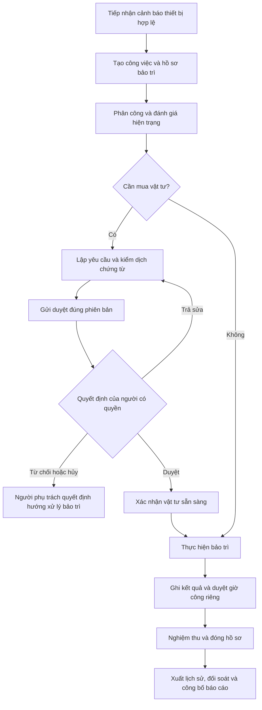

# DX-OS Open-Core — Tài liệu nghiệp vụ hệ thống

**Ngày tổng hợp:** 2026-11-04.  
**Cơ sở:** Đề tài OLP 2026, các phương án giải pháp, tài liệu cải thiện và tài liệu demo trong repository.  
**Trạng thái:** Bản tổng hợp nghiệp vụ đề xuất để thống nhất phạm vi và làm cơ sở triển khai, nghiệm thu. Không xác nhận toàn bộ năng lực dưới đây đã được xây dựng.

## 1. Mục tiêu và cách sử dụng tài liệu

DX-OS Open-Core cung cấp một nền tảng dùng chung để các đơn vị trong tổ chức làm việc, xử lý hồ sơ và khai thác dữ liệu liên thông. Các ứng dụng sử dụng chung định danh, phân quyền, công việc, tài liệu và năng lực điều phối; mỗi ứng dụng giữ quy tắc và vòng đời hồ sơ riêng.

Giá trị nghiệp vụ cần đạt:

- Người dùng đăng nhập một lần, truy cập đúng ứng dụng và dữ liệu được cấp quyền.
- Các bộ phận phối hợp trên cùng công việc, giảm nhập lại thông tin và thất lạc hồ sơ.
- Mọi quyết định phê duyệt gắn với người thực hiện và đúng phiên bản hồ sơ.
- Quản lý theo dõi được tiến độ, chi phí đề xuất, giờ công và nguyên nhân chậm xử lý.
- Số liệu báo cáo truy ngược được hồ sơ nguồn; dữ liệu lịch sử không làm cản trở tác nghiệp.
- Tổ chức có thể bổ sung ứng dụng và làm chủ dữ liệu trên nền tảng nguồn mở.

Tài liệu tập trung vào **ai làm gì, điều kiện thực hiện, kết quả và quy tắc kiểm soát**. Chi tiết công nghệ, mã nguồn và triển khai tiếp tục nằm trong các tài liệu kỹ thuật.

## 2. Căn cứ và cách tổng hợp các phương án

| Nguồn | Nội dung sử dụng |
|---|---|
| [Đề tài gốc](DX-OS_Open-Core_OLP_2026.md) | Ba tầng, H-P-D-I, dịch vụ lõi bắt buộc và bốn nguyên lý kỹ thuật |
| [Tổng quan giải pháp ban đầu](architecture_overview.md) | Cắm-rút ứng dụng, chia sẻ dữ liệu, quản trị cấu hình, AI và lịch sử |
| [Kế hoạch triển khai ban đầu](implementation_plan.md) | Mua sắm, giờ công, cổng hợp nhất và các năng lực dự kiến |
| [Tổng quan kiến trúc](DX-OS_Tong-quan-Kien-truc.md) | Ranh giới lõi, năng lực dùng chung và ứng dụng |
| [Đề xuất cải thiện](DX-OS_De-xuat-Cai-thien.md) | Tách hồ sơ, quyền xuyên suốt, kiểm soát phiên bản và phục hồi quy trình |
| [Phân tích và giải pháp](DX-OS_Phan-tich-va-Giai-phap.md) | Phạm vi dự thi và kịch bản bảo trì liên thông |
| [Sơ đồ hệ thống](DX-OS_So-do-He-thong.md) | Luồng bảo trì, mua sắm, giờ công và báo cáo |
| [Hướng dẫn demo](demo/README.md), [biên bản kiểm chứng](demo/VERIFICATION.md) | Phạm vi hiện có và giới hạn của demo Hasura–Go–Kestra |
| [Thiết kế demo](docs/superpowers/specs/2026-11-03-hasura-kestra-demo-design.md), [kế hoạch demo](docs/superpowers/plans/2026-11-03-hasura-kestra-demo.md) | Hợp đồng gửi duyệt, hộp duyệt, quyền và chống xử lý trùng |

Khi các phương án khác nhau, bản tổng hợp này lấy đề bài làm căn cứ yêu cầu và dùng hướng cải thiện để mô tả nghiệp vụ:

| Điểm khác biệt | Cách diễn giải trong tài liệu nghiệp vụ |
|---|---|
| PostgREST ở tổng quan ban đầu, Hasura ở kế hoạch và demo | Theo hướng giữ Hasura của bản cải thiện; quy tắc nghiệp vụ không phụ thuộc loại API |
| Một bảng và một trạng thái dùng chung | Chia sẻ công việc gốc; mua sắm, bảo trì và giờ công có hồ sơ cùng trạng thái riêng |
| Tự cấp quyền khi trường dữ liệu tương thích | Tương thích dữ liệu và cấp quyền là hai quyết định riêng |
| Workflow tự xử lý toàn bộ nghiệp vụ | Workflow điều phối; quyết định của con người phải qua kiểm tra thẩm quyền và phiên bản |
| AI, Operator và nhiều ứng dụng được mô tả như mục tiêu đầy đủ | Phân biệt yêu cầu đề bài, phạm vi minh họa và năng lực mở rộng |
| Cam kết 30 giây, giảm 80%, truy vấn O(1), điểm tuyệt đối | Không dùng làm kết quả đã đạt hoặc tiêu chí nghiệp vụ khi chưa có phép đo và căn cứ nghiệm thu |

Các tên trạng thái mở rộng, điều kiện đóng hồ sơ và vai trò chi tiết dưới đây là **đề xuất chuẩn hóa từ luồng đã mô tả**, chưa phải chính sách được tổ chức phê chuẩn. Những điểm cần chốt được liệt kê ở mục 13.

## 3. Phạm vi hệ thống

### 3.1. Phạm vi bắt buộc theo đề bài

- Tầng 1 là lõi headless: cung cấp Identity/SSO, API Gateway, dữ liệu cấu trúc, dữ liệu phi cấu trúc và Workflow.
- Tầng 2 có ít nhất một ứng dụng giao diện thuộc H-P-D-I để người dùng thực hiện nghiệp vụ.
- Thể hiện phân tách dữ liệu theo vòng đời; kết nối IT/OT; quản trị nguồn gốc, chất lượng và phả hệ dữ liệu; Zero-Trust, kiểm dịch tệp và GitOps.

Lõi cung cấp dịch vụ cho ứng dụng. Giao diện công việc và phê duyệt nằm ở tầng năng lực/nghiệp vụ; console kỹ thuật chỉ dành cho người quản trị được cấp quyền.

### 3.2. Phạm vi minh họa đề xuất

Kịch bản chính gồm quản lý công việc, bảo trì thiết bị, đề xuất mua vật tư, phê duyệt, ghi giờ công, nghiệm thu và báo cáo lịch sử. Dữ liệu cảm biến có thể được mô phỏng nhưng phải có danh tính, nguồn gốc và quy tắc xử lý.

Trong phạm vi này, mua sắm tập trung vào đề xuất và quyết định duyệt. Bước mua/nhận vật tư ghi nhận việc vật tư đã sẵn sàng; chưa bao hàm một hệ thống đơn hàng, kho, thanh toán hoặc kế toán hoàn chỉnh.

### 3.3. Phạm vi mở rộng

OCR, trợ lý RAG, phê duyệt nhiều cấp, thiết kế BPMN, đăng ký ứng dụng tự động bằng Operator, ký và kiểm chứng checkpoint audit được đưa vào khi luồng chính đã ổn định. Không xem workflow YAML là bằng chứng đã hỗ trợ BPMN.

Các nhóm ứng dụng chuyên ngành của đề tài là định hướng mở rộng:

| Nhóm | Ví dụ trong đề tài | Quan hệ với bản minh họa |
|---|---|---|
| Dòng chảy hàng hóa | OMS, WMS, POS, TMS | Mua sắm là tình huống khởi đầu; chưa thay thế quản lý chuỗi cung ứng |
| Thời gian và dự án | PSA, Timesheet, CDE/BIM | Kế thừa công việc và giờ công |
| Trải nghiệm và thuê bao | eKYC/AML, LMS, EMR, CRM | Tái sử dụng lõi, bổ sung quy tắc chuyên ngành khi triển khai |
| Tài sản và không gian | MES/SCADA, BMS, Smart City IoT | Bảo trì và dữ liệu thiết bị là tình huống minh họa |

## 4. Thuật ngữ nghiệp vụ

| Thuật ngữ | Ý nghĩa |
|---|---|
| Workspace | Phạm vi làm việc và cách ly dữ liệu của một đơn vị; cách ánh xạ với cơ cấu tổ chức cần được cấu hình |
| Ứng dụng | Phân hệ nghiệp vụ như mua sắm, bảo trì hoặc giờ công |
| Công việc chung | Thông tin phối hợp gồm mã, tiêu đề, người phụ trách, hạn xử lý và mức ưu tiên |
| Hồ sơ nghiệp vụ | Dữ liệu và vòng đời riêng của một yêu cầu mua sắm, lệnh bảo trì hoặc bản ghi giờ công |
| Phiên bản hồ sơ | Mốc nội dung dùng để phát hiện thay đổi và xác định chính xác dữ liệu được duyệt |
| Hộp duyệt | Danh sách yêu cầu đang chờ quyết định của người có thẩm quyền |
| IT/OT | Dữ liệu quản trị tổ chức / dữ liệu vận hành thiết bị, cảm biến |
| Audit | Lịch sử ai đã làm gì, khi nào, trên hồ sơ và phiên bản nào |
| Phả hệ dữ liệu | Quan hệ từ dữ liệu nguồn qua các phép biến đổi đến số liệu báo cáo |
| OCR / RAG | Nhận dạng văn bản từ tài liệu / hỏi đáp có truy xuất cơ sở tri thức |

## 5. Tác nhân và quyền nghiệp vụ

Một người có thể được giao nhiều vai trò. Quyền hiệu lực phải đồng thời phù hợp **workspace, ứng dụng, hành động và hồ sơ cụ thể**; đăng nhập thành công hoặc thấy ứng dụng không đồng nghĩa có quyền duyệt.

| Tác nhân | Trách nhiệm và giới hạn |
|---|---|
| Nhân viên/người đề xuất | Tạo, sửa bản nháp của mình; gửi duyệt; xem tiến độ hồ sơ trong quyền |
| Kỹ thuật viên | Nhận công việc bảo trì; ghi đánh giá, kết quả, vật tư cần mua và giờ công |
| Người phụ trách mua sắm | Xử lý đề xuất đã duyệt; ghi nhận vật tư sẵn sàng và chứng từ liên quan |
| Người phê duyệt | Duyệt hoặc từ chối hồ sơ đúng phạm vi và phiên bản; không tự duyệt hồ sơ mình tạo trong luồng minh họa |
| Người nghiệm thu | Kiểm tra kết quả bảo trì, yêu cầu bổ sung hoặc xác nhận hoàn tất |
| Quản lý đơn vị | Phân công, theo dõi quá hạn và xem chỉ số trong phạm vi được giao |
| Người kiểm tra/kiểm toán | Đọc lịch sử và truy vết nguồn theo quyền; không sửa quyết định đã ghi nhận |
| Quản trị workspace | Quản lý thành viên và quyền trong phạm vi được ủy quyền |
| Quản trị nền tảng | Quản lý ứng dụng, cấu hình, giám sát và phục hồi; quyền kỹ thuật không mặc nhiên là quyền duyệt nghiệp vụ |
| Thiết bị và dịch vụ tự động | Gửi dữ liệu hoặc thực hiện tác vụ đã được cấp quyền; không giả danh người phê duyệt |

Quyền đọc hồ sơ không mặc nhiên cho phép tải mọi tệp, xem mọi trường chi phí hoặc tra cứu dữ liệu qua AI. Các đường đọc trực tiếp, báo cáo, tìm kiếm, tệp và tác vụ nền phải áp dụng cùng phạm vi nghiệp vụ.

## 6. Đối tượng và quan hệ nghiệp vụ

| Đối tượng | Thông tin chính | Quan hệ và trách nhiệm |
|---|---|---|
| Workspace và thành viên | Đơn vị, người dùng, vai trò, ứng dụng được dùng | Là phạm vi kiểm soát truy cập |
| Thiết bị | Mã thiết bị, đơn vị, vị trí, trạng thái, số đo mới nhất | Thuộc một workspace; có nhiều lần đo và hồ sơ bảo trì |
| Cảnh báo | Nguồn, thời điểm, loại cảnh báo, giá trị đo, định danh | Liên kết thiết bị và công việc phát sinh |
| Công việc chung | Mã, tiêu đề, người phụ trách, hạn, ưu tiên | Có thể liên kết nhiều hồ sơ nghiệp vụ; không chứa chung mọi trạng thái |
| Hồ sơ bảo trì | Thiết bị, mô tả sự cố, đánh giá, kết quả, người nghiệm thu | Liên kết công việc, yêu cầu vật tư và giờ công |
| Yêu cầu mua sắm | Mục đích, người đề xuất, danh sách vật tư, số lượng, chi phí, phiên bản | Có vòng duyệt riêng; có thể phục vụ bảo trì |
| Bản ghi giờ công | Người thực hiện, ngày, công việc, số giờ, diễn giải | Nhiều bản ghi cho một công việc; kiểm tra tổng theo người/ngày |
| Tệp và chứng từ | Chủ sở hữu, hồ sơ liên quan, phiên bản nội dung, tình trạng kiểm dịch | Chỉ công bố nội dung đã được quét sạch |
| Quyết định phê duyệt | Người quyết định, kết quả, lý do, thời điểm, phiên bản được duyệt | Bảo toàn lịch sử từng vòng duyệt |
| Nhật ký và đợt xuất lịch sử | Hành động, nguồn, phiên bản, kết quả đối soát | Là cơ sở kiểm tra và truy ngược báo cáo |

Ví dụ: một công việc sửa máy liên kết một hồ sơ bảo trì, hai yêu cầu mua vật tư và nhiều bản ghi giờ công. Từ chối một yêu cầu vật tư không tự động hủy hồ sơ bảo trì hoặc các bản ghi giờ công.

## 7. Năng lực dùng chung theo H-P-D-I

| Không gian | Nghiệp vụ người dùng | Đầu ra |
|---|---|---|
| H — Con người số | Xem việc được giao, lịch và hạn; tra cứu tài liệu; nhận thông báo | Công việc có người phụ trách, trạng thái xử lý và lịch sử phối hợp |
| P — Quy trình số | Lập hồ sơ, kiểm tra dữ liệu, gửi duyệt, quyết định, nghiệm thu | Hồ sơ đi qua các bước hợp lệ, có trách nhiệm rõ ràng |
| D — Dữ liệu số | Xem tiến độ, chi phí, giờ công; lọc báo cáo và truy ngược nguồn | Chỉ số có phạm vi quyền, thời điểm dữ liệu và nguồn đối chiếu |
| I — Trí tuệ số | Bóc tách chứng từ, hỏi đáp quy chế, hỗ trợ kiểm tra | Kết quả hỗ trợ có nguồn tham chiếu và được con người kiểm tra |

Thanh toán, hóa đơn điện tử, e-Office, nhân sự/KPI, WebGIS, DaaS và phòng đọc bảo mật thuộc khung năng lực rộng của đề bài; chưa phải tất cả đều nằm trong bản minh họa này.

## 8. Quy trình nghiệp vụ liên thông

### 8.1. Luồng tổng thể

### 8.2. NV-01 — Đăng nhập và vào không gian làm việc

**Tác nhân:** Mọi người dùng. **Điều kiện:** Tài khoản hoạt động và được cấp quyền workspace.

1. Người dùng đăng nhập qua định danh tập trung; thực hiện MFA nếu chính sách yêu cầu.
2. Hệ thống xác định workspace và ứng dụng được phép sử dụng.
3. Người dùng chọn không gian làm việc, xem công việc và hồ sơ trong quyền.

**Kết quả:** Có ngữ cảnh làm việc đã xác thực. Tài khoản không hợp lệ hoặc workspace ngoài quyền bị từ chối; đổi mã hồ sơ trong yêu cầu không mở rộng quyền.

### 8.3. NV-02 — Tiếp nhận cảnh báo và khởi tạo bảo trì

**Tác nhân:** Thiết bị/dịch vụ tiếp nhận, người phụ trách bảo trì. **Đầu vào:** Danh tính thiết bị, thời điểm đo, giá trị và định danh bản tin.

1. Kiểm tra nguồn gửi và workspace của thiết bị.
2. Ghi nhận dữ liệu hợp lệ, đối chiếu thời điểm và quy tắc cảnh báo.
3. Khi có cảnh báo đủ điều kiện, tạo công việc cùng hồ sơ bảo trì và liên kết nguồn cảnh báo.
4. Người phụ trách phân công kỹ thuật viên, đặt mức ưu tiên và hạn xử lý.

**Kết quả:** Một cảnh báo được xử lý lại không tạo thêm công việc trùng. Bản tin thông thường không mặc nhiên tạo bảo trì. Chính sách gộp nhiều cảnh báo liên tiếp và độ trễ chấp nhận được cần cấu hình riêng.

### 8.4. NV-03 — Đánh giá sự cố và lập yêu cầu vật tư

**Tác nhân:** Kỹ thuật viên/người đề xuất. **Điều kiện:** Có quyền trên công việc và hồ sơ bảo trì.

1. Ghi hiện trạng, phương án xử lý và nhu cầu vật tư.
2. Nếu không cần mua, chuyển sang thực hiện bảo trì.
3. Nếu cần mua, lập yêu cầu gồm mục đích, danh sách vật tư, số lượng, chi phí dự kiến và chứng từ theo chính sách.
4. Liên kết yêu cầu với công việc và bảo trì để theo dõi xuyên suốt.

**Kết quả:** Bản nháp mua sắm có chủ sở hữu và phiên bản; có thể chỉnh sửa trong quyền. Các liên kết khác workspace bị chặn.

### 8.5. NV-04 — Tiếp nhận và sử dụng chứng từ

**Tác nhân:** Người tải lên, dịch vụ kiểm dịch. **Đầu vào:** Tệp và hồ sơ đích.

1. Kiểm tra quyền đính kèm; đưa tệp mới vào vùng cách ly.
2. Quét nội dung và ghi nhận kết quả gắn với đúng phiên bản tệp.
3. Chỉ tệp sạch mới được công bố cho người có quyền tải, dùng khi gửi duyệt hoặc đưa vào OCR.

**Ngoại lệ:** Tệp nhiễm mã độc bị chặn; tệp đang chờ hoặc quét lỗi tiếp tục bị cách ly. Thay nội dung tệp phải kiểm dịch lại. Lỗi quét không được coi là đã sạch.

### 8.6. NV-05 — Gửi và quyết định phê duyệt mua sắm

**Tác nhân:** Người đề xuất, người phê duyệt, dịch vụ điều phối.

1. Người đề xuất gửi bản nháp. Hệ thống kiểm tra quyền sở hữu, dữ liệu bắt buộc, số tiền hợp lệ, chứng từ cần thiết và phiên bản hiện tại.
2. Hệ thống ghi nhận trạng thái chờ duyệt, khóa nội dung cần phê duyệt và chuyển yêu cầu tới hộp duyệt.
3. Người có quyền đọc nội dung, chứng từ và phiên bản cần quyết định.
4. Người duyệt chấp thuận hoặc từ chối; nhánh trả sửa là mở rộng để bổ sung nội dung và gửi lại theo phiên bản mới.
5. Hệ thống ghi kết quả, người quyết định, thời điểm và lý do tương ứng; thông báo tới người liên quan.

**Kiểm soát:** Không tự duyệt; không duyệt chéo workspace; không áp dụng quyết định cũ lên hồ sơ đã đổi; hai quyết định đồng thời chỉ có một kết quả chuyển trạng thái hợp lệ. Sửa nội dung quan trọng sau duyệt cần vòng duyệt mới.

**Kết quả:** Hồ sơ được duyệt, bị từ chối hoặc được trả sửa theo chính sách. Workflow tiếp nhận yêu cầu chưa có nghĩa người quản lý đã duyệt.

### 8.7. NV-06 — Thực hiện mua vật tư và bảo trì

**Tác nhân:** Người phụ trách mua sắm, kỹ thuật viên.

1. Với yêu cầu được duyệt, ghi nhận việc mua/nhận vật tư và xác nhận vật tư đã sẵn sàng.
2. Kỹ thuật viên thực hiện bảo trì, ghi nội dung xử lý, kết quả và chứng từ liên quan.
3. Nếu yêu cầu vật tư bị từ chối/hủy, người phụ trách xem xét phương án khác, tạm chờ hoặc hủy bảo trì bằng quyết định riêng.

**Kết quả:** Có bằng chứng kết quả thực hiện. Phê duyệt mua sắm không đồng nghĩa đã nhận vật tư; nhận vật tư không đồng nghĩa bảo trì hoàn tất.

### 8.8. NV-07 — Ghi và duyệt giờ công

**Tác nhân:** Người thực hiện, người duyệt giờ công.

1. Người thực hiện ghi công việc, ngày làm, số giờ và diễn giải.
2. Hệ thống kiểm tra số giờ dương và tổng số giờ theo người/ngày trên các công việc liên quan.
3. Người thực hiện gửi duyệt; người có quyền quyết định trên đúng phiên bản.
4. Giờ công được duyệt đưa vào báo cáo; giờ công bị trả sửa hoặc từ chối được hiển thị riêng.

**Quy tắc đề xuất:** Tổng giờ ghi nhận hợp lệ không vượt 24 giờ/người/ngày; giới hạn làm thêm và nhóm trạng thái tham gia tính tổng cần chốt theo chính sách tổ chức. Hai lần gửi đồng thời không được vượt giới hạn tổng.

### 8.9. NV-08 — Nghiệm thu và đóng hồ sơ

**Tác nhân:** Kỹ thuật viên, người nghiệm thu/người phụ trách.

1. Kỹ thuật viên gửi kết quả hoàn thành.
2. Người nghiệm thu kiểm tra kết quả và các hồ sơ liên quan.
3. Nếu chưa đạt, ghi lý do và trả về thực hiện bổ sung.
4. Nếu đạt, kiểm tra điều kiện đóng: kết quả nghiệm thu hợp lệ, nhánh vật tư đã được giải quyết, giờ công bắt buộc đã được xử lý và không còn yêu cầu bắt buộc đang chờ.
5. Chốt phiên bản, ghi lịch sử và đóng hồ sơ bảo trì; cập nhật công việc chung theo quy tắc hoàn tất riêng.

**Kết quả:** Hồ sơ đóng không được sửa âm thầm. Chính sách mở lại hoặc lập hồ sơ điều chỉnh phải bảo toàn bản đã chốt và quan hệ với lịch sử.

### 8.10. NV-09 — Công bố lịch sử và khai thác báo cáo

**Tác nhân:** Dịch vụ xuất dữ liệu, quản lý, người kiểm tra.

1. Chọn hồ sơ đủ điều kiện đóng và chốt phiên bản nguồn cho đợt xuất.
2. Xuất dữ liệu, lưu nguồn và phép biến đổi, đối soát số lượng cùng các giá trị tổng hợp.
3. Chỉ công bố đợt xuất đạt đối soát; đợt lỗi được xử lý lại và không làm tăng số liệu hai lần.
4. Người dùng xem báo cáo theo quyền và truy ngược từ chỉ số về hồ sơ, phiên bản, chứng từ được phép đọc.

**Kết quả:** Báo cáo lịch sử có thời điểm cập nhật và nguồn đối chiếu. Xuất thành công không tự cho phép xóa dữ liệu tác nghiệp; lưu giữ và xóa cần chính sách riêng.

### 8.11. NV-10 — Hỗ trợ bằng OCR và RAG

**Phạm vi mở rộng.** OCR đề xuất dữ liệu từ tệp sạch để người dùng kiểm tra trước khi đưa vào hồ sơ. RAG trả lời từ tài liệu được cấp quyền, kèm tham chiếu nguồn; khi không đủ căn cứ phải thể hiện giới hạn kết quả.

AI không tự phê duyệt, không tự cấp quyền và không thay đổi nội dung đã được duyệt. Không truyền workspace hoặc namespace tùy ý để vượt phạm vi truy xuất.

### 8.12. NV-11 — Đăng ký, thay đổi và ngừng ứng dụng

**Tác nhân:** Quản trị nền tảng và chủ sở hữu ứng dụng.

1. Khai báo nhu cầu dữ liệu, quyền, quy trình và kết nối của ứng dụng.
2. Kiểm tra tương thích dữ liệu và phê chuẩn quyền chia sẻ riêng.
3. Áp dụng cấu hình; chỉ công bố ứng dụng sẵn sàng khi các phần bắt buộc hoàn tất.
4. Khi cấu hình lỗi, hiển thị bước lỗi và cho phép tiếp tục sau khắc phục; áp dụng lại không tạo cấu hình trùng.
5. Khi ngừng ứng dụng, thu hồi quyền sử dụng, xử lý hồ sơ đang mở và giữ dữ liệu lịch sử theo chính sách.

**Kết quả:** Ứng dụng mới tái sử dụng lõi; không tự tiếp cận dữ liệu riêng của ứng dụng khác. Operator tổng quát là hướng tự động hóa, không phải điều kiện để mọi giao dịch nghiệp vụ chạy.

## 9. Vòng đời và quy tắc chuyển trạng thái

Các trạng thái ngoài bốn trạng thái mua sắm của demo là mô hình nghiệp vụ đề xuất. Mỗi lần chuyển cần kiểm tra quyền, trạng thái hiện tại và phiên bản.

| Đối tượng | Vòng đời chính | Nhánh ngoại lệ |
|---|---|---|
| Công việc chung | Mới → Đã phân công → Đang thực hiện → Hoàn tất | Tạm chờ hoặc hủy theo quyết định riêng |
| Bảo trì | Mới → Đã phân công → Đang xử lý → Chờ nghiệm thu → Đã đóng | Chờ vật tư; nghiệm thu chưa đạt quay lại xử lý; hủy có lý do |
| Phê duyệt mua sắm | Nháp (`DRAFT`) → Chờ duyệt (`PENDING_APPROVAL`) → Đã duyệt (`APPROVED`) | Từ chối (`REJECTED`); trả sửa/hủy và gửi lại là mở rộng |
| Thực hiện mua sắm | Chưa thực hiện → Đang mua → Vật tư sẵn sàng → Hoàn tất | Chỉ bắt đầu sau duyệt; không ghi đè kết quả duyệt |
| Giờ công | Nháp → Chờ duyệt → Đã duyệt | Trả sửa hoặc từ chối; điều chỉnh sau duyệt có lịch sử riêng |
| Tệp | Cách ly → Đang quét → Sạch/được công bố | Nhiễm mã độc hoặc quét lỗi: tiếp tục chặn |
| Đợt xuất | Chờ xuất → Đang xuất → Đối soát → Đã công bố | Lỗi: xử lý lại trước khi công bố |
| Đăng ký ứng dụng | Chờ áp dụng → Đang áp dụng → Sẵn sàng | Thất bại: ghi bước lỗi và tiếp tục sau khắc phục |

## 10. Quy tắc nghiệp vụ xuyên suốt

| Mã | Quy tắc |
|---|---|
| QT-01 | Danh tính, workspace và người tạo được xác định/kiểm tra từ ngữ cảnh đã xác thực |
| QT-02 | Chia sẻ thực thể chung không đồng nghĩa chia sẻ mọi thuộc tính hoặc quyền sửa |
| QT-03 | Sửa bản nháp và quyết định gửi/duyệt/từ chối/đóng là các hành động có quyền riêng |
| QT-04 | Không sửa trực tiếp trạng thái quan trọng để bỏ qua quy trình |
| QT-05 | Quyết định duyệt gắn với phiên bản nội dung; thay đổi quan trọng làm phát sinh vòng duyệt mới |
| QT-06 | Sự kiện hoặc thao tác được gửi lại không tạo thêm tác động nghiệp vụ trùng |
| QT-07 | Kết quả xử lý đến muộn của phiên bản cũ không được ghi đè phiên bản mới |
| QT-08 | Tệp chưa được xác nhận sạch không được dùng trong hồ sơ gửi duyệt hoặc OCR |
| QT-09 | Mua sắm, giờ công, bảo trì và công việc chung có vòng đời độc lập nhưng kiểm tra điều kiện liên quan khi đóng |
| QT-10 | Thay đổi nghiệp vụ quan trọng phải lưu cùng lịch sử và yêu cầu xử lý tiếp theo một cách nhất quán |
| QT-11 | Gửi thông báo thất bại không làm mất quyết định đã ghi nhận; phục hồi không tự quyết định lại |
| QT-12 | Báo cáo chỉ sử dụng dữ liệu đủ điều kiện, tránh tính trùng giữa dữ liệu tác nghiệp và lịch sử |
| QT-13 | Quyền dữ liệu phải tiếp tục được kiểm tra khi dữ liệu chuyển sang tệp lịch sử, báo cáo hoặc AI |
| QT-14 | Mọi sửa đổi sau đóng, thu hồi quyền và thay đổi cấu hình phải có dấu vết để kiểm tra |

## 11. Ngoại lệ, giám sát và kiểm toán

| Tình huống | Hành vi cần có |
|---|---|
| Thiếu quyền hoặc liên kết khác workspace | Từ chối thao tác, không làm thay đổi hồ sơ |
| Hồ sơ đã đổi khi người dùng bấm duyệt | Thông báo xung đột; yêu cầu đọc lại nội dung trước khi quyết định |
| Workflow dừng hoặc dịch vụ tạm thời lỗi | Giữ trạng thái nghiệp vụ đúng thực tế; thử lại có giới hạn và ghi lỗi cần xử lý |
| Workflow đã nhận nhưng chưa tạo hộp duyệt | Hiển thị đang xử lý hoặc lỗi; có đối soát hồ sơ chờ với tác vụ thất bại |
| Sự kiện trùng/sai thứ tự | Nhận diện kết quả đã xử lý hoặc bỏ qua sự kiện cũ có lý do |
| Tệp chưa sạch hoặc quét lỗi | Chặn dùng tệp; cho phép thay tệp hoặc xử lý lại việc quét |
| Hồ sơ quá hạn | Hiển thị quá hạn và thông báo theo chính sách; không tự duyệt |
| Đợt xuất lịch sử lỗi | Không công bố số liệu dở dang; chạy lại không tính trùng |
| Cấu hình lệch với cấu hình chuẩn | Phát hiện cả quyền thiếu và quyền thừa, khôi phục có ghi nhận |
| Mất dữ liệu hoặc sự cố hệ thống | Phục hồi từ sao lưu và đối soát; phục hồi cấu hình không thay thế khôi phục dữ liệu |

Nhật ký cần có chủ thể, workspace, ứng dụng, hành động, đối tượng, phiên bản, thời điểm và kết quả. Khi có cơ chế kiểm chứng chuỗi băm/checkpoint, kết quả kiểm tra phải chỉ rõ phạm vi dữ liệu đã được bảo vệ và đối soát; không dùng nhãn “bất biến tuyệt đối” thay cho bằng chứng. Tài liệu này không kết luận giá trị pháp lý của chữ ký hoặc hồ sơ.

## 12. Báo cáo và tiêu chí nghiệm thu

### 12.1. Báo cáo quản trị đề xuất

| Báo cáo/chỉ số | Cách hiểu và nguồn |
|---|---|
| Công việc đang mở và quá hạn | Theo workspace, người phụ trách, hạn xử lý; tách hồ sơ hoàn tất/hủy |
| Thời gian xử lý phê duyệt | Từ lần gửi duyệt đến quyết định của cùng vòng duyệt; vòng đang chờ hiển thị riêng |
| Chi phí vật tư đề xuất/được duyệt | Tổng theo phiên bản hợp lệ; chưa gọi là chi phí thực chi nếu chưa có bằng chứng thanh toán |
| Giờ công được duyệt | Tổng bản ghi hợp lệ theo người, ngày và công việc; không cộng bản bị thay thế hai lần |
| Kết quả bảo trì | Số hồ sơ theo trạng thái, thiết bị, thời gian xử lý và kết quả nghiệm thu |
| Tình trạng chất lượng dữ liệu | Hồ sơ thiếu dữ liệu, tệp bị chặn, tác vụ lỗi và đợt xuất chưa đối soát |

Mỗi báo cáo phải thể hiện bộ lọc, thời điểm cập nhật, phạm vi dữ liệu và cách truy ngược nguồn. Chỉ tổng hợp nhiều đơn vị khi người xem có quyền tương ứng.

### 12.2. Kịch bản nghiệm thu

| Mã | Tình huống | Kết quả cần quan sát | Căn cứ |
|---|---|---|---|
| NT-01 | Đăng nhập và chuyển ứng dụng | Dùng cùng danh tính, chỉ thấy dữ liệu trong quyền | NV-01, QT-01 |
| NT-02 | Đổi workspace/ID hồ sơ khi đọc, duyệt, tải tệp hoặc hỏi AI | Không truy cập vượt quyền | QT-01, QT-13 |
| NT-03 | Gửi lại cùng cảnh báo thiết bị | Chỉ một công việc phát sinh cho cảnh báo đó | NV-02, QT-06 |
| NT-04 | Gửi hồ sơ có chứng từ chưa sạch | Bị chặn; không đưa tệp vào OCR | NV-04, QT-08 |
| NT-05 | Nhân viên gửi, quản lý duyệt đúng phiên bản | Ghi quyết định và lịch sử, người đề xuất thấy kết quả | NV-05 |
| NT-06 | Tự duyệt hoặc duyệt phiên bản cũ | Bị từ chối, trạng thái không bị thay đổi sai | NV-05, QT-05 |
| NT-07 | Từ chối yêu cầu vật tư | Không tự hủy bảo trì hoặc giờ công | QT-09 |
| NT-08 | Ghi nhiều dòng giờ công vượt giới hạn ngày | Bị chặn kể cả khi gửi đồng thời | NV-07 |
| NT-09 | Đóng bảo trì khi còn điều kiện bắt buộc chưa đạt | Bị chặn; hiển thị điều kiện còn thiếu | NV-08 |
| NT-10 | Dừng tác vụ, khởi động lại và gửi lại sự kiện | Có cách phục hồi, không tạo thêm tác động trùng | QT-06, mục 11 |
| NT-11 | Xuất lại hồ sơ và xem báo cáo | Không tính trùng; truy ngược đúng phiên bản nguồn | NV-09, QT-12 |
| NT-12 | Thêm ứng dụng có dữ liệu chung | Tái sử dụng công việc, không tự được cấp quyền dữ liệu riêng | NV-11, QT-02 |
| NT-13 | Khôi phục cấu hình và dữ liệu từ sao lưu | Có bằng chứng riêng cho từng loại phục hồi | Mục 11 |

Các tiêu chí có AI hoặc đăng ký ứng dụng tự động chỉ áp dụng khi đưa năng lực đó vào phạm vi phát hành. Các mục còn lại là mục tiêu nghiệm thu của phương án tổng hợp, không phải báo cáo đã chạy thành công.

## 13. Những chính sách cần chốt trước triển khai đầy đủ

| Nội dung | Điều cần thống nhất |
|---|---|
| Cơ cấu workspace | Một workspace đại diện tổ chức, chi nhánh hay phòng ban; ai được tổng hợp nhiều workspace |
| Thẩm quyền phê duyệt | Một hay nhiều cấp, hạn mức tiền, ủy quyền, thay người và phân tách người tạo/người duyệt |
| Trả sửa, từ chối và hủy | Trạng thái nào cho gửi lại; thời điểm được hủy; quy tắc điều chỉnh hồ sơ đã duyệt |
| Vật tư | Bằng chứng để xác nhận sẵn sàng; có cần quản lý nhận từng phần và đơn hàng hay không |
| Giờ công | Múi giờ/ngày nghiệp vụ, trạng thái tính vào giới hạn, làm thêm, hạn sửa và người duyệt |
| Cảnh báo thiết bị | Ngưỡng, thời gian trễ, gộp cảnh báo, điều kiện mở lại sự cố |
| Nghiệm thu | Ai được nghiệm thu; hồ sơ liên quan nào bắt buộc hoàn tất trước khi đóng |
| SLA và thông báo | Hạn xử lý, kênh thông báo, nhắc việc và chuyển cấp khi quá hạn |
| Lưu giữ dữ liệu | Thời hạn lưu, mở lại/điều chỉnh, quyền đọc lịch sử và điều kiện xóa |
| Phục hồi | Mức mất dữ liệu và thời gian khôi phục chấp nhận được, cách đo bằng diễn tập |
| AI và ký hồ sơ | Phạm vi dữ liệu được dùng, mô hình được phép gọi, người kiểm tra kết quả và yêu cầu chữ ký cụ thể |

## 14. Hiện trạng và trình tự hoàn thiện

Theo tài liệu demo và biên bản kiểm chứng hiện có, repo đã có luồng mua sắm hẹp: tạo/sửa bản nháp, gửi duyệt, tạo hộp duyệt, quản lý duyệt hoặc từ chối; kiểm tra JWT local, workspace, phiên bản và sự kiện trùng. Biên bản ghi nhận kiểm thử dịch vụ thật, nhưng các kiểm thử đó không được chạy lại khi biên soạn tài liệu này.

Demo dùng CLI/console và JWT local, chưa phải SSO thật hoặc giao diện H-P-D-I hoàn chỉnh. Bảo trì, giờ công đầy đủ, tệp có kiểm dịch, IT/OT, báo cáo lịch sử, AI, Operator và audit hash-chain vẫn thuộc phạm vi hoàn thiện/mở rộng theo các tài liệu đã rà soát.

Trình tự đề xuất:

1. Hoàn thiện đăng nhập, Gateway, giao diện công việc và luồng phê duyệt mua sắm.
2. Bổ sung bảo trì, cảnh báo thiết bị, tệp có kiểm dịch và giờ công để chạy xuyên suốt.
3. Hoàn thiện nghiệm thu, lịch sử, đối soát và truy ngược báo cáo.
4. Kiểm chứng phục hồi workflow, GitOps, giám sát và khôi phục dữ liệu.
5. Bổ sung tự động hóa đăng ký ứng dụng, OCR/RAG và các năng lực mở rộng đã được chọn.

Tài liệu này bổ sung góc nhìn nghiệp vụ cho đề tài; không thay đổi nội dung đề bài gốc hoặc biến các giản lược của demo thành giới hạn kiến trúc DX-OS.
