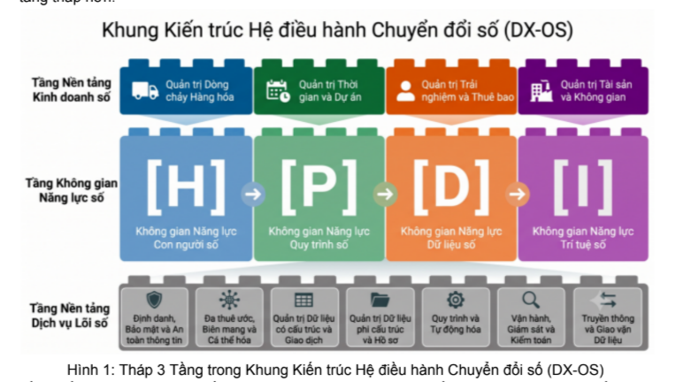

# Đề thi Phần mềm nguồn mở – OLP 2026

# Xây dựng Hệ điều hành Chuyển đổi số bằng Công nghệ Lõi nguồn mở (DX-OS Open-Core)

## 1. Đặt vấn đề

Hiện nay, nhiều tổ chức và doanh nghiệp đang gặp khó khăn trong quá trình chuyển đổi số do tư duy đầu tư công nghệ thường rơi vào hai thái cực. Thái cực thứ nhất là mua sắm vô số phần mềm độc lập, rời rạc cho từng phòng ban, dẫn đến hệ thống bị phân mảnh, tạo ra các 'ốc đảo dữ liệu'. Thái cực thứ hai là nỗ lực mua một hệ thống phần mềm nguyên khối (monolithic) đồ sộ, cồng kềnh, khó nâng cấp và khiến tổ chức trở thành 'con tin' của một nhà cung cấp duy nhất. Cả hai thực trạng này đều vô tình tạo ra gánh nặng kỹ thuật nặng nề, cản trở tiến trình chuyển đổi số.

Để giải quyết triệt để vấn đề này, Khung Kiến trúc Hệ điều hành Chuyển đổi số (DX-OS) được ra đời dựa trên nguyên tắc phân tách 3 tầng. Đồng thời, khi đi theo kiến trúc DX-OS, công nghệ nguồn mở (Open-Source) phải là ưu tiên số một. Giống như việc sử dụng hệ điều hành, nếu mua một hệ điều hành đóng, tổ chức sẽ lệ thuộc hoàn toàn vào hệ sinh thái của nhà cung cấp, dẫn đến đánh mất 'chủ quyền số' (Digital Sovereignty). Do đó, việc làm chủ công nghệ bằng kiến trúc Lõi mở (Open-Core) là định hướng tất yếu để tùy biến sâu và bảo đảm an ninh mạng tối đa.

Theo lý thuyết, chuyển đổi số phải được xây dựng dựa trên sự phát triển tự nhiên của năng lực quản trị trong tổ chức thông qua mô hình chuỗi tiến hóa HPDI. Mô hình này mô tả 4 không gian số tương ứng với mức độ trưởng thành của tổ chức trong quá trình chuyển giao quyền lực điều hành – từ các thao tác thủ công của con người sang sự tự động hóa thông minh của hệ thống, cụ thể như sau:

- **[H] Human (Con người số) – Xây dựng môi trường số:** Khởi điểm của chuyển đổi số là khởi tạo môi trường làm việc số nhằm kết nối toàn diện nguồn nhân lực. Tổ chức trang bị các công cụ giao tiếp, cộng tác đa kênh và quản trị mục tiêu trên không gian mạng, từng bước hình thành kỷ luật vận hành và văn hóa làm việc số.
- **[P] Process (Quy trình số) – Chuẩn hóa luồng nghiệp vụ:** Các hoạt động tác nghiệp mang tính tự phát dần được đưa vào khuôn khổ bằng các quy trình chuẩn (SOP) và luồng thủ tục rành mạch. Hệ thống thiết lập các rào chắn kỹ thuật số nhằm ngăn ngừa sai sót, số hóa toàn diện hồ sơ tài liệu và tự động hóa quy trình phối hợp liên phòng ban.
- **[D] Data (Dữ liệu số) – Quản trị dựa trên dữ liệu thực chứng:** Khi quy trình vận hành trơn tru và nhất quán, dữ liệu sinh ra đạt độ sạch, chuẩn hóa và toàn vẹn cao. Cấp quản lý dựa trên các trung tâm điều hành và bảng phân tích số liệu thời gian thực để ra quyết định quản trị chính xác dựa trên dữ liệu thực chứng thay vì cảm tính.
- **[I] Intelligence (Trí tuệ số) – Tự động hóa thông minh bằng AI:** Ở bậc thang trưởng thành cao nhất, tổ chức ứng dụng Trí tuệ Nhân tạo (AI) và các Tác tử thông minh (AI Agents) vào việc tự động phân tích dữ liệu, dự báo xu hướng và hỗ trợ ra quyết định tự động, biến tổ chức thành một thực thể số phản ứng linh hoạt và thích ứng liên tục.

## 2. Kiến trúc Hệ điều hành Chuyển đổi số (DX-OS)

Kiến trúc DX-OS được thiết kế xây dựng theo mô hình tháp 3 tầng tuân thủ nguyên tắc “phân tách mối quan tâm”. Ranh giới được phân định rạch ròi giữa phần kỹ thuật chạy ngầm (dịch vụ nền tảng số), lớp đệm năng lực số hóa quản trị (khung H-P-D-I) và phần ứng dụng nghiệp vụ đa ngành chuyên sâu (Hình 1). Kiến trúc này cho tổ chức có thể linh hoạt thay đổi nghiệp vụ kinh doanh ở tầng trên mà luôn bảo đảm giữ vững tính ổn định của hệ thống nền tảng nằm ở các tầng thấp hơn.

*Hình 1: Tháp 3 tầng trong Khung Kiến trúc Hệ điều hành Chuyển đổi số (DX-OS).*

### Tầng Nền tảng Dịch vụ Lõi số: Đóng vai trò là trái tim kỹ thuật cấp doanh nghiệp, cung cấp toàn bộ các dịch vụ số cơ sở dưới dạng Nền tảng như một Dịch vụ (PaaS). Nền tảng vận hành hoàn toàn ngầm theo cơ chế không giao diện (headless), không phục vụ trực tiếp người dùng đầu cuối mà tập trung trừu tượng hóa độ phức tạp của hạ tầng kỹ thuật. Đây là tập hợp các cụm cỗ máy dịch vụ dùng chung bắt buộc cho mọi ứng dụng vận hành ở quy mô doanh nghiệp:

- Định danh, Bảo mật và An toàn thông tin: Cung cấp cơ chế quản trị định danh tập trung (Đăng nhập một lần - SSO, Xác thực đa yếu tố - MFA); Két sắt mật mã quản lý vòng đời khóa và bí mật hệ thống; Trạm kiểm dịch đám mây xử lý an toàn tệp tin; và Động cơ chữ ký số/mã hóa chuyên trách (Hạ tầng khóa công khai - PKI, Mô-đun bảo mật phần cứng - HSM).
- Đa thuê ước, Biên mạng và Cá thể hóa: Cửa ngõ API kiểm soát biên mạng áp dụng mô hình bảo mật không tín nhiệm (zero-trust); Động cơ rà soát và che giấu thông tin định danh cá nhân (PII); Quản trị đa thuê ước (multi-tenancy) đảm bảo cách ly dữ liệu giữa các đơn vị; cùng Hệ thống dịch thuật và bản địa hóa đa ngôn ngữ toàn cục.
- Quản trị Dữ liệu có cấu trúc và Giao dịch: Động cơ quản trị và xử lý dữ liệu giao dịch (OLTP) đảm bảo tính toàn vẹn, tin cậy và nhất quán; Tự động tạo lập các giao diện lập trình (API) từ cơ sở dữ liệu tích hợp cơ chế phân quyền tới cấp độ dòng; Động cơ quản
lý phiên bản và lịch sử biến động dữ liệu; Cỗ máy tính toán, đóng băng số liệu thống kê theo chuỗi thời gian; và Lớp ngữ nghĩa khai thác dữ liệu báo cáo tốc độ cao.

- Quản trị Dữ liệu phi cấu trúc và Hồ sơ: Động cơ lưu trữ tệp dữ liệu theo chuẩn đối tượng; Động cơ quản lý hồ sơ và văn bản nghiệp vụ phục vụ trực tiếp cho các quy trình phê duyệt; Cỗ máy đánh chỉ mục toàn văn bản phục vụ tìm kiếm siêu tốc; và Động cơ trộn dữ liệu tự động sinh biểu mẫu, báo cáo động.
- Quy trình và Tự động hóa: Cỗ máy quản lý trạng thái luồng phê duyệt và quy trình nghiệp vụ (BPMN); Môi trường thực thi kịch bản tự động hóa ngầm (serverless); cùng API thu nhận, chuẩn hóa và nạp dữ liệu khối lượng lớn theo lô.
- Vận hành, Giám sát và Kiểm toán: Hệ thống thu thập nhật ký truy vết phân tán và kiểm toán hành vi bất biến; Trục truyền phát sự kiện thời gian thực (streaming); Cơ chế triển khai hạ tầng tự động bằng mã (GitOps); và Dịch vụ sao lưu, khôi phục thảm họa tự động.
- Truyền thông và Giao vận Dữ liệu: Động cơ định tuyến và phân phối thông tin đa kênh; Cỗ máy duy trì kết nối truyền thông thời gian thực (websocket); và Hạ tầng quản lý hàng đợi, giao vận dữ liệu bất đồng bộ đảm bảo chống chối bỏ.

### Tầng Không gian Năng lực số: Là lớp đệm ứng dụng số hóa toàn bộ các hoạt động quản trị tổ chức, cung cấp môi trường giao diện người dùng cuối (end-user) và hệ thống các cổng dịch vụ nghiệp vụ dùng chung. Tầng này được cấu trúc chặt chẽ theo 4 không gian năng lực tiến hóa H-P-D-I:

- Không gian Năng lực Con người số [H]: Hội tụ trải nghiệm người dùng cá nhân hóa thông qua Cổng giao tiếp điện tử tập trung; Ổ đĩa lưu trữ đám mây; Bảng điều khiển hiệu suất công việc (Kanban & Lịch); Bách khoa toàn thư quản trị tri thức; và Ứng dụng di động tác nghiệp hiện trường.
- Không gian Năng lực Quy trình số [P]: Cung cấp các cổng dịch vụ dùng chung toàn hệ thống bao gồm: Thanh toán điện tử và đối soát dòng tiền; Phát hành hóa đơn điện tử; Giải mã an toàn tài liệu trên RAM; Văn phòng điện tử (e-Office); Quản trị nhân sự và KPIs; Quản lý dự án và kế hoạch; cùng các công cụ thiết kế trực quan biểu mẫu, quy trình BPMN.
- Không gian Năng lực Dữ liệu số [D]: Được tổ chức phân tầng theo nhiệt độ của dữ liệu. Kho dữ liệu ấm cung cấp năng lực khai thác, phân tích và điều hành thời gian thực thông qua Cổng dữ liệu ngữ cảnh (NGSI-LD); Kho dữ liệu tổng hợp (Lakehouse); Cổng thông tin địa lý (WebGIS); Trung tâm Điều hành thông minh (IOC/BI); Cổng dịch vụ dữ liệu (DaaS); và Quản trị phả hệ dữ liệu (Data Lineage). Kho dữ liệu lạnh cung cấp năng lực lưu trữ lịch sử, đóng băng và bảo toàn tính pháp lý thông qua Phòng đọc ảo bảo mật chống sửa xóa và Cổng đối soát sổ cái mật mã bất biến.
- Không gian Năng lực Trí tuệ số [I]: Tích hợp công cụ tìm kiếm toàn văn và tìm kiếm ngữ nghĩa véc-tơ; Cổng quản trị và giám sát các tác tử trí tuệ nhân tạo; Động cơ nhận dạng và bóc tách văn bản (OCR), cùng Trợ lý ảo đa năng vận hành trên cơ sở tri thức nội bộ (RAG).

### Tầng Nền tảng Kinh doanh số: Là tầng trên cùng chứa các ứng dụng nghiệp vụ chuyên ngành thực chiến, vận hành theo cơ chế cắm-rút linh hoạt và được quy hoạch thành 4 nhóm mô hình kinh doanh cốt lõi:

- Quản trị Dòng chảy Hàng hóa: Tích hợp các giải pháp điều hành chuỗi cung ứng và thương mại bao gồm: Hệ thống Quản lý đơn hàng (OMS); Quản lý kho bãi thông minh (WMS); Quản lý điểm bán lẻ (POS) và Quản lý vận tải giao nhận (TMS).
- Quản trị Thời gian và Dự án: Tích hợp các giải pháp điều hành tiến độ và tài nguyên bao gồm: Hệ thống Tự động hóa dịch vụ chuyên nghiệp (PSA); Quản lý thời gian làm việc và giờ công (Timesheet); cùng Môi trường dữ liệu chung cho xây dựng (CDE) tích hợp mô hình 3D BIM.
- Quản trị Trải nghiệm và Thuê bao: Tích hợp các giải pháp tương tác và duy trì dịch vụ khách hàng bao gồm: Giải pháp Định danh điện tử và Chống rửa tiền (eKYC/AML) chuyên ngành; Hệ thống Quản lý học tập và đào tạo (LMS); Bệnh án điện tử tập trung (EMR) và Quản lý quan hệ khách hàng (CRM).
- Quản trị Tài sản và Không gian: Tích hợp các giải pháp điều hành tự động hóa hạ tầng và thiết bị bao gồm: Hệ thống Điều hành và Giám sát sản xuất nhà máy (MES/SCADA); Quản lý tòa nhà thông minh (BMS) và Hạ tầng Đô thị thông minh kết nối vạn vật (Smart City IoT).

## 3. Mục đích yêu cầu đề thi Dựa trên Khung kiến trúc DX-OS được đề xuất, các đội thi nghiên cứu tích hợp các sản phẩm lõi công nghệ mở để thiết lập một mô hình thực hành số gọi tắt là DX-OS Open-Core. Mô hình này phải bao một nền tảng dịch vụ lõi chạy ngầm (headless) ở Tầng 1 và ít nhất một ứng dụng minh họa giao diện nằm trong không gian H-P-D-I ở Tầng 2 của Khung kiến trúc DX-OS. Nền tảng lõi (Open-Core) bắt buộc phải cung cấp được các dịch vụ cốt lõi không thể thiếu trong xây dựng hầu hết các ứng dụng gồm: Định danh bảo mật (Identity/SSO), Cổng API (API Gateway), Quản trị dữ liệu cấu trúc/phi cấu trúc và Động cơ luồng công việc (Workflow). Nguyên tắc xây dựng đối với nền tảng dịch vụ lõi là hoàn toàn không cung cấp giao diện UI mà chỉ hoạt động như một PaaS để cung cấp dịch vụ cho các ứng dụng hoạt động ở tầng trên. Sinh viên có thể tham khảo thêm nguyên lý hoạt động này từ một số nền tảng headless nguồn mở được dùng phổ biến hiện nay như Supabase / Strapi / Directus.

## 4. Yêu cầu kỹ thuật của nền tảng Hệ sinh thái công nghệ DX-OS Open-Core cần được xây dựng dựa trên bốn nguyên lý thiết kế tiên tiến, bao gồm: (i) Phân tách chức năng theo vòng đời và tốc độ của dữ liệu, giúp xử lý nhanh các giao dịch tác nghiệp thời gian thực ở tầng nghiệp vụ, đồng thời tự động đẩy dữ liệu lịch sử xuống lưu trữ trong hồ dữ liệu để phục vụ phân tích mà không gây nghẽn hệ thống lõi; (ii) Hội tụ quản lý dữ liệu hành chính (IT) và dữ liệu vận hành (OT), cho phép kết nối thông suốt giữa quy trình nghiệp vụ và các dữ liệu cảm biến hiện trường nhằm khởi tạo các bản sao số theo thời gian thực; (iii) Quản trị dữ liệu thế hệ mới linh hoạt, tự động hóa dòng chảy và quá trình phân tích dữ liệu, bảo đảm khả năng kiểm soát toàn diện phả hệ, nguồn gốc và chất lượng thông tin trên các báo cáo tổng hợp; và (iv) Bảo mật không tín nhiệm (Zero-Trust) gắn liền với tự động hóa vận hành (GitOps), thực thi kiểm dịch mã độc nghiêm ngặt ngay tại cửa ngõ biên mạng, kết hợp cấu hình hạ tầng tự động bằng mã để bảo đảm khả năng tự phục hồi tức thì khi xảy ra sự cố.

Trên cơ sở các nguyên tắc trên, các đội thi có toàn quyền lựa chọn công nghệ phù hợp để sử dụng. Để minh họa làm ví dụ, dưới đây là một giải pháp tham chiếu công nghệ quy hoạch theo 7 lớp chức năng cốt lõi dùng trong ứng dụng.

#### Lớp công nghệ Công nghệ lựa chọn

Vai trò kiến trúc kỹ thuật

Giá trị vận hành hệ thống

#### Lớp 1: Trải nghiệm & Giao diện Đa kênh

Nuxt 3 / Vue 3, Flutter, Centrifugo, Tailwind CSS

Bóc tách giao diện đa nền tảng (Web, Mobile App); duy trì truyền phát trạng thái thời gian thực qua WebSocket.

Trải nghiệm người dùng mượt mà, đồng nhất trên mọi thiết bị; cập nhật dữ liệu thời gian thực không độ trễ.

#### Lớp 2: Biên mạng, Cửa ngõ & An toàn thông tin

Apache APISIX, Keycloak, HashiCorp Vault, ClamAV & Coraza WAF

Lưới bảo mật không tín nhiệm (Zero Trust) vòng ngoài, xác thực đăng nhập một lần (SSO) và đa yếu tố (MFA), bảo vệ khóa bí mật và kiểm dịch mã độc.

Chống tấn công mạng hiệu quả; triệt tiêu rủi ro lộ mật khẩu; bảo vệ an toàn tuyệt đối cho hệ thống lõi.

#### Lớp 3: Tác nghiệp, Logic & Trạng thái Thực thể

Hasura GraphQL, PostgreSQL (+PostGIS), MongoDB, Orion Context Broker

Xử lý dữ liệu giao dịch (OLTP); tự động sinh API; đồng bộ và chia sẻ dữ liệu ngữ cảnh thực thể theo chuẩn NGSI-LD.

Bảo đảm xử lý tác nghiệp liên tục, nhất quán; duy trì trạng thái bản sao số (Digital Twin) thời gian thực.

#### Lớp 4: Tự động hóa, Quy trình & DevSecOps

ArgoCD & GitLab CI, Flowable (quy trình nghiệp vụ - BPMN) & n8n, Kestra, Velero

Triển khai hạ tầng tự động bằng mã (GitOps); số hóa luồng phê duyệt và kịch bản ngầm; sao lưu và khôi phục thảm họa.

Loại bỏ thao tác thủ công dễ gây lỗi; linh hoạt điều chỉnh quy trình nghiệp vụ mà không cần sửa mã nguồn.

#### Lớp 5: Dữ liệu Siêu hội tụ, Truyền phát & Sổ cái

Redpanda, Apache Iceberg, MinIO, ImmuDB

Trục truyền phát sự kiện tốc độ cao; lưu trữ đối tượng và dữ liệu lịch sử lâu dài (Lakehouse); niêm phong mật mã bất biến.

Hội tụ dữ liệu khổng lồ an toàn; bảo đảm tính chống chối bỏ và giá trị pháp lý vững chắc cho dữ liệu.

#### Lớp 6: Phục vụ Phân tích, Không gian & Trí tuệ

Trino & DuckDB, GeoServer, Metabase & Cube.dev, Ollama / vLLM

Truy vấn dữ liệu phân tán tốc độ cao; xử lý dữ liệu không gian địa lý (GIS); trực quan hóa báo cáo và thực thi mô hình AI (LLM).

Cung cấp báo cáo điều hành thông minh tức thì; triển khai các ứng dụng AI tự hành bảo mật ngay trong nội bộ.

#### Lớp 7: Quản trị, Tìm kiếm & Giám sát Hệ thống

Vector & Parseable, OpenMetadata, Meilisearch & Qdrant, Prometheus / Grafana

Định tuyến và lưu trữ nhật ký kiểm toán (Log); quản lý phả hệ dữ liệu; tìm kiếm toàn văn và tìm kiếm ngữ nghĩa véc-tơ; giám sát 360 độ.

Duy trì hệ thống hoạt động ổn định 24/7; hỗ trợ người dùng tra cứu thông tin nhanh chóng, chính xác.

