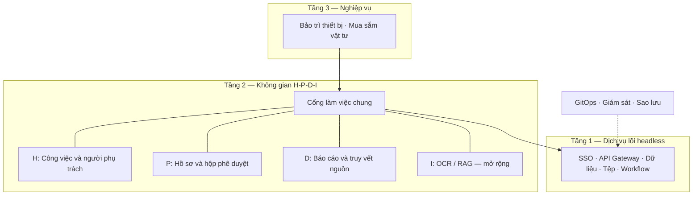

# DX-OS Open-Core OLP 2026 — Phân tích và giải pháp đề xuất

**Ngày phân tích:** 2026-11-04.  
**Cơ sở:** [Đề bài DX-OS Open-Core](DX-OS_Open-Core_OLP_2026.md), sơ đồ kiến trúc và các tài liệu bổ sung trong repository.  
**Trạng thái:** Đề xuất giải pháp cho bản dự thi có thể chạy và kiểm chứng; không phải xác nhận toàn bộ hệ thống đã được triển khai.

**Đề xuất xây dựng DX-OS thành một nền tảng dịch vụ dùng chung, phát triển tiếp từ demo Hasura–Go–Kestra hiện có, với kịch bản xuyên suốt: bảo trì thiết bị → mua vật tư → phê duyệt → báo cáo lịch sử.** Cách này vừa giải quyết bài toán liên thông dữ liệu, vừa có phạm vi đủ cụ thể để triển khai và chứng minh các yêu cầu của đề.

## 1. Phân tích bài toán và yêu cầu

### 1.1. Bài toán cốt lõi

Bài toán cốt lõi là tái sử dụng năng lực và liên thông nghiệp vụ. Khi mỗi phòng ban có phần mềm riêng, tổ chức phải lặp lại việc xây đăng nhập, phân quyền, lưu tệp, phê duyệt và báo cáo; dữ liệu cũng khó liên kết. DX-OS cần đưa những năng lực này về một lõi chung, đồng thời giữ quy tắc chuyên ngành ở từng ứng dụng.

### 1.2. Phân biệt các mức yêu cầu

| Mức | Nội dung |
|---|---|
| **Bắt buộc rõ tại mục 3** | Lõi headless; Identity/SSO; API Gateway; dữ liệu có cấu trúc và phi cấu trúc; Workflow; ít nhất một ứng dụng có giao diện thuộc H-P-D-I. |
| **Nguyên lý kỹ thuật tại mục 4** | Tách dữ liệu theo vòng đời; liên thông IT/OT; quản trị nguồn gốc, chất lượng và phả hệ dữ liệu; Zero-Trust, kiểm dịch mã độc và GitOps. |
| **Kiến trúc tham chiếu** | Các sản phẩm và phân hệ được liệt kê để tham khảo; đề cho phép chọn công nghệ phù hợp. |

Có thể thu gọn số công nghệ, nhưng vẫn phải có bằng chứng cho bốn nguyên lý kỹ thuật. AI, toàn bộ ứng dụng tầng 3 và Kubernetes Operator tự viết chưa được nêu là điều kiện tối thiểu. Nguồn: mục 3–4 của [đề bài](DX-OS_Open-Core_OLP_2026.md).

## 2. Các hướng giải quyết và lựa chọn đề xuất

| Hướng | Lợi ích | Đánh đổi |
|---|---|---|
| Dùng nền tảng đóng gói như Supabase | Khởi động nhanh các dịch vụ dữ liệu, định danh và lưu trữ | Vẫn phải tích hợp workflow, IT/OT, lịch sử và quản trị dữ liệu. |
| **Tiếp tục Hasura–Go–Kestra** | Kế thừa demo và các hợp đồng đã có trong repo | Phải bổ sung SSO, Gateway, UI, tệp và vận hành. |
| Triển khai đầy đủ hệ sinh thái tham chiếu | Bao phủ nhiều năng lực doanh nghiệp | Chi phí tích hợp và vận hành lớn, khó hoàn thiện đồng đều. |

**Khuyến nghị hướng thứ hai**, vì repo đã có nền móng phù hợp: dữ liệu công việc chung, hồ sơ mua sắm riêng, API lệnh, outbox và xử lý sự kiện trùng.

## 3. Kiến trúc giải pháp

### 3.1. Phân tách ba tầng

Kiến trúc đề xuất giữ đúng ba tầng. Sơ đồ sau thể hiện quan hệ sử dụng năng lực:

Tầng 1 cung cấp cơ chế dùng chung. Tầng 2 cung cấp trải nghiệm công việc, phê duyệt và báo cáo. Tầng 3 sở hữu quy tắc như điều kiện mua vật tư hoặc nghiệm thu bảo trì. Ba tầng này là ranh giới trách nhiệm; giai đoạn đầu có thể triển khai các module nghiệp vụ trong cùng một API Go.

Trong phương án này, *headless* được diễn giải là không cung cấp giao diện nghiệp vụ cho người dùng cuối ở lõi. Console kỹ thuật của Hasura/Kestra chỉ phục vụ quản trị và cần được giới hạn truy cập. Đây là cách diễn giải của phương án, cần đối chiếu khi có tiêu chí nghiệm thu chi tiết từ ban tổ chức.

### 3.2. Bộ công nghệ đề xuất

| Năng lực | Lựa chọn | Vai trò |
|---|---|---|
| Giao diện | Vue/Nuxt | Cổng công việc, biểu mẫu, hộp duyệt và báo cáo. |
| Định danh | Keycloak | Đăng nhập tập trung và tích hợp ứng dụng qua OIDC. |
| Cửa ngõ | Apache APISIX | Định tuyến, kiểm tra xác thực, giới hạn lưu lượng. |
| Dữ liệu giao dịch | PostgreSQL + Hasura | Lưu trữ quan hệ, API dữ liệu, phân quyền dòng/cột. |
| Lệnh nghiệp vụ | Go | Kiểm tra quyền, điều kiện và chuyển trạng thái. |
| Điều phối | Kestra | Tác vụ nền, thử lại, thông báo và xuất dữ liệu. |
| Tệp | SeaweedFS + ClamAV | Kho đối tượng, vùng cách ly và quét mã độc. |
| Phân tích lịch sử | Parquet + DuckDB | Lưu và truy vấn lịch sử tách khỏi giao dịch chính. |
| Vận hành | Kubernetes/k3s + Argo CD | Triển khai và đối soát cấu hình từ Git. |

Keycloak cung cấp OIDC; APISIX có plugin tích hợp OIDC; DuckDB hỗ trợ đọc Parquet qua S3. Đây là các khả năng có tài liệu chính thức để làm cơ sở tích hợp. Tham khảo [Keycloak](https://www.keycloak.org/securing-apps/oidc-layers), [APISIX](https://apisix.apache.org/docs/apisix/plugins/openid-connect/) và [DuckDB](https://duckdb.org/docs/current/guides/network_cloud_storage/s3_import).

### 3.3. Nguồn mở và quản lý thành phần

Nên ghim phiên bản và lập danh mục giấy phép cho các thành phần thực tế sử dụng. SeaweedFS công bố giấy phép Apache-2.0; OpenBao là lựa chọn quản lý bí mật nguồn mở nếu cần bổ sung năng lực này. Tham khảo [SeaweedFS](https://github.com/seaweedfs/seaweedfs) và [OpenBao](https://openbao.org/).

## 4. Kịch bản nghiệp vụ xuyên suốt

Một luồng nghiệp vụ nên chứng minh được nhiều yêu cầu cùng lúc:

1. Bộ cảm biến mô phỏng gửi nhiệt độ thiết bị, kèm danh tính thiết bị và thời điểm đo.
2. Hệ thống phát hiện vượt ngưỡng, cập nhật trạng thái thiết bị và tạo công việc bảo trì.
3. Kỹ thuật viên nhận việc; nếu thiếu vật tư, tạo yêu cầu mua sắm và đính kèm báo giá.
4. Tệp được cách ly và quét trước khi dùng trong hồ sơ.
5. Người quản lý duyệt đúng hồ sơ, đúng phiên bản và trong phạm vi quyền.
6. Kỹ thuật viên hoàn tất bảo trì; người có thẩm quyền nghiệm thu.
7. Hồ sơ đóng được xuất sang kho lịch sử; báo cáo truy ngược được về thiết bị, công việc và chứng từ nguồn.

Kịch bản này thể hiện **H** qua phân công công việc, **P** qua phê duyệt, **D** qua báo cáo; đồng thời nối dữ liệu cảm biến **OT** với nghiệp vụ **IT**. OCR/RAG có thể bổ sung ở **I** sau khi luồng chính ổn định.

## 5. Các quyết định thiết kế quan trọng

### 5.1. Chia sẻ thực thể chung, giữ hồ sơ nghiệp vụ riêng

Dùng `core.work_items` cho công việc, `assets.devices` cho thiết bị; mua sắm và bảo trì có bảng cùng trạng thái riêng. Các hồ sơ liên kết bằng định danh. Một yêu cầu mua sắm bị từ chối không được tự ghi đè trạng thái công việc bảo trì.

### 5.2. Thực thi quyền trên mọi đường truy cập

Quyền cần xét đơn vị/workspace, ứng dụng và hành động. Đọc dữ liệu qua Hasura, gọi API Go, tải tệp và xem báo cáo đều phải kiểm tra phạm vi tương ứng. Role Hasura không tự trở thành PostgreSQL role; các dịch vụ truy cập DB trực tiếp cần tài khoản và kiểm soát riêng. Tham khảo [cơ chế quyền Hasura](https://hasura.io/docs/2.0/auth/authorization/permissions/).

### 5.3. Tách chỉnh sửa dữ liệu khỏi quyết định nghiệp vụ

Hasura phục vụ đọc và sửa bản nháp. Các lệnh `submit`, `approve`, `reject`, `close` đi qua API nghiệp vụ để kiểm tra người thực hiện, trạng thái và phiên bản. Ghi thay đổi, audit và sự kiện cần phát trong cùng giao dịch DB.

### 5.4. Thiết kế workflow chịu được lỗi và chạy lại

Outbox lưu sự kiện cùng giao dịch nghiệp vụ. Mỗi sự kiện có định danh; bước xử lý phải chống tác động trùng và từ chối phiên bản cũ. Hasura Event Triggers có thể giao nhiều lần và sai thứ tự, nên retry cần đi kèm các kiểm soát này. Cũng cần bộ đối soát phát hiện hồ sơ còn chờ nhưng execution đã thất bại. Tham khảo [Hasura Event Triggers](https://hasura.io/docs/2.0/event-triggers/create-trigger/).

### 5.5. Quản lý vòng đời tệp ngay từ lúc tiếp nhận

Luồng đề xuất là `cách ly → quét → công bố`. Tệp chưa quét, quét lỗi hoặc bị phát hiện mã độc đều chưa được tải để sử dụng hay đưa vào OCR. Cần kiểm tra đúng phiên bản/nội dung tệp đã quét, tránh thay tệp sau kiểm tra. ClamAV cung cấp cơ chế quét để dịch vụ tệp tích hợp. Tham khảo [tài liệu ClamAV](https://docs.clamav.net/manual/Usage/Scanning.html).

### 5.6. Xuất lịch sử có đối soát và phả hệ

Dữ liệu tác nghiệp nằm ở PostgreSQL; hồ sơ đã đóng được xuất theo phiên bản sang Parquet. Mỗi đợt xuất lưu mã đợt, phiên bản nguồn, phiên bản phép biến đổi và kết quả đối soát. Báo cáo chỉ dùng đợt đã công bố thành công; chạy lại không tính trùng. Quyền truy cập phải được áp dụng lại ở dịch vụ báo cáo và kho tệp.

## 6. Ranh giới Workflow, BPMN và GitOps

### 6.1. Workflow và BPMN

Mục 3 yêu cầu Workflow nói chung, còn khung kiến trúc có nhắc BPMN. Demo Kestra hiện tại là nền cho điều phối tác vụ và phê duyệt qua API riêng.

**Nếu bản dự thi cam kết thực thi BPMN, cần dùng một engine BPMN như Flowable cho phần quy trình đó.** Flowable hỗ trợ BPMN 2.0 và user task; không nên coi workflow YAML là bằng chứng đã đáp ứng BPMN. Tham khảo [Flowable Open Source](https://www.flowable.com/open-source/docs/bpmn/ch02-GettingStarted/).

### 6.2. GitOps và phục hồi

Nên đưa manifest triển khai, migration, metadata Hasura và định nghĩa workflow vào Git, kèm quy trình áp dụng có kiểm tra. Argo CD có thể tự đồng bộ và sửa sai lệch tài nguyên khi cấu hình phù hợp. Khôi phục dữ liệu từ backup vẫn là một bài kiểm tra riêng. Tham khảo [Argo CD self-healing](https://argo-cd.readthedocs.io/en/stable/user-guide/auto_sync/).

## 7. Giá trị đội thi tự xây

Giá trị đội thi tự xây nên tập trung vào lớp tích hợp:

- Hợp đồng đăng ký ứng dụng.
- Mô hình quyền thống nhất.
- Dữ liệu dùng chung và các API nghiệp vụ.
- Giao diện H-P-D-I.
- Khả năng truy vết xuyên suốt giữa hồ sơ, workflow và báo cáo.

Ban đầu có thể dùng manifest cùng công cụ bootstrap; Operator tổng quát nên đến sau khi các hợp đồng đã ổn định.

## 8. Hiện trạng có thể kế thừa

Repo hiện có thể kế thừa đáng kể. [README demo](demo/README.md) đã mô tả luồng Hasura → Kestra → Go, outbox và chống xử lý trùng. [Biên bản kiểm chứng](demo/VERIFICATION.md) ghi nhận các kiểm thử dịch vụ thật; các kiểm thử đó không được chạy lại trong lượt phân tích này.

Demo vẫn thiếu UI riêng, SSO thật và các phần tích hợp rộng hơn của đề. Các tài liệu [đề xuất cải thiện](DX-OS_De-xuat-Cai-thien.md) và [sơ đồ hệ thống](DX-OS_So-do-He-thong.md) là cơ sở liên quan để tiếp tục phát triển.

## 9. Lộ trình triển khai và tiêu chí nghiệm thu

| Chặng | Đầu ra | Bằng chứng nghiệm thu |
|---|---|---|
| **1. Hoàn thiện luồng hiện có** | Keycloak, Gateway, UI công việc và mua sắm | Đăng nhập, tạo hồ sơ, gửi và duyệt; chặn truy cập chéo workspace và duyệt sai phiên bản. |
| **2. Hoàn thành yêu cầu kỹ thuật** | Tệp có kiểm dịch, cảm biến mô phỏng, bảo trì, xuất lịch sử và lineage | Tệp chưa sạch bị chặn; một cảnh báo tạo một công việc; báo cáo truy ngược được nguồn, xuất lại không tính trùng. |
| **3. Hoàn thiện vận hành** | GitOps, giám sát, đối soát workflow và sao lưu | Cài từ môi trường sạch; phục hồi sau lỗi; sửa sai lệch cấu hình; khôi phục được dữ liệu backup. |
| **4. Bổ sung điểm khác biệt** | Ứng dụng thứ hai, OCR/RAG hoặc khai báo ứng dụng tự động | Chứng minh tái sử dụng lõi; AI chỉ truy xuất dữ liệu được cấp quyền và trả kết quả có nguồn tham chiếu. |
