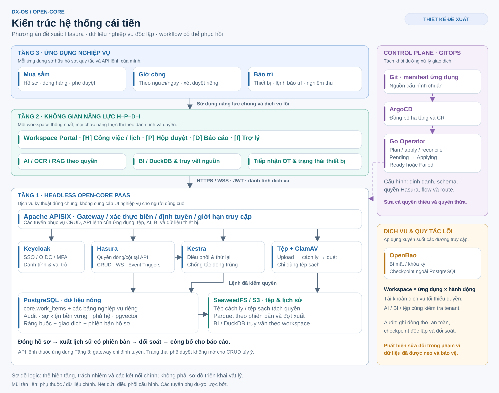
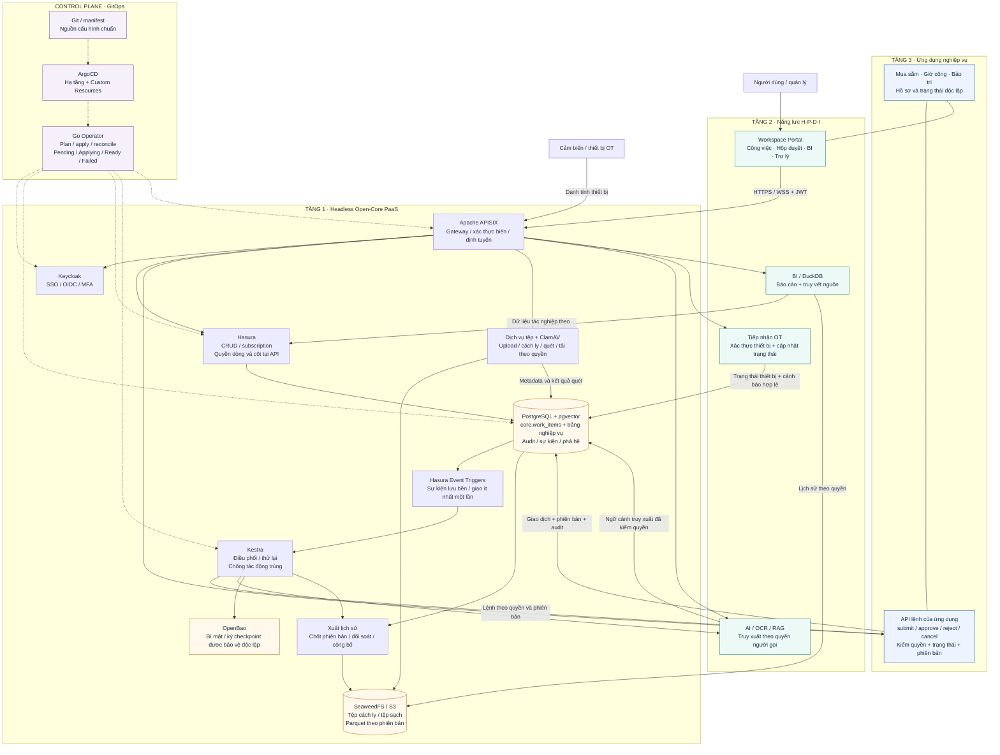
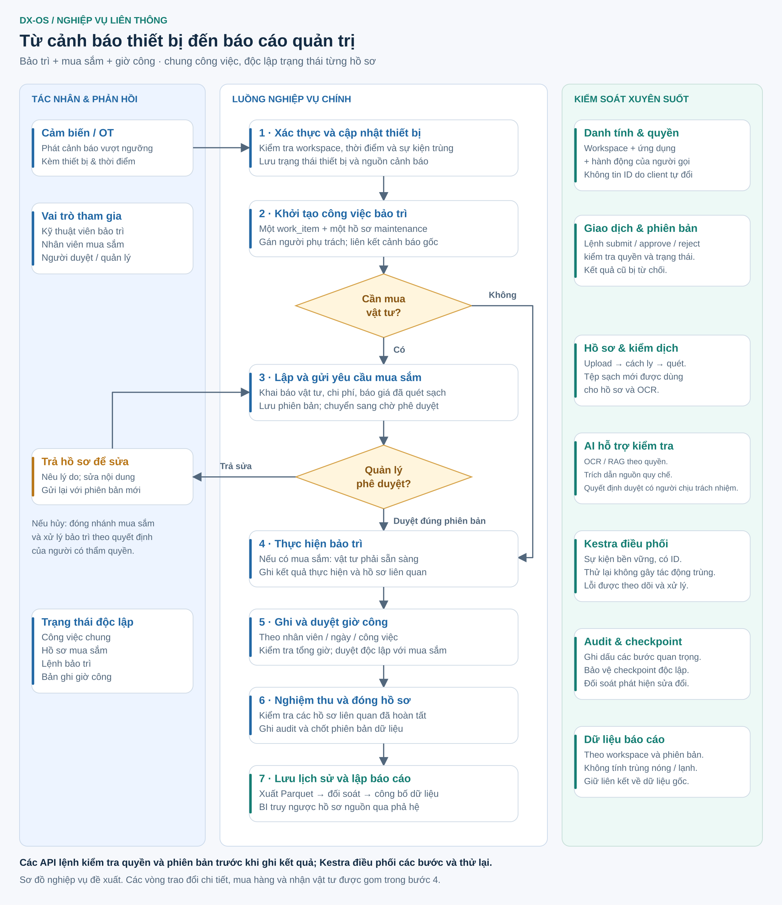
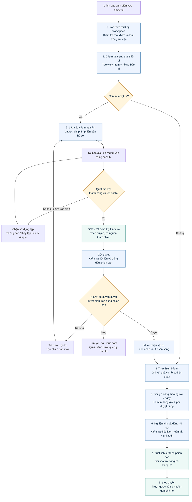

# DX-OS Open-Core — Kiến trúc hệ thống và luồng nghiệp vụ

Các sơ đồ minh họa **phương án cải tiến giữ Hasura** trong [đề xuất cải thiện](DX-OS_De-xuat-Cai-thien.md). Đây là thiết kế đề xuất, không phải xác nhận hệ thống đã được triển khai.

Ảnh PNG dùng để đọc và đưa vào tài liệu; SVG có thể phóng lớn hoặc chỉnh sửa bằng công cụ đồ họa vector. Các khối Mermaid bên dưới cung cấp bản mô tả có thể chỉnh sửa bằng văn bản, với một số kết nối được thể hiện chi tiết hơn so với ảnh tổng quan.

## 1. Kiến trúc hệ thống



[Mở bản SVG](DX-OS_Kien-truc-Cai-tien.svg) · [Mở bản PNG](DX-OS_Kien-truc-Cai-tien.png)

### Cách đọc

- **Tầng 3:** các ứng dụng sở hữu hồ sơ, quy tắc nghiệp vụ và API lệnh; mua sắm, giờ công và bảo trì có trạng thái riêng.
- **Tầng 2:** workspace H-P-D-I và các năng lực dùng chung như hộp duyệt, AI, BI và dữ liệu ngữ cảnh thiết bị.
- **Tầng 1:** dịch vụ lõi headless phục vụ xác thực, API, dữ liệu, workflow, lưu tệp và bảo mật.
- **Control plane:** Git, ArgoCD và Operator quản lý cấu hình. Operator không nằm trên đường xử lý bắt buộc của từng giao dịch nghiệp vụ.
- Các mũi tên trong ảnh là phụ thuộc hoặc luồng dữ liệu chính; nét đứt thể hiện điều phối cấu hình. Đây là sơ đồ logic, không phải sơ đồ triển khai vật lý hay ánh xạ mỗi khối thành một tiến trình riêng.

### Các nguyên tắc cần giữ khi triển khai

1. CRUD thông thường đi qua Hasura. Các lệnh `submit`, `approve`, `reject`, `cancel` đi qua phần xử lý nghiệp vụ của ứng dụng để kiểm tra quyền, trạng thái và phiên bản hồ sơ.
2. Role Hasura và role PostgreSQL là hai cơ chế riêng. Tài khoản kết nối DB và các đường truy cập của dịch vụ nền phải được phân quyền rõ ràng.
3. Kestra điều phối tác vụ và thử lại. Khi thay đổi trạng thái quan trọng, workflow gọi đường xử lý lệnh có kiểm quyền; mũi tên Kestra tới DB trong ảnh tổng quan biểu diễn kết quả của đường xử lý này.
4. Dữ liệu công việc chung nằm ở `core.work_items`; hồ sơ mua sắm, giờ công và bảo trì nằm trong các bảng nghiệp vụ riêng, liên kết bằng định danh.
5. AI, BI, tệp và workflow đều kiểm tra workspace cùng quyền hành động. Gateway không thay thế việc phân quyền tại nơi thực thi.
6. Dữ liệu nóng được xuất sang lịch sử theo phiên bản và đợt xuất có đối soát. Việc truy vấn Parquet phải thực thi quyền riêng; quyền DB không tự đi theo tệp.
7. Checkpoint audit được bảo vệ độc lập với quyền sửa DB và có cơ chế đối soát. Phạm vi phát hiện sửa đổi phải được mô tả đúng với dữ liệu đã được neo.

### Bản Mermaid — kiến trúc và các kết nối chính



## 2. Luồng nghiệp vụ liên thông

Kịch bản bắt đầu từ một **cảnh báo thiết bị vượt ngưỡng**. Dữ liệu cảm biến thông thường vẫn được tiếp nhận và theo dõi; không phải mọi bản tin cảm biến đều tạo công việc bảo trì.



[Mở bản SVG](DX-OS_Luong-Nghiep-vu.svg) · [Mở bản PNG](DX-OS_Luong-Nghiep-vu.png)

### Các bước chính

| Bước | Chủ thể / năng lực | Kết quả |
|---|---|---|
| 1. Xác thực và cập nhật thiết bị | Tiếp nhận OT | Cảnh báo hợp lệ, đúng workspace, có nguồn gốc và không bị xử lý trùng |
| 2. Khởi tạo công việc | Bảo trì | Một công việc chung và một hồ sơ bảo trì có người phụ trách |
| 3. Lập và gửi yêu cầu mua sắm nếu cần | Mua sắm + dịch vụ tệp | Yêu cầu theo phiên bản, chứng từ đã quét sạch, đang chờ phê duyệt |
| 4. Thực hiện bảo trì | Người duyệt + mua sắm + kỹ thuật viên | Yêu cầu được duyệt đúng phiên bản, vật tư sẵn sàng và kết quả bảo trì được ghi nhận |
| 5. Ghi và duyệt giờ công | Nhân viên + người duyệt | Giờ công theo người/ngày được kiểm tra và duyệt độc lập |
| 6. Nghiệm thu và đóng hồ sơ | Người có thẩm quyền | Các hồ sơ liên quan hoàn tất, phiên bản được chốt và audit được ghi |
| 7. Lưu lịch sử và báo cáo | Xuất dữ liệu + BI | Dữ liệu lịch sử được đối soát, không tính trùng và truy ngược được nguồn |

### Nhánh xử lý và điều kiện

- **Không cần mua vật tư:** chuyển từ đánh giá nhu cầu sang thực hiện bảo trì.
- **Trả hồ sơ:** ghi lý do, sửa nội dung và gửi lại với phiên bản mới. Quyết định cũ không áp dụng lên phiên bản đã thay đổi.
- **Hủy mua sắm:** đóng nhánh mua sắm; tiếp tục hay hủy bảo trì phải do người có thẩm quyền quyết định theo tình huống.
- **Tệp không sạch hoặc chưa quét xong:** không được đưa vào hồ sơ gửi duyệt và không chuyển tới OCR.
- **Lỗi tác vụ:** workflow thử lại có kiểm soát; sự kiện trùng không được tạo thêm tác động nghiệp vụ.
- **Đóng hồ sơ:** chỉ thực hiện sau khi các điều kiện hoàn tất liên quan đã được kiểm tra. Sửa hồ sơ đã đóng cần quy tắc mở lại hoặc phiên bản mới.

### Bản Mermaid — luồng nghiệp vụ chi tiết



## 3. Các tình huống cần kiểm chứng từ sơ đồ

- Người không có quyền không duyệt được hồ sơ hoặc đổi workspace để đọc dữ liệu khác.
- Một cảnh báo được gửi lại không tạo trùng công việc.
- Một bước workflow được chạy lại không tạo thêm tác động nghiệp vụ.
- Kết quả duyệt phiên bản cũ bị từ chối sau khi hồ sơ thay đổi.
- Mua sắm, bảo trì và giờ công không ghi đè trạng thái của nhau.
- Tệp chưa quét sạch không thể được tải để sử dụng hoặc gửi tới OCR.
- Một đợt xuất lịch sử chạy lại không khiến báo cáo tính trùng.
- Chỉ số báo cáo truy ngược được hồ sơ và phiên bản nguồn.

## 4. Chỉnh sửa và xuất ảnh

- Sửa các khối Mermaid để thay đổi mô tả cấu trúc và luồng.
- Sửa SVG bằng công cụ vector nếu cần giữ bố cục của ảnh minh họa.
- Mermaid và SVG là hai biểu diễn độc lập; khi thay đổi kiến trúc cần cập nhật đồng bộ.
- Có thể xuất lại PNG từ SVG bằng `rsvg-convert` nếu công cụ đã được cài đặt:

```sh
rsvg-convert -w 2400 -o DX-OS_Kien-truc-Cai-tien.png DX-OS_Kien-truc-Cai-tien.svg
rsvg-convert -w 2200 -o DX-OS_Luong-Nghiep-vu.png DX-OS_Luong-Nghiep-vu.svg
```
