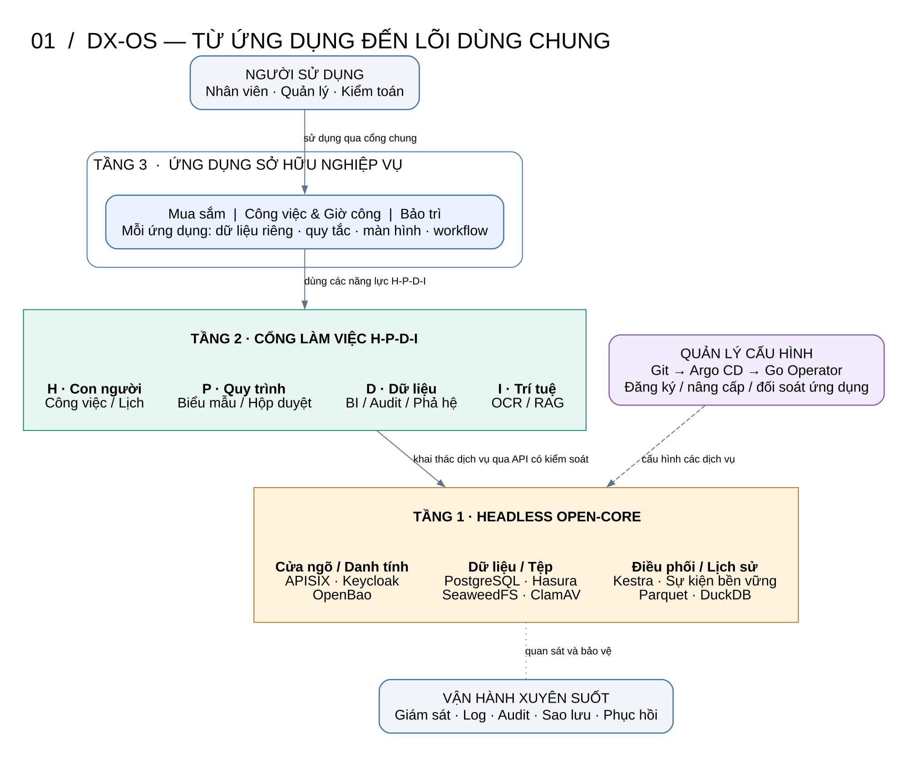

# DX-OS Open-Core — Bản thiết kế trực quan

**Thiết kế đầy đủ theo hướng 2:** giữ toàn bộ năng lực ban đầu, tổ chức rõ dữ liệu chung và hồ sơ riêng; thống nhất lõi headless, H-P-D-I, ứng dụng cắm-rút, Operator/GitOps, AI, kiểm toán và dữ liệu lịch sử.

**Đọc [tài liệu thiết kế chi tiết](docs/superpowers/specs/2026-11-04-dx-os-system-design.md).** Trạng thái: bản thiết kế đề xuất chờ duyệt, không phải báo cáo đã triển khai. Căn cứ là đề tài và ba tài liệu giải pháp ban đầu; hiện trạng thực hành không giới hạn phạm vi.

## Bộ sơ đồ

| Hình | Câu hỏi được giải thích | Phóng lớn | Ảnh |
|---|---|---|---|
| 01. Tổng thể | Ba tầng và H-P-D-I liên hệ thế nào? | [SVG](DX-OS_V2_01-Tong-the.svg) | [PNG](DX-OS_V2_01-Tong-the.png) |
| 02. Xử lý yêu cầu | Hasura, API Go và Kestra làm gì? | [SVG](DX-OS_V2_02-Xu-ly-Yeu-cau.svg) | [PNG](DX-OS_V2_02-Xu-ly-Yeu-cau.png) |
| 03. Dữ liệu và quyền | Cái gì dùng chung, cái gì thuộc ứng dụng? | [SVG](DX-OS_V2_03-Du-lieu-va-Quyen.svg) | [PNG](DX-OS_V2_03-Du-lieu-va-Quyen.png) |
| 04. Đăng ký ứng dụng | Manifest đi qua GitOps và Operator ra sao? | [SVG](DX-OS_V2_04-Dang-ky-Ung-dung.svg) | [PNG](DX-OS_V2_04-Dang-ky-Ung-dung.png) |
| 05. Nghiệp vụ | Bảo trì, mua sắm và giờ công phối hợp thế nào? | [SVG](DX-OS_V2_05-Nghiep-vu.svg) | [PNG](DX-OS_V2_05-Nghiep-vu.png) |
| 06. Tệp và AI | Tệp được kiểm dịch và khai thác bằng AI thế nào? | [SVG](DX-OS_V2_06-Tep-va-AI.svg) | [PNG](DX-OS_V2_06-Tep-va-AI.png) |
| 07. Lịch sử và audit | Báo cáo có nguồn và kiểm chứng ra sao? | [SVG](DX-OS_V2_07-Lich-su-va-Audit.svg) | [PNG](DX-OS_V2_07-Lich-su-va-Audit.png) |
| 08. Triển khai | Hệ thống được vận hành và phục hồi thế nào? | [SVG](DX-OS_V2_08-Trien-khai.svg) | [PNG](DX-OS_V2_08-Trien-khai.png) |

Các lựa chọn kỹ thuật và giới hạn được giải thích trong tài liệu chi tiết. Hình tổng thể biểu diễn quan hệ năng lực; hình xử lý yêu cầu biểu diễn đường dữ liệu. Nguồn DOT của từng hình nằm cùng thư mục để chỉnh sửa và xuất lại.
