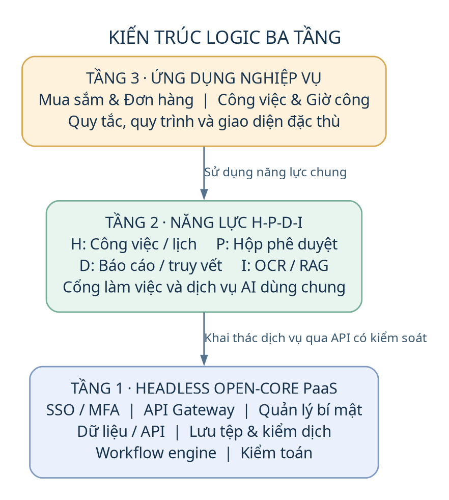
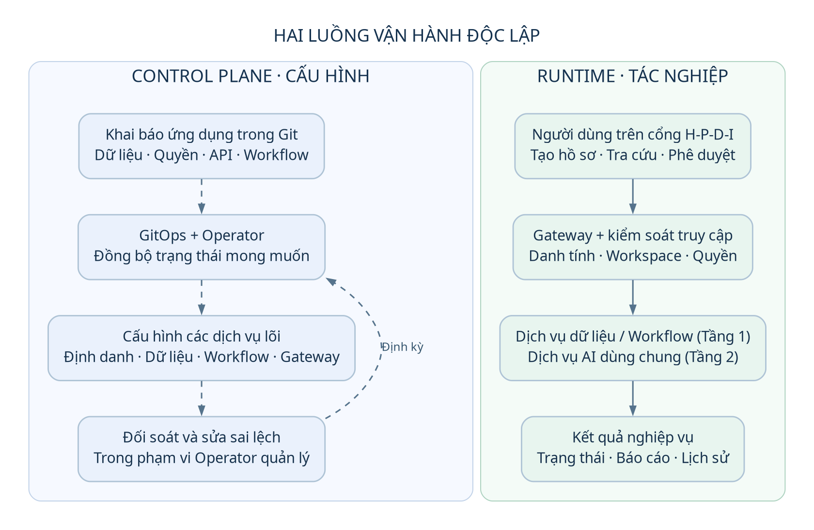
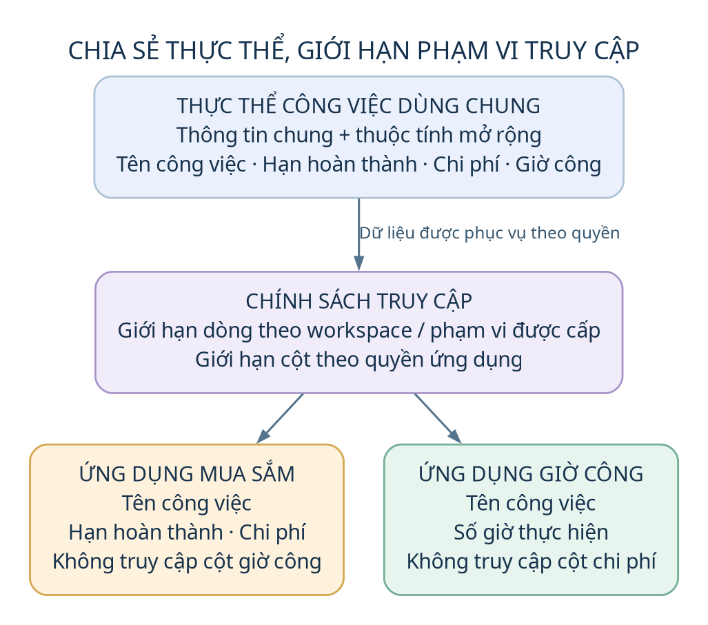

# DX-OS Open-Core — Tổng quan kiến trúc và năng lực

**Đối tượng:** Chuyên gia hệ thống / Architect.  
**Nguồn:** [implementation_plan.md](implementation_plan.md). Các năng lực dưới đây mô tả phạm vi thiết kế dự kiến.

## 1. Hệ thống này là gì?

**DX-OS Open-Core là nền tảng dịch vụ dùng chung theo mô hình Cloud-Native Declarative PaaS**, tích hợp các công nghệ nguồn mở để vận hành nhiều ứng dụng nghiệp vụ trên cùng một lõi. Mục tiêu là giảm phân mảnh dữ liệu, tái sử dụng năng lực kỹ thuật và giảm chi phí phát triển, tích hợp, vận hành khi mở rộng ứng dụng.

### Kiến trúc ba tầng

*Hình 1. Ranh giới trách nhiệm giữa ứng dụng, năng lực dùng chung và dịch vụ lõi. Mũi tên biểu diễn quan hệ sử dụng năng lực, không phải toàn bộ luồng gọi mạng.*

| Tầng | Vai trò kiến trúc |
|---|---|
| **1 — Dịch vụ lõi** | Headless PaaS cung cấp định danh/SSO, API Gateway, dữ liệu cấu trúc và tệp, workflow, quản lý bí mật và kiểm toán. Lõi cung cấp cơ chế dùng chung; quy tắc nghiệp vụ do ứng dụng khai báo. |
| **2 — Năng lực H-P-D-I** | Cổng làm việc hợp nhất: **H** — công việc và cộng tác; **P** — xử lý, phê duyệt; **D** — báo cáo, kiểm toán và nguồn gốc dữ liệu; **I** — OCR, trích xuất và hỏi đáp RAG. AI là dịch vụ dùng chung ở tầng này, sử dụng dữ liệu được cấp quyền. |
| **3 — Ứng dụng nghiệp vụ** | Các ứng dụng sử dụng lại lõi và không gian H-P-D-I. Phạm vi minh họa gồm **Mua sắm & Đơn hàng** và **Công việc & Giờ công**, cùng khai thác thực thể công việc chung với quyền truy cập riêng. |

### Cơ chế vận hành

*Hình 2. Nét đứt là luồng điều phối cấu hình; nét liền là luồng tác nghiệp. Đây là sơ đồ logic rút gọn, không biểu diễn thứ tự triển khai.*

- **Control plane:** GitOps và Operator tiếp nhận khai báo ứng dụng, đồng bộ cấu hình định danh, dữ liệu, quyền, API và workflow; định kỳ đối soát để sửa sai lệch so với trạng thái mong muốn.
- **Runtime:** Người dùng thao tác qua cổng hợp nhất; yêu cầu đi qua Gateway tới dịch vụ dữ liệu, workflow hoặc AI. Các dịch vụ phối hợp xử lý theo ngữ cảnh danh tính, workspace và ứng dụng; kết quả cùng lịch sử phục vụ tác nghiệp và quản trị.

Operator quản lý cấu hình, không nằm trên đường xử lý bắt buộc của từng giao dịch nghiệp vụ. Gateway là cửa ngõ; các dịch vụ vẫn thực thi quyền truy cập dữ liệu và hành động tương ứng.

### Mô hình chia sẻ dữ liệu

*Hình 3. Hai góc nhìn được phân quyền trên dữ liệu chung, không phải hai bản sao dữ liệu độc lập. Các trường trong hình được diễn giải bằng tên nghiệp vụ thay cho task1–task4 của kế hoạch.*

Phương án chọn thực thể công việc dùng chung, kết hợp thuộc tính chung/riêng và từ điển thuộc tính để kiểm soát mở rộng dữ liệu. Phân quyền dòng giới hạn phạm vi workspace; phân quyền cột giới hạn thuộc tính từng ứng dụng được sử dụng. Việc dùng chung thực thể là lựa chọn của phương án hiện tại, không đồng nghĩa mọi dữ liệu nghiệp vụ đều phải đặt trong một bảng.

## 2. Những khả năng chính

| Năng lực | Khả năng và giá trị nghiệp vụ |
|---|---|
| **Mở rộng ứng dụng bằng khai báo** | Đăng ký nhu cầu dữ liệu, quyền, API và workflow để nền tảng tự cấu hình dịch vụ tương ứng; giảm phần CRUD và tích hợp lặp lại. Giao diện và quy tắc đặc thù vẫn thuộc phạm vi ứng dụng. |
| **Liên thông dữ liệu có kiểm soát** | Các ứng dụng khai thác cùng thực thể, chia sẻ thuộc tính chung nhưng giới hạn thuộc tính riêng; phát hiện xung đột định nghĩa dữ liệu khi mở rộng. |
| **Định danh và bảo mật tập trung** | SSO/MFA, kiểm soát truy cập qua Gateway, cách ly workspace, phân quyền dòng/cột, quản lý bí mật và khóa; phạm vi thiết kế bao gồm lưu tệp và kiểm dịch mã độc. |
| **Điều phối nghiệp vụ linh hoạt** | Thực thi workflow khai báo, kiểm tra điều kiện nghiệp vụ, phối hợp phê duyệt với tác vụ tự động và AI; ghi nhận kết quả xử lý và ký dữ liệu theo luồng được định nghĩa. |
| **Trải nghiệm H-P-D-I thống nhất** | Bảng công việc, lịch, hộp phê duyệt, báo cáo và tra cứu lịch sử trên một cổng; chuyển đổi giữa các ứng dụng theo quyền người dùng. |
| **AI dùng chung theo ngữ cảnh** | OCR/bóc tách dữ liệu theo cấu trúc yêu cầu; RAG hỏi đáp và đối chiếu quy chế có trích dẫn, giới hạn nguồn theo namespace ứng dụng và workspace; hỗ trợ mô hình nội bộ hoặc dịch vụ AI bên ngoài. |
| **Truy vết và kiểm chứng dữ liệu** | Nhật ký kiểm toán, liên kết nguồn gốc dữ liệu và kiểm chứng tính toàn vẹn bằng chuỗi băm; hỗ trợ giải thích lịch sử xử lý hồ sơ và dữ liệu báo cáo. |
| **Vận hành nhất quán đa môi trường** | GitOps quản lý cấu hình staging/production; Operator áp dụng lặp lại và sửa sai lệch cấu hình. Phân phối dưới dạng sản phẩm nguồn mở có tài liệu, danh mục thành phần phần mềm (SBOM) và gói phát hành. |

### Phạm vi nghiệp vụ minh họa

- **Mua sắm & Đơn hàng:** đề xuất, kiểm tra báo giá và phê duyệt.
- **Công việc & Giờ công:** ghi nhận, kiểm tra và duyệt giờ làm.

Hai ứng dụng chứng minh khả năng tái sử dụng lõi, chia sẻ dữ liệu và tách quyền trên cùng nền tảng.

> **Trạng thái:** Đây là tổng quan thiết kế, chưa phải kết quả nghiệm thu. Các tuyên bố định lượng về hiệu năng, tài nguyên, tiết kiệm chi phí và điểm đánh giá trong bản kế hoạch chưa được coi là cam kết đã kiểm chứng.
