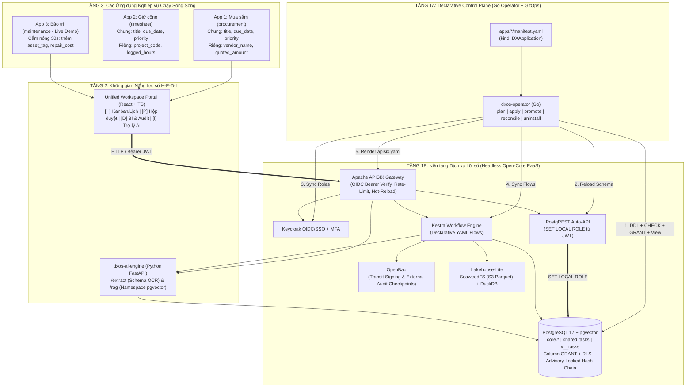

# Tổng quan Kiến trúc & Giải pháp Kỹ thuật: DX-OS Open-Core (OLP 2026)

## 1. Bức tranh Tổng thể & Định vị Giải pháp

Đề thi **OLP Phần mềm Nguồn mở 2026** đặt ra bài toán xây dựng **Hệ điều hành Chuyển đổi số (DX-OS Open-Core)** nhằm giải quyết hai căn bệnh lớn của doanh nghiệp:
1. **Mua phần mềm rời rạc:** Tạo ra các "ốc đảo dữ liệu" (Data Silos), trùng lặp hạ tầng và không thể liên thông quy trình.
2. **Mua phần mềm nguyên khối (Monolithic):** Cồng kềnh, cứng nhắc, mất chủ quyền số và tốn nhiều công sức viết lại Backend mỗi khi thêm nghiệp vụ mới.

### Ba Giá trị Cốt lõi (Core Value Propositions) của Đội thi:
- **Zero-Silo, Zero-Copy Data Mesh (Liên thông dữ liệu không nhân bản):** Nhiều ứng dụng phòng ban chạy song song cùng đọc/ghi trên một thực thể dữ liệu gốc duy nhất (`shared.tasks`), vừa chia sẻ các trường chung vừa cô lập các trường riêng bằng cơ chế bảo mật gốc của PostgreSQL — không nhân bản dữ liệu, không cần `JOIN` chéo nhiều bảng.
- **Zero-Boilerplate Declarative PaaS (Cắm ứng dụng bằng Manifest, không viết lại Backend CRUD):** Tầng 1 tự động hóa hoàn toàn việc sinh API (PostgREST) và chạy quy trình (Kestra). Thêm một ứng dụng mới chỉ cần khai báo 1 file `manifest.yaml`.
- **Self-Healing Go Control Plane (Điều phối tự hành & Tự phục hồi):** Sử dụng Kubernetes Operator viết bằng **Go (`dxos-operator`)** để tự động đồng bộ cấu hình xuống toàn bộ các dịch vụ Tầng 1 và tự động khôi phục khi phát hiện quyền hoặc tuyến mạng bị sửa trái phép (Configuration Drift).

---

## 2. Sơ đồ Kiến trúc 3 Tầng

---

## 3. Năm Kỹ thuật Đặc biệt (Điểm nhấn Sáng tạo)

### 3.1. Bảng Thực thể Đa hình + `Security-Invoker Views` + Native PostgreSQL Role (`PostgREST`)
- **Từ điển Thuộc tính (`core.attribute_dictionary`):** Quản lý toàn bộ các cột của bảng dùng chung `shared.tasks`, phân loại rõ **`SHARED` (cột dùng chung xuyên ứng dụng)** và **`APP` (cột thuộc sở hữu riêng của từng ứng dụng)**.
- **Thực thi quyền tới từng Cột & Dòng ngay trong PostgreSQL:**
  - Khi request đi qua APISIX vào **PostgREST**, PostgREST đọc claim `dxos_role` và `workspace_id` từ JWT của Keycloak, rồi chạy `SET LOCAL ROLE <dxos_role>`.
  - Trên bảng gốc `shared.tasks`: khóa quyền bằng `GRANT SELECT/INSERT/UPDATE (<cột_của_app>) TO <dxos_role>` và `RLS Policy` (có đủ cả `USING` và `WITH CHECK` theo `workspace_id`).
  - Để hỗ trợ truy vấn `SELECT *` và `RETURNING *` chuẩn của PostgREST mà không bị lỗi `42501` do vướng cột của App khác, `dxos-operator` tự động tạo cho mỗi App một **Updatable Security-Invoker View** (`shared.v_<app>_tasks WITH (security_invoker = true, security_barrier = true)`).
- **Lệnh `promote` (Chuyển cột riêng thành cột chung 0-Migration):** Khi một cột ban đầu chỉ thuộc về App 1 (`scope = 'APP'`), nếu sau này App 2 và App 3 cũng cần dùng chung, quản trị viên chỉ cần chạy `dxos-operator promote --column <tên_cột>`. Hệ thống chuyển cột đó sang `SHARED` và cấp quyền `GRANT` mà **không cần chạy bất kỳ câu lệnh `ALTER TABLE` hay dời chuyển dữ liệu nào**.

### 3.2. Go Operator (`dxos-operator`) & Tự phục hồi Hạ tầng (`Self-Healing Reconciliation`)
- Viết bằng **Go (Golang)** chuẩn Cloud-Native, đóng gói thành 1 binary tĩnh siêu nhẹ.
- Hỗ trợ 5 chế độ vận hành:
  1. `plan`: In bản xem trước (diff) các thay đổi SQL DDL, `CHECK` constraints, `GRANT`, View và tuyến APISIX trước khi áp dụng (giống `terraform plan`).
  2. `apply`: Thực thi đồng bộ lũy đẳng từ `manifest.yaml` xuống toàn bộ Tầng 1.
  3. `promote`: Nâng cấp cột từ `APP` lên `SHARED` không cần migration.
  4. `reconcile`: Đọc trực tiếp bảng hệ thống `information_schema.role_column_grants` của PostgreSQL và cấu hình APISIX để phát hiện sai lệch (Drift) và **tự động khôi phục lại quyền/tuyến bị mất**.
  5. `uninstall`: Thu hồi toàn bộ quyền (`REVOKE`), xóa View của App và đánh dấu cột riêng là `DEPRECATED` mà không làm mất dữ liệu lịch sử.

### 3.3. Poka-yoke 2 Lớp & Luồng Quy trình Kestra
- **Lớp 1 — Cưỡng chế đồng bộ ngay tại DB:** Các quy tắc Poka-yoke khai báo trong `manifest.yaml` (ví dụ: `quoted_amount > 0`, `logged_hours > 0 AND logged_hours <= 24`) được Operator tự động biên dịch thành **SQL `CHECK` constraint** gắn thẳng vào bảng `shared.tasks`.
- **Lớp 2 — Quy trình bất đồng bộ trên Kestra:** Khi bản ghi mới được tạo hoặc đổi trạng thái, PostgreSQL bắn sự kiện `pg_notify('dxos_workflow_events')` kích hoạt luồng YAML tương ứng trên **Kestra** để kiểm tra chéo, gọi AI phân tích và thực hiện phê duyệt.

### 3.4. Chuỗi Băm Kiểm toán Bất biến (`SHA-256 Hash-Chain`) + Chữ ký OpenBao Ngoài DB
- Bảng `core.audit_logs` dùng `pg_advisory_xact_lock` theo từng workspace để tính `row_hash = sha256(prev_hash || payload)` tuần tự, đảm bảo **không bao giờ bị chẻ nhánh (fork) khi có nhiều giao dịch ghi đồng thời**.
- Đầu chuỗi băm (Chain Head) được ký mật mã bằng **OpenBao Transit Engine** và lưu bản Checkpoint trực tiếp vào **OpenBao KV Store (nằm ngoài PostgreSQL)** — giúp phát hiện ngay cả khi `superuser` của DB cố tình xóa dòng cuối hoặc tính lại toàn bộ bảng băm.

### 3.5. Lakehouse-Lite (`Parquet + SeaweedFS + DuckDB`) & AI Đa Thuê Ước (`ai-engine`)
- **Phân tách dữ liệu Nóng / Lạnh (Nguyên lý 1 của đề thi):** Dữ liệu đang xử lý nằm trên PostgreSQL (OLTP); các bản ghi đã đóng được đóng băng sang định dạng cột chuẩn mở **Apache Parquet** lưu trên **SeaweedFS (S3)** và truy vấn phân tích tức thì bằng **DuckDB**.
- **AI Engine Phi Nghiệp Vụ:** Cung cấp 2 API tổng quát: `/api/ai/extract` (trích xuất dữ liệu theo `target_schema` + kiểm tra Poka-yoke) và `/api/ai/rag` (hỏi đáp quy chế kèm trích dẫn nguồn, cô lập theo `namespace` của từng App).

---

## 4. Kịch bản "4 Màn Trình Diễn" tại Vòng Chung kết (15 Phút)

1. **Màn 1 — Cắm nóng Ứng dụng thứ 3 trong 30 giây (`Live Hot-Plug`):**
   - Hệ thống đang chạy 2 App (`Mua sắm` và `Giờ công`). Chạy lệnh `dxos-operator apply -f apps/maintenance/manifest.yaml`.
   - Giao diện Web tự động đọc `shared.v_app_registry`, lập tức xuất hiện thêm **App 3: Bảo trì Thiết bị** hiển thị các công việc hiện có với cột chung `(title, due_date, priority)` và cột riêng mới `(asset_tag, repair_cost)` mà không cần build lại UI hay tắt hệ thống.
2. **Màn 2 — Nâng cấp Cột Riêng thành Cột Chung Không Cần Migration (`Zero-Migration Promote`):**
   - Dùng lệnh `dxos-operator promote --column project_code` để biến trường `project_code` của App Giờ công thành trường dùng chung cho cả App Mua sắm và Bảo trì ngay lập tức.
3. **Màn 3 — Tự phục hồi Hạ tầng khi bị phá hoại (`Self-Healing Drift Recovery`):**
   - Vào thẳng PostgreSQL chạy `REVOKE SELECT ON shared.tasks FROM role_procurement;`. Trong 5 giây, `dxos-operator reconcile` phát hiện mất quyền trong `information_schema` và tự động khôi phục lại nguyên trạng.
4. **Màn 4 — Chặn đứng Xung đột Schema & Kiểm chứng Sổ cái Kiểm toán:**
   - Thử nạp một manifest khai báo sai kiểu dữ liệu (`due_date: integer` thay vì `date`) $\rightarrow$ bị Operator chặn ngay với lỗi `ErrSchemaTypeConflict`.
   - Bấm kiểm chứng chuỗi băm SHA-256 của `core.audit_logs` đối chiếu với chữ ký OpenBao Transit.

---

## 5. Chiến lược Đạt Tuyệt đối 50/50 Điểm PoF (Points of FAIL)

| Tiêu chí PoF | Điểm | Giải pháp thực thi trong Repo |
| :--- | :---: | :--- |
| **1. Quản lý mã nguồn trên Internet** | 5/5 | GitHub Repo công khai, lịch sử commit đều đặn, bật và sử dụng thật GitHub Issues làm Bug Tracker. |
| **2. Giấy phép OSI-approved** | 10/10 | **Apache-2.0** toàn dự án; có đủ `LICENSE`, `NOTICE` (nêu rõ mục đích cấp phép), `COPYRIGHT.txt`, `sbom/*.cdx.json`, và gắn Full Apache-2.0 Header vào đầu mọi file nguồn. |
| **3. Bản phát hành (Releases)** | 5/5 | Phát hành sớm theo SemVer (`v0.1.0` $\rightarrow$ `v0.2.0` $\rightarrow$ `v1.0.0`), đính kèm gói chuẩn mở `dxos-open-core-X.Y.Z.tar.gz` (giải nén vào thư mục kèm số hiệu phiên bản) + `SHA256SUMS`. |
| **4. Cài đặt & Dịch từ mã nguồn** | 10/10 | Dùng `GNU Make` chuẩn, cấu hình qua `.env`, có `./scripts/install.sh /opt/dxos` để cài đặt và chạy hoàn chỉnh bên ngoài thư mục mã nguồn. |
| **5. Thư viện & Gói đính kèm** | 10/10 | Tuyệt đối không vendor/bundle mã nguồn thư viện bên thứ 3 vào repo; dùng `go.mod`, `pyproject.toml`, `package.json` và các image nguồn mở chuẩn OSI (`SeaweedFS`, `PostgREST`, `OpenBao`, `Kestra`). |
| **6. Tài liệu & Giao tiếp** | 10/10 | Đầy đủ `README.md`, `CHANGELOG.md`, `CONTRIBUTING.md`, `CODE_OF_CONDUCT.md`, `SECURITY.md` và script `check_pof.py` kiểm tra tự động trên CI. |
