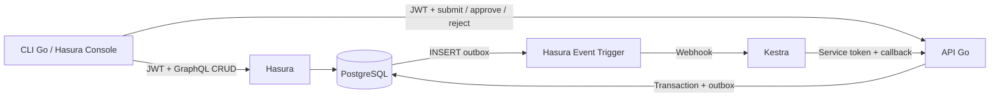

# Học Hasura và Kestra với Go

Bộ ba bài thực hành chạy dịch vụ thật để học các thành phần trong [sơ đồ DX-OS](../DX-OS_So-do-He-thong.md). Bắt đầu với Hasura CRUD, thử workflow Kestra độc lập, rồi nối hai công cụ bằng API Go.

## Chạy lần đầu

Cần Docker Engine + Docker Compose v2 trở lên, GNU Make và kết nối Internet để tải image/module. Không cần cài Go. Stack có Kestra JVM, nên dành khoảng 4 GB RAM cho Docker để khởi động thuận lợi; đây là mức dự phòng, xem `docker stats` để đo máy của bạn.

```sh
cd demo
cp .env.example .env
make up
make bootstrap
make smoke
```

`make up` build Go và khởi động dịch vụ. `bootstrap` đợi dịch vụ sẵn sàng tối đa 180 giây, nạp hai flow Kestra rồi nạp metadata Hasura. Chạy `make bootstrap` nhiều lần giữ nguyên dữ liệu; flow được cập nhật bằng cùng namespace/ID. Image được ghim trong [compose.yaml](compose.yaml), Go runtime build theo [Dockerfile](Dockerfile).

| Thành phần | Địa chỉ mặc định | Cách truy cập |
|---|---|---|
| Hasura Console | http://localhost:8080 | Admin secret trong `.env`, chỉ để cấu hình |
| Kestra UI | http://localhost:8082 | Đăng nhập bằng `KESTRA_USER` / `KESTRA_PASSWORD` trong `.env` |
| API Go | http://localhost:8090/healthz | Healthcheck; lệnh nghiệp vụ cần JWT |
| PostgreSQL | Trong mạng Compose | Không công bố cổng host |

Đổi `HASURA_PORT`, `KESTRA_PORT`, `API_PORT` trong `.env` nếu cổng đã được dùng, rồi chạy lại `make up`. Địa chỉ nội bộ giữa container dùng tên service và cổng container, không dùng `localhost`.

## Thứ tự học

1. [Hasura: CRUD, quyền và subscription](lessons/01-hasura.md).
2. [Kestra: HTTP task và retry](lessons/02-kestra.md).
3. [Tích hợp: gửi duyệt, sự kiện và chống trùng](lessons/03-integration.md).

Mỗi bài có lệnh CLI và cách quan sát trong UI. Đọc file Go song song với việc chạy lệnh; CLI nằm ở `cmd/demo`, HTTP server ở `internal/server`, giao dịch ở `internal/store`.

## Mô hình nhỏ dùng trong bài học



`core.work_items` giữ công việc chung, `procurement.requests` giữ hồ sơ mua sắm. `submit` chuyển DRAFT → PENDING_APPROVAL và tạo outbox cùng giao dịch. Kestra gọi Go để tạo `approval_inbox`; người quản lý mới quyết định APPROVED/REJECTED. Hasura không cho người dùng ghi trực tiếp status/version. Khi sửa bản nháp, trigger DB tăng version; khi đổi trạng thái, API tăng version.

Danh tính mẫu: `alice` (nhân viên ws-a), `bob` (nhân viên ws-b), `manager-a`, `manager-b`. CLI ký JWT local bằng HS256; Hasura và Go cùng kiểm tra. Lệnh `token` chỉ là công cụ học trên máy, không phải dịch vụ đăng nhập. Bất kỳ ai có khóa ký local đều tạo được danh tính demo; triển khai thật thay bằng nhà cung cấp OIDC như Keycloak.

Role Hasura là quyền ở API GraphQL, không tự trở thành PostgreSQL role. [SQL khởi tạo](db/001-init.sql) tạo tài khoản DB riêng cho API, Hasura, metadata và Kestra. [SQL quyền trigger](hasura/event-trigger-security.sql) chạy sau metadata để API được INSERT đúng các cột cần cho event log của trigger. API không được đọc/sửa/xóa catalog hay quản trị metadata. Quyền DB của Hasura đủ để engine thực hiện các thao tác được cấu hình; việc lọc người dùng theo workspace diễn ra ở metadata. Không tuyên bố demo có DB RLS cho từng người dùng. Request học quyền không gửi admin secret vì secret này bỏ qua quyền Hasura.

Credential trong `.env.example` và password SQL đều là giá trị công khai cho môi trường học local. Webhook key bảo vệ URL nhận sự kiện; service token bảo vệ callback Go; JWT xác định người dùng. Chúng có mục đích khác nhau. Entrypoint Kestra tự base64-encode giá trị `.env` thành biến `SECRET_*` để `secret()` đọc; base64 là định dạng truyền, không phải mã hóa bảo mật; khi đổi secret, chạy lại `make up` và `make bootstrap`.

## Kiểm thử và dừng

```sh
make test       # Go unit tests và integration tests với PostgreSQL thật
make smoke      # Hasura → Kestra → Go → người duyệt; kiểm tra quyền và replay
make down       # dừng, giữ volume
make reset      # hỏi gõ DELETE trước khi xóa volume dữ liệu demo
```

Smoke tạo hồ sơ mới mỗi lần chạy; dữ liệu cũ được giữ để xem trong UI. Test DB cũng tạo hồ sơ riêng. Không chạy kiểm thử với database thật của bạn. Nếu sửa SQL init khi volume đã tồn tại, entrypoint sẽ không tự chạy lại SQL; chỉ reset khi muốn bỏ toàn bộ dữ liệu học.

Nếu có Go 1.26+, chạy kiểm tra nhanh trên host:

```sh
go test ./...
go vet ./...
go build -buildvcs=false ./...
```

Test store sẽ ghi SKIP nếu không đặt `TEST_DATABASE_URL`. `make test` tự cung cấp DB và chạy đầy đủ. DB không mở cổng ra host; dùng container test là cách đơn giản. Có thể debug API trong container test bằng `go run ./cmd/api` với các env tương ứng, hoặc tự cấu hình DB/URL khi chạy Go trên host. File `.env` được Compose đọc, Go trên host không tự đọc file đó.

## Tìm lỗi

```sh
docker compose ps -a
docker compose logs --tail=60 postgres hasura kestra api
docker stats --no-stream
```

- Bootstrap lỗi kết nối: xem service nào dừng; Hasura và Kestra cần DB sẵn sàng. Khởi động lần đầu có thể chậm vì tải image/JVM.
- GraphQL báo `field not found`: xem role hiện tại, table tracking và column permissions. CLI coi `errors` trong HTTP 200 là thất bại.
- Không có hộp duyệt: Hasura Console → Events → `request_submitted` → delivery logs; tiếp đó xem Kestra Executions → task `create_inbox`, rồi API logs.
- Đã có execution nhưng task FAILED: sửa nguyên nhân rồi replay theo bài 3. Webhook được nhận không đồng nghĩa nghiệp vụ đã hoàn tất.
- Thay file Go: chạy `make up` để build lại. Thay YAML/metadata: chạy `make bootstrap`. Bootstrap lấy file trong repo làm nguồn chuẩn và ghi đè chỉnh sửa metadata/flow bằng UI của demo.

## Giới hạn và tài liệu

Demo tập trung một nghiệp vụ mua sắm: chưa có UI riêng, Kubernetes, Operator, SSO thật, AI, audit hash-chain hay bộ phục hồi execution tự động. Không sửa các tài liệu kiến trúc gốc. Luồng theo sơ đồ cải tiến, không theo bảng đa hình `shared.tasks` của kế hoạch cũ.

Nguồn chính thức: [Hasura JWT](https://hasura.io/docs/2.0/auth/authentication/jwt/), [Hasura permissions](https://hasura.io/docs/2.0/auth/authorization/permissions/), [Event Triggers](https://hasura.io/docs/2.0/event-triggers/create-trigger/), [Kestra webhook](https://kestra.io/docs/workflow-components/triggers/webhook-trigger), [HTTP Request](https://kestra.io/plugins/core/http/io.kestra.plugin.core.http.request), [retry](https://kestra.io/docs/workflow-components/retries).
