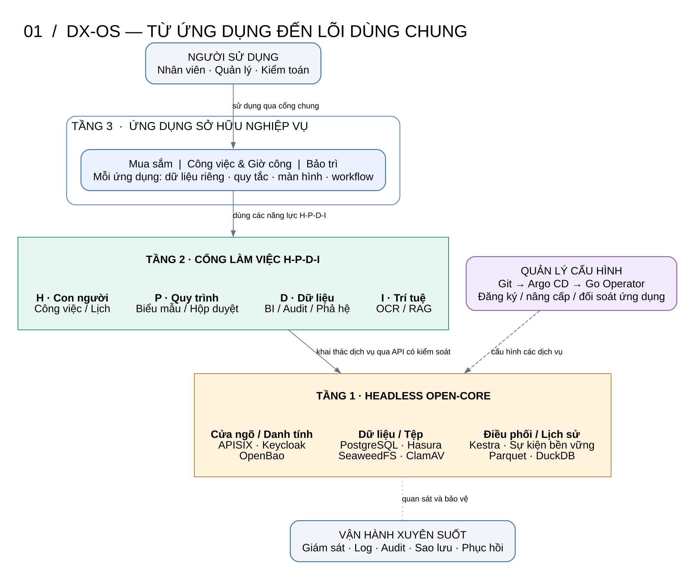
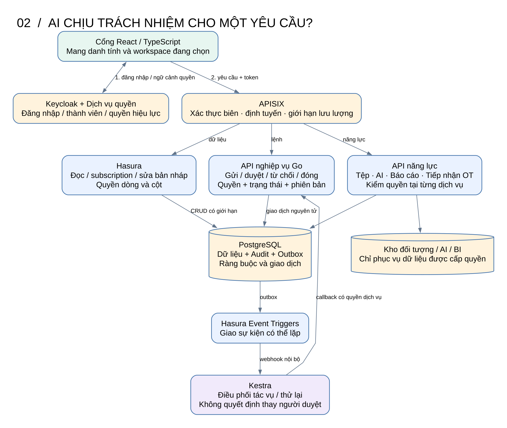
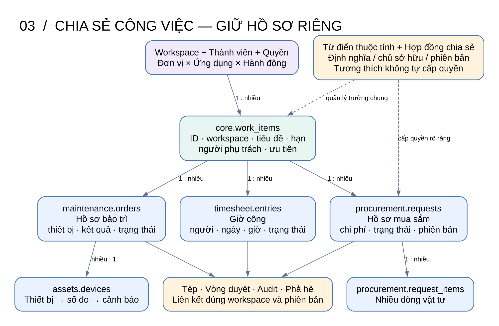
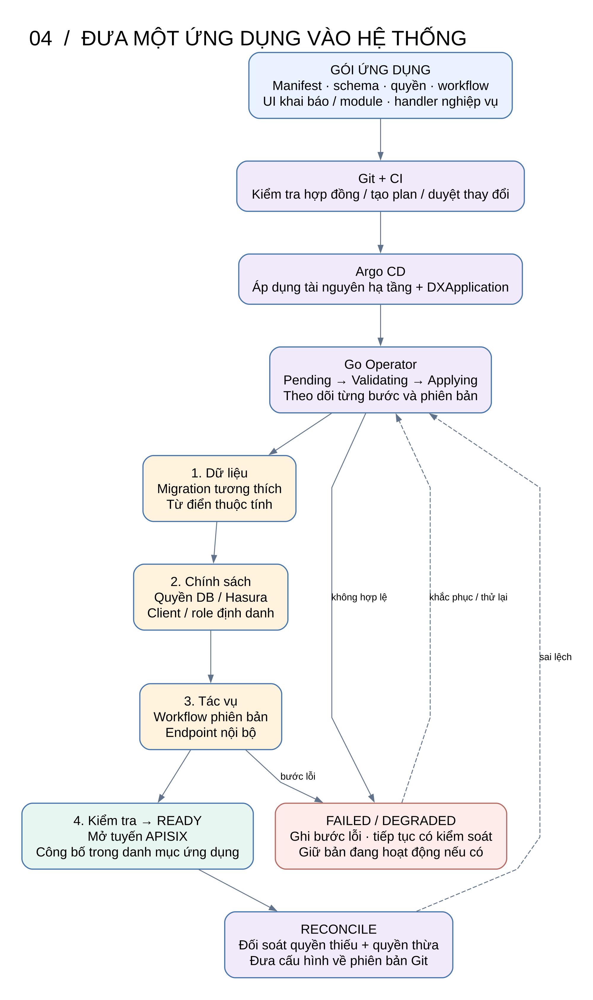
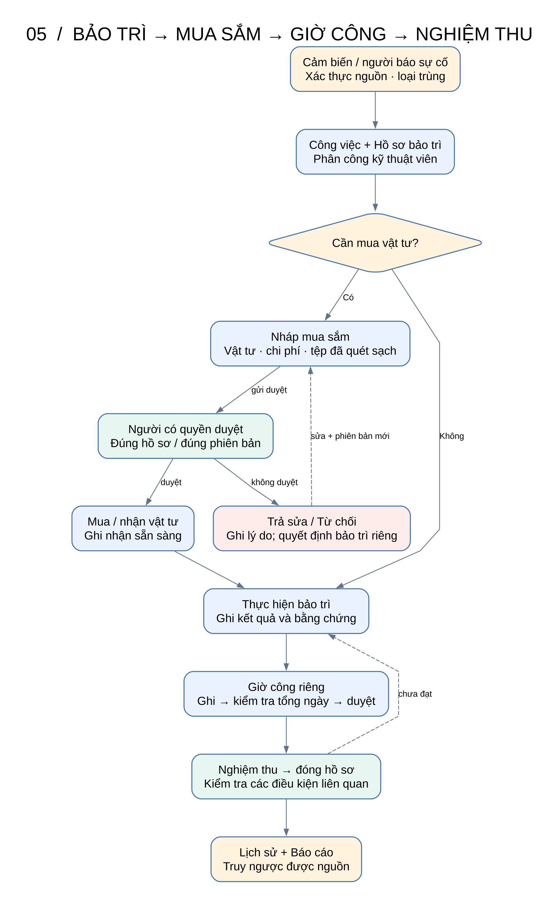
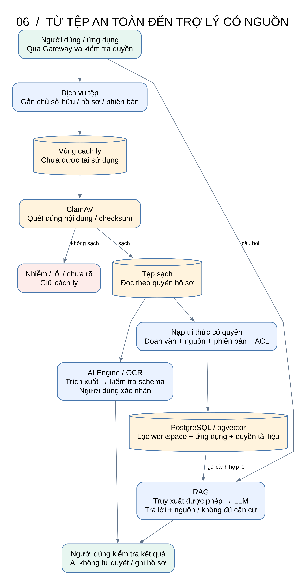
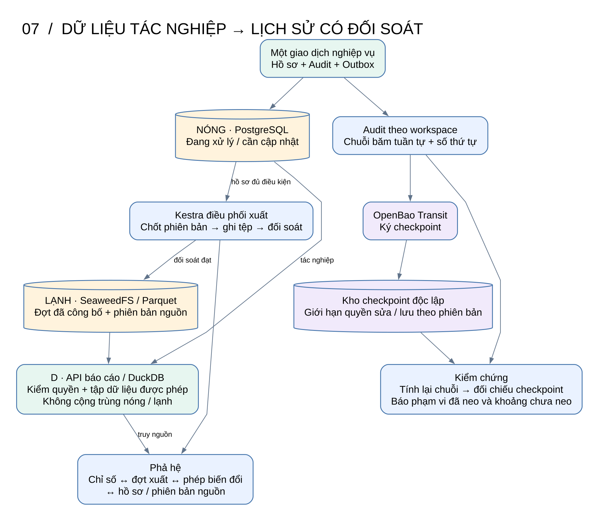
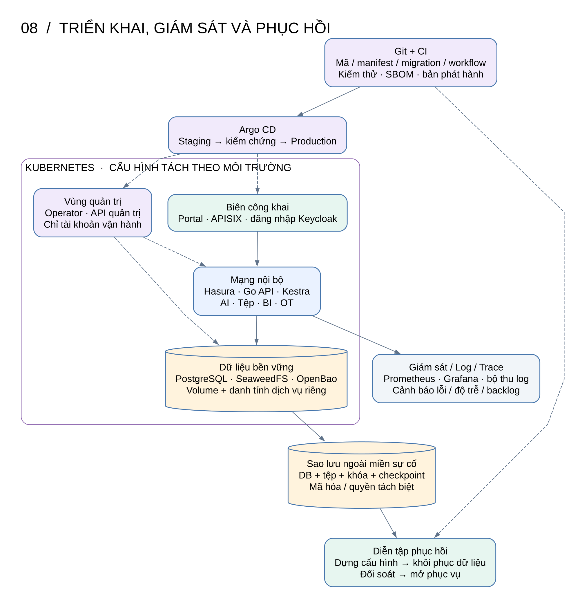

# DX-OS Open-Core — Thiết kế hệ thống đầy đủ, hướng trực quan

**Phiên bản:** 2.0 — bản thiết kế để duyệt, ngày 2026-11-04.  
**Quyết định của người dùng:** Giữ toàn bộ phạm vi giải pháp ban đầu; chọn hướng 2: giữ năng lực, tổ chức lại cấu trúc bên trong. Ưu tiên tài liệu và ảnh sơ đồ.  
**Căn cứ:** [Đề tài](../../../DX-OS_Open-Core_OLP_2026.md), [kế hoạch ban đầu](../../../implementation_plan.md), [tổng quan ban đầu](../../../architecture_overview.md), [phân tích và giải pháp](../../../DX-OS_Phan-tich-va-Giai-phap.md). Không dùng hiện trạng trong thư mục thực hành làm căn cứ thu hẹp thiết kế.

## 1. Đọc hệ thống từ bức tranh tổng thể

**DX-OS là nền tảng để nhiều ứng dụng nghiệp vụ cùng hoạt động trên một lõi dịch vụ, một hệ thống định danh và những thực thể dùng chung có kiểm soát.** Khi thêm ứng dụng, đội phát triển khai báo nhu cầu và bổ sung phần nghiệp vụ riêng; nền tảng cấu hình các dịch vụ dùng chung cho ứng dụng đó.



[Phóng lớn SVG](../../../DX-OS_V2_01-Tong-the.svg) · [Nguồn sơ đồ](../../../DX-OS_V2_01-Tong-the.dot)

**Cách đọc toàn bộ bộ ảnh:** xanh dương là ứng dụng và xử lý; xanh lá là trải nghiệm/năng lực người dùng; vàng là dịch vụ lõi và kho dữ liệu; tím là quản trị cấu hình hoặc bảo vệ khóa; đỏ là nhánh lỗi. Nét liền là yêu cầu, dữ liệu hoặc quan hệ được ghi trên mũi tên; nét đứt là cấu hình hoặc nhánh thử lại. Hình 1 mô tả quan hệ sử dụng năng lực, không phải toàn bộ đường gọi mạng. Hình 2 mới mô tả luồng xử lý yêu cầu.

| Tầng | Trả lời câu hỏi | Thành phần |
|---|---|---|
| **3. Ứng dụng nghiệp vụ** | Tổ chức đang giải quyết công việc gì? | Mua sắm & Đơn hàng; Công việc & Giờ công; Bảo trì thiết bị |
| **2. Năng lực H-P-D-I** | Người dùng làm việc và ra quyết định như thế nào? | Cổng chung, Kanban/lịch, biểu mẫu, hộp duyệt, BI, kiểm toán, OCR/RAG |
| **1. Lõi headless** | Những dịch vụ nào được dùng lại? | SSO, Gateway, dữ liệu, tệp, workflow, sự kiện, bí mật, lịch sử |
| **Quản lý cấu hình** | Làm sao đưa ứng dụng vào vận hành? | Git, CI, Argo CD, DXApplication, Go Operator |
| **Vận hành xuyên suốt** | Làm sao biết hệ thống khỏe và phục hồi được? | Log, metric, trace, audit, sao lưu và diễn tập khôi phục |

H-P-D-I lần lượt là **Human — Con người, Process — Quy trình, Data — Dữ liệu, Intelligence — Trí tuệ**. Ba tầng là ranh giới trách nhiệm, không buộc mỗi ô trong hình trở thành một tiến trình riêng.

## 2. Phạm vi giữ nguyên và lựa chọn thiết kế

### 2.1. Toàn bộ năng lực thuộc phạm vi

- Lõi headless và API dùng chung; Identity/SSO/MFA; Gateway và Zero-Trust.
- Nhiều workspace, nhiều ứng dụng; phân quyền tới dòng, trường và hành động.
- Dữ liệu chung, từ điển thuộc tính, khả năng mở rộng và chia sẻ trường có kiểm soát.
- Ứng dụng đóng gói bằng manifest; Go Operator hỗ trợ `plan`, `apply`, `promote`, `reconcile`, `uninstall`.
- GitOps với staging/production, phát hiện sai lệch và phục hồi cấu hình.
- Cổng React/TypeScript đầy đủ H-P-D-I, chạy song song mua sắm và giờ công; cắm thêm bảo trì.
- Workflow Kestra; phê duyệt của con người; kiểm tra lỗi đầu vào và quy tắc tổng hợp.
- Quản lý tệp có kiểm dịch; AI Engine Python/FastAPI với OCR và RAG có nguồn.
- Audit theo chuỗi băm, checkpoint ký bằng OpenBao, phả hệ dữ liệu.
- Phân tách dữ liệu tác nghiệp/lịch sử bằng PostgreSQL và SeaweedFS–Parquet–DuckDB.
- Kết nối IT/OT, giám sát, sao lưu, khôi phục và đóng gói phát hành nguồn mở.

AI và Operator là thành phần của bản thiết kế đầy đủ. Thứ tự triển khai có thể chia chặng nhưng không loại các thành phần này khỏi đích đến.

### 2.2. Các hướng đã cân nhắc

| Hướng | Lợi ích | Đánh đổi | Kết quả |
|---|---|---|---|
| Giữ bảng đa hình và cơ chế ban đầu | Ít thay đổi khái niệm, nổi bật mở rộng cột | Khó biểu diễn nhiều dòng hàng, nhiều giờ công và trạng thái độc lập | Không chọn |
| **Giữ toàn bộ năng lực, tách cấu trúc chung/riêng** | Tái sử dụng lõi, giữ đúng quan hệ nghiệp vụ, kiểm soát quyền và giao dịch rõ | Cần hợp đồng dữ liệu, API lệnh và cơ chế điều phối nhất quán | **Người dùng đã chọn** |

### 2.3. Các quyết định cụ thể do bản thiết kế đề xuất

| Chủ đề | Quyết định | Lý do |
|---|---|---|
| Auto-API | Hasura GraphQL Engine v2; không chạy song song PostgREST | Thống nhất hướng của kế hoạch ban đầu, giữ subscription và Event Triggers |
| Giao diện | React + TypeScript; Vite và Tailwind | Giữ lựa chọn của kế hoạch ban đầu; không chuyển sang Vue/Nuxt |
| Lõi dữ liệu | PostgreSQL, schema `core` và schema từng ứng dụng | Công việc chung không gánh toàn bộ dữ liệu nghiệp vụ |
| API lệnh | Go; module nghiệp vụ nằm trong gói ứng dụng | Kiểm quyền, phiên bản và điều kiện trước khi ghi trạng thái |
| Workflow | Kestra điều phối tác vụ; hộp duyệt và quyết định nằm trong DB/API | Tránh trạng thái chỉ tồn tại trong engine hoặc engine duyệt thay người |
| Kho tệp | SeaweedFS + ClamAV | Chọn một kho đối tượng thống nhất với tổng quan ban đầu |
| Lịch sử và BI | Parquet + DuckDB qua dịch vụ báo cáo | Phân tích tách khỏi xử lý giao dịch |
| AI | FastAPI; OCR adapter; pgvector; Ollama mặc định | Giữ năng lực AI nội bộ; provider ngoài chỉ bật theo cấu hình được cho phép |
| Bí mật và kiểm chứng | OpenBao; kho checkpoint có quyền độc lập | Tách quyền sửa hồ sơ khỏi quyền ký và lưu dấu kiểm chứng |
| Điều phối cấu hình | Kubernetes + Argo CD + Go Operator | Có nguồn cấu hình chuẩn và đối soát liên tục |

Các lựa chọn trên là đề xuất kỹ thuật của người biên soạn để người dùng duyệt cùng tài liệu, không phải những lựa chọn người dùng đã xác nhận riêng lẻ. Patch version và ma trận tương thích sẽ được ghim khi lập kế hoạch, không suy từ các con số phiên bản cũ.

### 2.4. Giới hạn rõ ràng

“Giữ toàn bộ thiết kế ban đầu” là giữ năng lực của giải pháp trong ba tài liệu nguồn, không biến mọi sản phẩm ví dụ của đề thi thành một dịch vụ bắt buộc phải cài. Các ngành CRM, LMS, EMR, BIM, SCADA có thể bổ sung bằng hợp đồng ứng dụng; bản thiết kế này xác định ba ứng dụng cụ thể nêu trên.

Không coi “không cần JOIN”, “truy vấn O(1)”, “30 giây”, “giảm 80%”, “<20 MB” hoặc “đạt điểm tuyệt đối” là thuộc tính đã được chứng minh. Mục tiêu thực chất là tái sử dụng, tính đúng đắn, mở rộng có kiểm soát và có phép đo.

## 3. Trách nhiệm của từng thành phần



[Phóng lớn SVG](../../../DX-OS_V2_02-Xu-ly-Yeu-cau.svg) · [Nguồn sơ đồ](../../../DX-OS_V2_02-Xu-ly-Yeu-cau.dot)

| Thành phần | Sở hữu và xử lý | Giới hạn trách nhiệm |
|---|---|---|
| Workspace Portal | Đăng nhập, chọn đơn vị/ứng dụng, màn hình H-P-D-I và thông báo | Ẩn nút không thay thế kiểm quyền backend |
| Keycloak | Danh tính, phiên SSO, MFA và định danh dịch vụ | Không tự suy ra thẩm quyền duyệt hồ sơ |
| Dịch vụ quyền/ngữ cảnh | Thành viên workspace, quyền ứng dụng/hành động, phát ngữ cảnh truy cập ngắn hạn | Không tin workspace do client khai báo mà chưa đối chiếu |
| APISIX | Cửa ngõ HTTPS/WSS, xác thực biên, định tuyến, rate limit và lọc header | Không thay quyền dữ liệu trong từng dịch vụ |
| Hasura | Query, subscription và mutation bản nháp trong quyền dòng/cột | Không cho sửa trạng thái, người tạo hoặc phiên bản tùy ý |
| API nghiệp vụ Go | Các lệnh, chuyển trạng thái, quy tắc tổng hợp, audit/outbox | Lõi không hardcode nghiệp vụ mua sắm hoặc giờ công |
| Kestra | Chạy bước tự động, retry, gọi dịch vụ, nhắc việc, xuất lịch sử | Kết quả execution không là nguồn duy nhất của trạng thái nghiệp vụ |
| Dịch vụ tệp | Upload, cách ly, quét, công bố và tải theo quyền | Bucket không mở cho trình duyệt đọc trực tiếp tùy ý |
| AI Engine | OCR, trích xuất theo schema, truy xuất tri thức và trả lời có nguồn | Không tự cấp quyền, tự duyệt hoặc tự ghi hồ sơ đã chốt |
| Dịch vụ báo cáo | Định nghĩa chỉ số, tập dữ liệu được phép, truy vấn và lineage | Không nhận đường dẫn kho hoặc SQL tùy ý từ người dùng |
| Dịch vụ OT | Danh tính thiết bị, số đo, trạng thái và cảnh báo | Không tạo công việc cho mọi số đo |
| Operator | Biến khai báo thành cấu hình, kiểm tra và sửa sai lệch | Không nằm trên đường bắt buộc của từng giao dịch |

**Nguồn sự thật:** PostgreSQL giữ hồ sơ và quyết định; Git giữ cấu hình mong muốn; kho đối tượng giữ nội dung tệp theo phiên bản; catalog xuất dữ liệu quyết định đợt lịch sử nào được công bố. Trạng thái Kestra và trạng thái Operator là hai loại trạng thái vận hành riêng.

## 4. Dữ liệu chung, dữ liệu riêng và cách chia sẻ



[Phóng lớn SVG](../../../DX-OS_V2_03-Du-lieu-va-Quyen.svg) · [Nguồn sơ đồ](../../../DX-OS_V2_03-Du-lieu-va-Quyen.dot)

### 4.1. Mô hình thực thể

| Nhóm | Thực thể | Quy tắc sở hữu |
|---|---|---|
| Tổ chức/quyền | `core.workspaces`, memberships, app grants, policy versions | Quản trị được ủy quyền quản lý; người dùng không tự cấp quyền |
| Danh mục ứng dụng | app registry, revisions, application instances | Một ứng dụng có thể bật tại nhiều workspace |
| Dữ liệu chung | `core.work_items`, shared attributes | Chủ sở hữu công việc quản lý các trường được phép sửa |
| Mua sắm | requests, request items, orders, receipts | Ứng dụng mua sắm quản lý vòng duyệt và thực hiện đơn hàng |
| Giờ công | entries, review rounds | Mỗi người/ngày/công việc có thể có nhiều bản ghi; kiểm tra tổng |
| Bảo trì | orders, inspections, device links | Ứng dụng bảo trì quản lý đánh giá, thực hiện và nghiệm thu |
| Thiết bị | devices, observations, alerts | Thiết bị thuộc workspace; nguồn dữ liệu có danh tính |
| Dịch vụ chung | files, approval tasks, audit, outbox, processed events | Chỉ API có thẩm quyền được tạo tác động quan trọng |
| Dữ liệu lịch sử/AI | export batches, lineage edges, knowledge chunks | Giữ nguồn, phiên bản và quyền truy cập liên quan |

Mọi liên kết nghiệp vụ mang `workspace_id`; khóa ngoại hoặc cơ chế kiểm tra tương đương chặn việc liên kết hai hồ sơ ở hai workspace. Mô hình đầu tiên không hỗ trợ liên kết nghiệp vụ xuyên workspace; báo cáo liên đơn vị là phép tổng hợp những phạm vi người xem được cấp quyền.

Ví dụ: công việc `CV-001` có một hồ sơ bảo trì, hai yêu cầu mua vật tư và mười dòng giờ công. Ba ứng dụng nhìn cùng tiêu đề, hạn và người phụ trách, nhưng mỗi hồ sơ có trạng thái, phiên bản và quyết định riêng. Sửa trạng thái mua sắm không ghi đè trạng thái bảo trì.

### 4.2. Giữ từ điển thuộc tính và chức năng promote

Từ điển thuộc tính lưu mã thuộc tính, ý nghĩa, kiểu dữ liệu, đơn vị đo, chủ sở hữu, phạm vi `APP/SHARED`, vị trí lưu, phiên bản hợp đồng và quyền đọc/ghi. Cùng tên và cùng kiểu chưa đủ để kết luận hai thuộc tính có cùng ý nghĩa.

- Thuộc tính dùng chung thực sự nằm trên thực thể chung hoặc phần mở rộng của nó.
- Dòng hàng và giờ công là quan hệ một–nhiều, không chuyển thành hàng loạt cột của công việc.
- `promote` chuyển một thuộc tính thành hợp đồng chia sẻ sau khi chủ sở hữu phê chuẩn người được đọc/ghi.
- Nếu dữ liệu giữ nguyên vị trí và quan hệ, promote chỉ đổi hợp đồng/quyền. Nếu cần chuyển bảng, đổi kiểu hoặc đổi số lượng quan hệ, phải có migration và đối soát; không cam kết mọi promote đều “zero-migration”.

**Quyền sửa trường chung:** manifest khai báo rõ `read` và `write`; mặc định ứng dụng mới chỉ có phần quyền đã phê chuẩn. Trường chủ chốt như người phụ trách, hạn hoặc tên công việc dùng kiểm tra phiên bản để tránh ghi đè khi nhiều ứng dụng sửa đồng thời.

## 5. Định danh và phân quyền xuyên suốt

### 5.1. Ngữ cảnh truy cập thống nhất

Người dùng đăng nhập Keycloak bằng OIDC Authorization Code + PKCE. Portal gửi token và workspace muốn chọn tới dịch vụ ngữ cảnh; dịch vụ xác thực danh tính, tra quyền hiệu lực, rồi phát token ngắn hạn ràng buộc **người dùng, workspace, ứng dụng, vai trò và phiên bản chính sách**. Khóa ký đặt dưới cơ chế quản lý bí mật; public keys được công bố nội bộ để các dịch vụ kiểm chứng. Đây là phần tích hợp đội thi tự xây, không giả định Keycloak tự hiểu dữ liệu membership trong ứng dụng.

Hasura kiểm chữ ký token và dùng các claim đã xác thực để áp dụng metadata. Go API và các API tệp/AI/BI kiểm chữ ký, audience, thời hạn và quyền hiện hành cho hành động nhạy cảm. Gateway bỏ các header danh tính giả do client tự gửi. Client không có admin secret hoặc tài khoản DB.

Token truy cập workspace đề xuất sống tối đa 5 phút. Thu hồi quyền làm tăng policy version; lệnh nhạy cảm kiểm phiên bản hiện hành ngay. Query/subscription có thể còn quyền tới lúc token hết hạn; subscription phải tái xác thực/đóng ở mốc đó. Đây là giới hạn thiết kế cần được kiểm chứng bằng bản Hasura được ghim, không tuyên bố thu hồi tức thì mọi kết nối.

Keycloak cung cấp giao thức và các endpoint OIDC; APISIX có plugin tích hợp OpenID Connect. Phần ánh xạ workspace và quyền nghiệp vụ là thiết kế bổ sung của DX-OS. Nguồn: [Keycloak OIDC](https://www.keycloak.org/securing-apps/oidc-layers), [APISIX OIDC](https://apisix.apache.org/docs/apisix/plugins/openid-connect/).

### 5.2. Nơi thực thi từng lớp quyền

| Đường truy cập | Kiểm soát bắt buộc |
|---|---|
| Hasura query/mutation/subscription | Workspace, role theo ứng dụng, filter dòng, danh sách cột, preset người tạo; kiểm quyền sở hữu bản nháp |
| API lệnh | Quyền hành động, hồ sơ cùng workspace, trạng thái, phiên bản và phân tách người tạo/người duyệt |
| Dịch vụ truy cập DB trực tiếp | DB role riêng; GRANT tối thiểu; đặt workspace theo giao dịch; RLS cho bảng nghiệp vụ; không dùng superuser/BYPASSRLS |
| Tệp | Quyền trên hồ sơ, trạng thái sạch và đúng phiên bản nội dung |
| AI | Giao của quyền người gọi, workspace, ứng dụng và ACL của tài liệu |
| Báo cáo | Tập workspace và trường được đọc; filter trước khi tổng hợp; quyền xuất báo cáo riêng |
| Callback workflow | Danh tính dịch vụ, loại hành động được phép, đối chiếu sự kiện gốc; không dùng danh tính giả của người duyệt |
| Operator/migration | Credential quản trị riêng, giới hạn miền quản lý và ghi audit thay đổi |

Role Hasura không tự trở thành PostgreSQL role. Với Hasura, metadata là lớp phân quyền người dùng; DB role của Hasura chỉ có quyền cần cho các bảng đã khai báo. Không giả định RLS tự nhận claim của người dùng qua mọi truy vấn Hasura. Với Go/worker trực tiếp, RLS và `SET LOCAL` theo giao dịch được triển khai riêng; connection pool phải xóa ngữ cảnh sau giao dịch. Hai đường phải có kiểm thử quyền tương đương.

Trên bảng bật RLS, policy dành riêng cho DB role Hasura cho phép engine truy cập tập dữ liệu cần phục vụ, còn metadata lọc workspace/người dùng. Policy cho Go/worker trực tiếp buộc khớp ngữ cảnh giao dịch. Không dùng một policy thiếu ngữ cảnh cho cả hai đường; quyền kết nối Hasura là miền tin cậy riêng, được cô lập mạng và không cấp cho ứng dụng khác.

Hasura hỗ trợ quy tắc quyền theo role, bảng, thao tác, dòng và cột; chính sách DX-OS phải được biên dịch thành metadata tương ứng. Nguồn: [Hasura permissions](https://hasura.io/docs/2.0/auth/authorization/permissions/).

## 6. Đăng ký và vận hành ứng dụng cắm-rút



[Phóng lớn SVG](../../../DX-OS_V2_04-Dang-ky-Ung-dung.svg) · [Nguồn sơ đồ](../../../DX-OS_V2_04-Dang-ky-Ung-dung.dot)

### 6.1. Một gói ứng dụng chứa gì?

| Phần khai báo | Ý nghĩa |
|---|---|
| Identity/version | Mã ứng dụng, phiên bản, phiên bản hợp đồng nền tảng, phụ thuộc |
| Entities/attributes | Thực thể sở hữu, trường chung sử dụng, schema và migration |
| Permissions | Vai trò ứng dụng; hành động; quyền trường; quyền chia sẻ được phê chuẩn |
| Commands | Lệnh nghiệp vụ và handler module/service xử lý |
| Workflows | Flow phiên bản, sự kiện kích hoạt, callback và chính sách retry |
| UI | Biểu mẫu, danh sách, bộ lọc, trang chi tiết, hành động; module riêng nếu cần |
| Knowledge | Nguồn tri thức, namespace, quyền truy cập và schema OCR |
| Routes/health | Tuyến API và điều kiện sẵn sàng |
| Lifecycle | Cách nâng cấp, vô hiệu hóa, xử lý hồ sơ đang mở và giữ lịch sử |

**Manifest không tự sinh mọi nghiệp vụ.** Những ứng dụng dùng bộ biểu mẫu và lệnh chuẩn có thể được công bố mà không build lại Portal. UI đặc thù hoặc quy tắc mới cần module đã đóng gói, kiểm thử và phát hành. Không tải mã JavaScript tùy ý từ manifest của người dùng cuối.

Lõi cung cấp interface và dịch vụ dùng chung; code handler mua sắm, giờ công, bảo trì nằm dưới `apps/`. Có thể đóng gói các handler trong một Go service ở giai đoạn đầu; biên module vẫn giữ rõ để tách tiến trình sau này.

### 6.2. Vòng đời cấu hình và quyền sở hữu

1. CI kiểm schema manifest, xung đột ý nghĩa/kiểu, quyền chia sẻ, migration và dependency; tạo bản plan.
2. Sau phê chuẩn thay đổi Git, Argo CD đồng bộ hạ tầng, binary đã build và `DXApplication`.
3. Operator giữ khóa theo ứng dụng và khóa cho thay đổi thực thể chung, áp dụng các bước theo thứ tự.
4. Operator ghi kết quả từng bước, hash manifest, generation và revision đang hoạt động.
5. Chỉ đánh dấu `Ready` và công bố ứng dụng khi kiểm tra quyền, API, flow và tuyến đạt yêu cầu.
6. Reconcile so sánh cấu hình thực tế với revision được duyệt, sửa cả quyền thiếu lẫn quyền thừa trong miền tài nguyên do Operator sở hữu.

| Chủ thể | Được quản lý |
|---|---|
| Argo CD | Deployment, Service, NetworkPolicy, cấu hình hạ tầng, CRD và DXApplication |
| Operator | Schema ứng dụng, hợp đồng thuộc tính, metadata Hasura, client/role ứng dụng, flow và route ứng dụng |
| Quản trị tổ chức | Thành viên và quyền được ủy quyền qua API quản trị có audit |

Argo CD không ghi đè route/metadata do Operator sinh. Operator không xóa quyền vận hành hoặc quyền của ứng dụng khác. Metadata dùng chung được cập nhật có khóa và kiểm tra revision, tránh hai reconcile ghi đè nhau.

### 6.3. Nâng cấp, lỗi và gỡ ứng dụng

- Các bước áp dụng phải lũy đẳng. Lỗi giữa chừng giữ checkpoint để tiếp tục, không coi toàn bộ dịch vụ là một giao dịch phân tán.
- Migration mặc định là bổ sung tương thích. Đổi kiểu hoặc xóa dữ liệu yêu cầu kế hoạch chuyển đổi riêng, bản sao lưu và phê chuẩn rõ.
- Khi nâng cấp, giữ revision hoạt động cũ tới lúc revision mới đạt kiểm tra. Chỉ chuyển tuyến khi schema và handler tương thích; nếu không, cần cửa sổ bảo trì được khai báo.
- Workflow đang chạy giữ phiên bản đã bắt đầu; phiên bản mới phục vụ hồ sơ/vòng duyệt mới. Không sửa ngầm định nghĩa flow mà hồ sơ cũ đang phụ thuộc.
- `uninstall` trước hết ngừng tạo mới, xử lý hoặc chuyển giao hồ sơ đang mở, thu hồi quyền và tuyến. Giữ dữ liệu lịch sử, schema lưu trữ và quyền đọc lịch sử cần thiết; không tự drop dữ liệu.

`plan` là xem thay đổi; `apply` là áp dụng revision; `promote` là phê chuẩn hợp đồng chia sẻ; `reconcile` là sửa sai lệch; `uninstall` là ngừng sử dụng có kiểm soát. Trong môi trường GitOps, CLI tạo hoặc sử dụng thay đổi đã ghi nhận trong Git, không lập nguồn cấu hình thứ hai.

## 7. Quy trình nghiệp vụ và workflow chịu lỗi



[Phóng lớn SVG](../../../DX-OS_V2_05-Nghiep-vu.svg) · [Nguồn sơ đồ](../../../DX-OS_V2_05-Nghiep-vu.dot)

### 7.1. Ba ứng dụng chạy trên cùng nền tảng

| Ứng dụng | Vòng đời và chức năng |
|---|---|
| Mua sắm & Đơn hàng | Nháp → gửi duyệt → duyệt/trả sửa/từ chối; yêu cầu đã duyệt có thể sinh đơn hàng, ghi nhận nhận hàng từng phần/đầy đủ và đóng. Tách quyết định duyệt khỏi trạng thái thực hiện đơn |
| Công việc & Giờ công | Phân công, Kanban/lịch; ghi giờ theo người/ngày/công việc; kiểm tra tổng; gửi và duyệt giờ công riêng |
| Bảo trì | Cảnh báo/khởi tạo thủ công → phân công → đánh giá → chờ vật tư nếu cần → thực hiện → nghiệm thu → đóng |

Thanh toán, kế toán kho toàn diện và kết nối nhà cung cấp là tích hợp tiếp theo, không được suy ra từ nhãn “đơn hàng”. Đơn hàng trong thiết kế này quản lý danh sách vật tư, số lượng đặt/nhận, trạng thái và chứng từ liên quan.

### 7.2. Điều kiện nghiệp vụ mặc định của bản thiết kế

- Mỗi vòng duyệt dùng một người có thẩm quyền tại workspace; cấu trúc approval rounds/steps cho phép bổ sung nhiều cấp. Người tạo không tự duyệt.
- Nội dung nháp được sửa trong quyền. Gửi duyệt khóa các trường thuộc bản chụp; trả sửa tạo phiên bản mới, lưu vòng duyệt cũ.
- Giá trị tiền và số lượng phải hợp lệ; số giờ dương, tổng giờ đang chờ/đã duyệt theo người/ngày không vượt 24. Nháp chưa đưa vào tổng; gửi hai nháp đồng thời phải kiểm tra tổng trong giao dịch có khóa.
- Không cộng tiền khác loại tiền tệ. Đơn vị tiền tệ là trường bắt buộc; báo cáo tổng hợp tách theo loại tiền nếu chưa có quy tắc quy đổi.
- Bảo trì chỉ đóng khi nghiệm thu đạt, nhánh mua vật tư đã giải quyết và các bản giờ công bắt buộc đã được duyệt. Hủy một nhánh phải có lý do và quyết định riêng.
- Không có SLA hoặc hạn mức tiền cố định áp dụng cho mọi tổ chức; các giá trị đó là chính sách được cấu hình và gắn phiên bản với vòng duyệt.

Đây là mặc định do người biên soạn đề xuất để triển khai có cơ sở; không phải quy chế của một tổ chức đã được cung cấp.

### 7.3. Một lệnh gửi duyệt diễn ra như thế nào?

1. Portal gọi `submit` với ID hồ sơ, phiên bản mong đợi và khóa chống lặp.
2. Go API kiểm người gọi, workspace, quyền sở hữu và quy tắc dữ liệu; khóa/kiểm phiên bản hồ sơ.
3. Trong một giao dịch, ghi trạng thái mới, audit và outbox. Chỉ báo thành công khi giao dịch hoàn tất.
4. Hasura Event Trigger giao sự kiện outbox tới webhook Kestra nội bộ.
5. Kestra gọi callback Go để tạo task hộp duyệt. Callback đối chiếu outbox gốc, deduplicate và kiểm phiên bản.
6. Người quản lý duyệt qua API lệnh. API ghi quyết định và sự kiện tiếp theo; Kestra chạy phần thông báo hoặc thực hiện tự động.

Hasura Event Triggers có cơ chế retry và cảnh báo về sự kiện trùng/sai thứ tự. DX-OS vì vậy thiết kế tác động lũy đẳng thay vì giả định mỗi sự kiện chỉ đến một lần. Nguồn: [Hasura Event Triggers](https://hasura.io/docs/2.0/event-triggers/create-trigger/).

### 7.4. Hợp đồng điều phối

Envelope sự kiện gồm `event_id`, `event_type`, `workspace_id`, `app_id`, `aggregate_id`, `aggregate_version`, `occurred_at`, `correlation_id`, `schema_version`, `workflow_revision`. Nội dung tối thiểu; worker đọc dữ liệu hiện hành qua API có quyền.

Khóa chống trùng theo sự kiện và loại tác động. Ghi nhận đã xử lý cùng giao dịch với tác động. Sự kiện cũ không làm thay đổi phiên bản mới. Nếu bước tạo tác động bên ngoài chưa biết đã thành công hay chưa, phải đối soát hoặc dùng khóa lũy đẳng của nhà cung cấp; không thử lại mù.

Một bộ đối soát định kỳ kiểm hồ sơ đang chờ, outbox, task nghiệp vụ và execution Kestra. Sự kiện đã được webhook nhận nhưng execution thất bại vẫn phải xuất hiện trong danh sách cần phục hồi. Người vận hành được replay sự kiện gốc có audit; replay không cấp quyền duyệt.

Kestra nhận webhook để kích hoạt flow; HTTP chấp nhận webhook không được diễn giải là toàn bộ quy trình thành công. Nguồn: [Kestra webhook](https://kestra.io/docs/workflow-components/triggers/webhook-trigger).

### 7.5. Workflow và BPMN

Bản giải pháp ban đầu dùng Kestra, nên thiết kế giữ workflow khai báo và hộp duyệt trong Portal. Không tuyên bố hỗ trợ thực thi BPMN 2.0. Nếu chọn bổ sung BPMN sau này, adapter engine phải dùng cùng hợp đồng command/event và quyền; cần một quyết định phạm vi riêng, không đổi nhãn YAML thành BPMN.

## 8. Tệp, OCR và RAG dùng chung



[Phóng lớn SVG](../../../DX-OS_V2_06-Tep-va-AI.svg) · [Nguồn sơ đồ](../../../DX-OS_V2_06-Tep-va-AI.dot)

### 8.1. Vòng đời tệp

Tệp đi qua `Quarantined → Scanning → Clean` hoặc `Blocked/ScanFailed`. Dịch vụ tệp kiểm quyền upload, loại tệp, dung lượng, liên kết hồ sơ và lưu checksum/version. Chỉ nội dung đúng phiên bản đã quét sạch được công bố; thay nội dung phải tạo phiên bản và quét lại. Chính sách quét dựa trên tích hợp ClamAV: [Scanning](https://docs.clamav.net/manual/Usage/Scanning.html).

Upload ghi vào khóa bất biến riêng; vùng cách ly chỉ scanner và dịch vụ tệp đọc được. Download trong bản đầu đi qua dịch vụ tệp có kiểm quyền mỗi lần, tránh liên kết trực tiếp sống quá lâu sau thu hồi quyền. Chứng từ của hồ sơ đã duyệt giữ tham chiếu tới phiên bản đã duyệt.

### 8.2. Hợp đồng AI thống nhất

| Năng lực | Đầu vào | Đầu ra |
|---|---|---|
| `/ai/extract` | `file_id`, `file_version`, mã schema đã đăng ký; ngữ cảnh xác thực | Trường trích xuất, nguồn trang/đoạn nếu có, kết quả kiểm schema, lỗi/độ tin cậy nếu adapter hỗ trợ |
| `/ai/ingest` | Tài liệu sạch, phiên bản, namespace được quyền ghi | Trạng thái nạp, nguồn và các đoạn tri thức mang ACL |
| `/ai/rag` | Câu hỏi, namespace yêu cầu trong quyền | Câu trả lời, citations, nguồn/phiên bản và trạng thái không đủ căn cứ |

Không nhận URL tùy ý để AI tải nội dung nội bộ. Schema OCR lấy từ registry ứng dụng; không thực thi code/rule tùy ý do người dùng gửi. Người dùng kiểm tra kết quả trước khi tạo hoặc sửa bản nháp.

RAG lọc quyền trước truy xuất và kiểm lại tài liệu trước khi trả kết quả. Thu hồi quyền hoặc thay tài liệu phải cập nhật khả năng truy xuất; cache gắn với người/phạm vi/policy version. Trích dẫn chỉ dẫn tới nguồn người gọi còn quyền đọc. Nội dung tài liệu được coi là dữ liệu, không phải chỉ thị cho agent vượt quyền.

Ollama là provider nội bộ mặc định. Adapter Gemini có thể giữ để tương thích thiết kế ban đầu nhưng mặc định tắt; workspace phải có cấu hình cho phép dữ liệu ra ngoài. Chế độ deterministic phục vụ kiểm thử hợp đồng và tái hiện lỗi, không được trình bày như chất lượng AI thực. OCR engine, embedding model và LLM cụ thể do người triển khai chọn theo tiếng Việt, giấy phép và tài nguyên, rồi ghi vào ma trận kiểm chứng.

## 9. IT/OT và trạng thái thiết bị

Dịch vụ tiếp nhận OT cung cấp hợp đồng quan sát gồm thiết bị, định danh bản tin, thời điểm đo, đơn vị đo và giá trị. Thiết bị được cấp credential riêng, chỉ ghi dữ liệu cho thiết bị/workspace tương ứng; không có quyền người dùng.

Hệ thống lưu số đo, cập nhật trạng thái mới nhất theo thời điểm hợp lệ và áp dụng chính sách cảnh báo. Bản tin đến muộn có thể được lưu lịch sử nhưng không ghi đè trạng thái mới hơn. Bản tin trùng không tạo tác động trùng.

Một đợt cảnh báo dùng khóa thiết bị + loại cảnh báo + mã đợt. Khi đợt còn mở, các bản tin tiếp theo liên kết vào đợt đó; khi đã đóng và lại đủ điều kiện, tạo đợt mới. Ngưỡng, khoảng trễ và điều kiện đóng đợt là cấu hình có phiên bản. Công việc bảo trì giữ liên kết về đợt cảnh báo và dữ liệu nguồn.

Bản thiết kế dùng dịch vụ ngữ cảnh thiết bị riêng; chưa khẳng định tương thích NGSI-LD. Nếu tích hợp broker hoặc chuẩn trao đổi ngữ cảnh sau này, adapter phải giữ danh tính, đơn vị đo và nguồn gốc dữ liệu.

## 10. Lịch sử, BI, audit và phả hệ



[Phóng lớn SVG](../../../DX-OS_V2_07-Lich-su-va-Audit.svg) · [Nguồn sơ đồ](../../../DX-OS_V2_07-Lich-su-va-Audit.dot)

### 10.1. Nóng, ấm và lạnh được hiểu thế nào?

- **Nóng:** PostgreSQL chứa hồ sơ đang xử lý, trạng thái thiết bị và dữ liệu cần phản hồi tác nghiệp.
- **Ấm:** mô hình báo cáo/tổng hợp phục vụ dashboard và truy vấn DuckDB; đây là lớp phục vụ dữ liệu, không buộc có một sản phẩm lưu trữ thứ ba.
- **Lạnh:** snapshot hồ sơ đã đóng, tệp và Parquet theo phiên bản trong SeaweedFS. Dữ liệu vẫn được truy vấn qua API có quyền.

### 10.2. Công bố dữ liệu theo đợt

Mỗi đợt xuất ghi snapshot/watermark nguồn, danh sách ID/phiên bản, phiên bản phép biến đổi, số dòng, tổng kiểm tra, checksum tệp và trạng thái. Writer ghi vào vị trí tạm của đợt; chỉ sau đối soát thành công mới cập nhật catalog `Published`. Reader chỉ đọc những tệp catalog công bố.

Khóa nhận diện nguồn là workspace + loại thực thể + ID + phiên bản. Xuất lại cùng snapshot không được thêm bản sao vào tập dữ liệu logic. Điều chỉnh hồ sơ đóng tạo phiên bản mới và đánh dấu quan hệ thay thế; báo cáo hiện hành chọn bản hợp lệ mới nhất, báo cáo lịch sử có thể chọn bản chụp tại một thời điểm.

Báo cáo kết hợp nóng/lạnh phải có quy tắc tập hợp loại trùng theo khóa nguồn; không `UNION ALL` mọi dữ liệu. DuckDB chỉ được dịch vụ báo cáo gọi với truy vấn mẫu và danh sách tệp đã kiểm quyền; không cung cấp console SQL cho người dùng nghiệp vụ. Phân quyền DB không tự đi theo tệp Parquet.

### 10.3. Audit có phạm vi kiểm chứng rõ

Audit ghi cùng giao dịch với thay đổi quan trọng. Trong mỗi workspace, cấp số thứ tự và tính chuỗi băm tuần tự dưới khóa; payload được chuẩn hóa để tính lại nhất quán. Role runtime không được sửa/xóa audit. Các hành động ở dịch vụ ngoài DB có bản ghi yêu cầu/kết quả liên kết qua correlation ID, không giả định một giao dịch DB bao phủ mọi dịch vụ.

Worker checkpoint lấy sequence cuối + hash + workspace + thời điểm + key version, yêu cầu OpenBao Transit ký rồi ghi vào kho checkpoint độc lập với quyền quản trị DB nghiệp vụ. OpenBao Transit hỗ trợ ký/kiểm chứng và không tự lưu nội dung được gửi vào; việc lưu checkpoint là trách nhiệm riêng của thiết kế. Nguồn: [OpenBao Transit](https://openbao.org/docs/secrets/transit/).

Kho checkpoint đề xuất là OpenBao KV theo phiên bản trong miền quản trị tách biệt; ứng dụng không có quyền xóa, worker không có quyền quản trị khóa hoặc kho. Bản sao lưu checkpoint được lưu ngoài miền sự cố. Quyền quản trị OpenBao vẫn là miền tin cậy: cơ chế này không chống được mọi bên quản trị cùng thông đồng.

Khi OpenBao tạm lỗi, giao dịch nghiệp vụ vẫn ghi audit tại DB; checkpoint nằm trong hàng chờ và dashboard báo “chưa neo”. Công cụ kiểm chứng đối chiếu toàn chuỗi tới checkpoint đã ký, đồng thời báo rõ đuôi chưa neo. Mốc ký đề xuất mỗi phút hoặc mỗi 100 sự kiện, tùy điều kiện nào đến trước; phải đo tải để điều chỉnh.

### 10.4. Phả hệ và chỉ số

Phả hệ lưu quan hệ báo cáo → đợt xuất → phép biến đổi → hồ sơ/phiên bản → chứng từ/quan sát nguồn. Dịch vụ đọc lineage kiểm quyền ở từng đầu liên kết; có thể báo nguồn bị hạn chế mà không lộ nội dung.

Các chỉ số đầu tiên: công việc quá hạn, thời gian vòng duyệt, tiền đề xuất/được duyệt theo loại tiền, giờ công được duyệt, thời gian xử lý bảo trì, lỗi workflow và độ trễ xuất lịch sử. Tiền được duyệt không được gọi là tiền đã thanh toán. Mỗi chỉ số có công thức, tập trạng thái được tính, múi giờ và thời điểm cập nhật.

## 11. Trải nghiệm người dùng H-P-D-I

Portal có bộ chọn workspace, danh mục ứng dụng theo quyền, tìm kiếm và thông báo. Bốn không gian dùng cùng ngữ cảnh danh tính; ứng dụng đóng góp màn hình vào khung chung.

| Không gian | Màn hình | Hành vi chính |
|---|---|---|
| H | Việc của tôi, Kanban, lịch, chi tiết công việc | Nhận việc, phân công, cập nhật tiến độ, xem hồ sơ liên quan |
| P | Biểu mẫu, hộp duyệt, lịch sử vòng duyệt | Xem đúng bản chụp, quyết định, trả sửa; hiển thị lỗi điều kiện rõ ràng |
| D | Dashboard, báo cáo, audit và lineage | Lọc dữ liệu, xem thời điểm cập nhật, đi từ chỉ số về nguồn |
| I | OCR và trợ lý tri thức | Xem dữ liệu trích xuất cạnh nguồn, hỏi đáp kèm citations |

Danh mục chỉ công bố revision ứng dụng `Ready`. Người dùng thấy khác biệt giữa “đã ghi nhận yêu cầu”, “đang xử lý nền”, “chờ người duyệt” và “đã hoàn tất”. Khi gửi lỗi phiên bản, UI yêu cầu đọc dữ liệu mới; không lặng lẽ ghi đè.

Console Hasura/Kestra/Argo CD là giao diện kỹ thuật của quản trị viên, được giới hạn mạng và quyền. Người dùng nghiệp vụ thao tác qua Portal. Cách phân tách này duy trì lõi headless đối với người dùng cuối.

## 12. Triển khai, giám sát, phục hồi và phát hành



[Phóng lớn SVG](../../../DX-OS_V2_08-Trien-khai.svg) · [Nguồn sơ đồ](../../../DX-OS_V2_08-Trien-khai.dot)

### 12.1. Bố trí triển khai

Kubernetes là đích triển khai đầy đủ; k3d trên Docker phục vụ môi trường một máy. Staging và production dùng overlay riêng, tách credential, DB, bucket và key; trong triển khai tổ chức nên tách cụm hoặc miền sự cố phù hợp. Docker Compose có thể là chế độ phát triển nhanh nhưng không thay bằng chứng vận hành GitOps.

Portal, Gateway và endpoint đăng nhập là biên công khai. Hasura, API lệnh, Kestra, AI, báo cáo, OT, kho dữ liệu và API quản trị nằm trong mạng nội bộ. Dịch vụ xác thực lẫn nhau bằng danh tính riêng; NetworkPolicy và TLS bảo vệ các đường kết nối. Cấu hình OpenBao, quản lý khóa và tài khoản migration không được gắn vào container Portal.

Phần dịch vụ không trạng thái có thể nhân bản; PostgreSQL, SeaweedFS, OpenBao và hạ tầng Kestra cần cấu hình lưu trữ/HA riêng. Bản cài một máy dùng để kiểm chứng chức năng, không đại diện cho khả năng chịu lỗi của nhiều máy. Số replica và tài nguyên sẽ được quyết định bằng profile tải khi lập kế hoạch.

### 12.2. Quan sát và phục hồi

Prometheus/Grafana theo dõi độ trễ API, lỗi xác thực, DB, backlog sự kiện, execution thất bại, tệp chờ quét, checkpoint chưa neo và đợt xuất lỗi. Log/trace mang correlation ID, workspace và app khi phù hợp; che bí mật và dữ liệu nhạy cảm. Pipeline log có thể dùng Vector/Parseable như khung tham chiếu; công cụ cụ thể được ghim trong kế hoạch vận hành.

Argo CD self-heal phải được bật có chủ đích; chính sách prune cần giữ an toàn cho tài nguyên dữ liệu. Tự đồng bộ cấu hình không khôi phục nội dung DB hoặc bucket. Nguồn: [Argo CD automated sync](https://argo-cd.readthedocs.io/en/stable/user-guide/auto_sync/).

Sao lưu bao gồm PostgreSQL/WAL, đối tượng và metadata SeaweedFS, dữ liệu Keycloak/Kestra, cấu hình/khóa OpenBao theo quy trình của sản phẩm, checkpoint và catalog lịch sử. Kho backup tách quyền và miền sự cố. Velero có thể sao lưu tài nguyên Kubernetes/volume, nhưng backup DB phải bảo đảm tính nhất quán theo cơ chế DB; không coi snapshot volume bất kỳ là đủ.

Phục hồi theo thứ tự: nền mạng và secrets → DB/kho tệp/khóa → dịch vụ → cấu hình ứng dụng → đối soát sự kiện, checkpoint và catalog → mở lưu lượng. Các tác vụ ngoài hệ thống có thể đã hoàn tất sau điểm backup phải được đối soát trước replay. RPO/RTO là chỉ tiêu cần đo theo profile triển khai; tài liệu không tự cam kết một con số chưa được kiểm chứng.

### 12.3. Nguồn mở và bàn giao

Giữ mã tự viết theo Apache-2.0 và SPDX; thành phần bên thứ ba giữ giấy phép riêng. Phát hành có danh mục phụ thuộc/SBOM, phiên bản image/model, mã nguồn, hướng dẫn dựng bằng công cụ mở, checksum và gói cài đặt độc lập với thư mục nguồn. README, CHANGELOG, CONTRIBUTING và SECURITY là phần bàn giao. Không suy ra điểm thi từ việc chỉ có đủ tên tệp.

## 13. Hợp đồng giao tiếp để lập kế hoạch triển khai

| Hợp đồng | Nội dung bắt buộc |
|---|---|
| Ngữ cảnh truy cập | Subject, workspace, app, role/quyền, policy version, issuer, audience, expiry |
| Lệnh nghiệp vụ | ID, expected version, idempotency key, payload được phép; trả ID/trạng thái/phiên bản/correlation ID |
| Lỗi | Mã ổn định: chưa xác thực, thiếu quyền, không tìm thấy, xung đột phiên bản, dữ liệu sai, dịch vụ tạm lỗi |
| Sự kiện | Envelope ở mục 7.4; payload có phiên bản, không tin dữ liệu do client tự tạo |
| Tệp | ID, version, owner/workspace, checksum, scan status, liên kết hồ sơ |
| Ứng dụng | Manifest revision, dependencies, capabilities, điều kiện Ready và ownership của tài nguyên |
| Xuất lịch sử | Batch ID, snapshot nguồn, transformation version, danh sách tệp/checksum, reconciliation, publication status |
| Audit/checkpoint | Sequence, prev hash/hash, nội dung chuẩn hóa; checkpoint có key version và chữ ký |

GraphQL phục vụ mô hình dữ liệu, REST/HTTP phục vụ lệnh và API năng lực. Không buộc mọi lệnh phải đi qua GraphQL. Module nội bộ có thể gọi trực tiếp qua interface nếu cùng tiến trình nhưng vẫn giữ kiểm quyền và giao dịch như hợp đồng.

## 14. Kiểm chứng toàn bộ năng lực

| Nhóm | Tình huống nghiệm thu cần có |
|---|---|
| Kiến trúc | Portal gọi lõi qua API; rule chuyên ngành nằm ở ứng dụng; thay một ứng dụng không đổi dịch vụ lõi |
| Định danh | SSO giữa ứng dụng; token sai/hết hạn bị từ chối; chọn workspace ngoài quyền thất bại |
| Quyền | Đổi ID/workspace/role không vượt quyền qua GraphQL, API lệnh, tệp, AI, BI và callback; kiểm cả thu hồi và subscription |
| Dữ liệu chung | Hai ứng dụng thấy cùng công việc; dữ liệu riêng được giới hạn; xung đột ý nghĩa/kiểu bị chặn |
| Operator | Cài mới, áp dụng lại, nâng cấp, lỗi giữa chừng, promote, thu hồi quyền thừa và gỡ giữ lịch sử |
| UI cắm-rút | Công bố ứng dụng khai báo dùng component chuẩn không build lại Portal; module đặc thù có quy trình phát hành riêng |
| Phê duyệt | Tự duyệt, duyệt cũ, sửa trạng thái qua CRUD, quyết định đồng thời đều bị kiểm soát |
| Đơn hàng/giờ công | Nhận hàng từng phần không đóng sớm; tổng giờ vượt giới hạn bị chặn kể cả đồng thời |
| Workflow | Gửi lặp, sai thứ tự, restart và execution lỗi sau khi nhận webhook; phục hồi không thêm tác động trùng |
| IT/OT | Xác thực thiết bị, không ghi đè bằng bản tin cũ; gộp cảnh báo và liên kết nguồn bảo trì |
| Tệp | Chưa quét, nhiễm, quét lỗi và thay tệp sau quét đều không vượt được điều kiện công bố |
| AI | OCR sai schema có lỗi rõ; RAG không lộ tài liệu trái quyền; trả nguồn hợp lệ hoặc không đủ căn cứ; kiểm provider thật |
| Audit | Ghi đồng thời không tách chuỗi; sửa/xóa bằng quyền DB được phát hiện trong phạm vi checkpoint; thấy rõ đuôi chưa neo |
| Lịch sử | Xuất lặp/đứt giữa chừng không tính trùng; báo cáo chỉ đọc batch đã công bố; truy nguồn có quyền |
| GitOps/DR | Sửa lệch cấu hình được đối soát; restore dữ liệu và khóa được diễn tập độc lập; đo RPO/RTO thực tế |
| Phát hành | Cài từ gói ở thư mục mới, không phụ thuộc checkout; kiểm giấy phép, phụ thuộc và hướng dẫn |

Kịch bản trình diễn đầy đủ: hai ứng dụng mua sắm/giờ công đang hoạt động → đăng ký bảo trì → tạo cảnh báo thiết bị → mua vật tư → duyệt → nhận vật tư → ghi giờ công → nghiệm thu → báo cáo có nguồn → kiểm chứng audit → gây lỗi cấu hình/workflow và phục hồi. Thời gian từng bước được đo và công bố cùng điều kiện chạy.

## 15. Phần còn lại cho người lập kế hoạch

Thiết kế này đủ để phân chia công việc theo hợp đồng. Người lập kế hoạch chọn patch version, chart/image, cấu trúc package, OCR/model cụ thể, thư viện Go/Python/React, kích thước máy và cách tổ chức bài kiểm tra. Các lựa chọn phải giữ ranh giới và tiêu chí ở trên, không thu hẹp AI/Operator hoặc thay toàn bộ mô hình quyền mà không cập nhật thiết kế.

Các quyết định cần người dùng xem kỹ khi duyệt: Hasura thay PostgREST; React giữ theo kế hoạch; dịch vụ ngữ cảnh quyền; hồ sơ riêng và API lệnh; semantics promote có thể cần migration; Kestra không được gắn nhãn BPMN; mặc định phê duyệt một cấp và AI nội bộ.

Sau khi thiết kế được duyệt mới lập kế hoạch triển khai mới; không thực thi nguyên xi kế hoạch cũ có các giả định đã thay đổi. Các tài liệu nguồn được giữ nguyên để đối chiếu; bản này là thiết kế hợp nhất đề xuất, chưa phải xác nhận sản phẩm đã triển khai.

## 16. Chỉnh sửa và tái xuất sơ đồ

Mỗi hình có nguồn Graphviz `.dot`, bản SVG phóng lớn và PNG rộng 2000 px, đặt ở repository root. Sửa nguồn rồi chạy, ví dụ:

```sh
dot -Tsvg DX-OS_V2_01-Tong-the.dot -o DX-OS_V2_01-Tong-the.svg
rsvg-convert -w 2000 -o DX-OS_V2_01-Tong-the.png DX-OS_V2_01-Tong-the.svg
```

Khi đổi thiết kế phải sửa cả mô tả lẫn nguồn sơ đồ và tái xuất ảnh. Không chỉnh SVG/PNG riêng làm lệch nguồn DOT.
