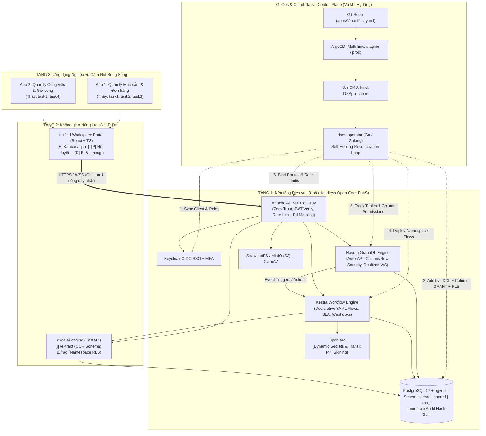
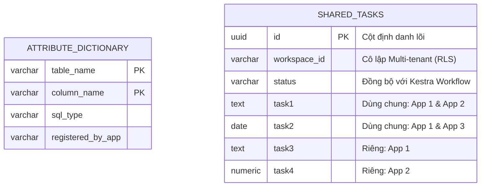

# DX-OS Open-Core: Cloud-Native Declarative PaaS — Architecture & Implementation Plan

> **For agentic workers:** REQUIRED SUB-SKILL: Use `superpowers:subagent-driven-development` (recommended) or `superpowers:executing-plans` to implement this plan task-by-task. Steps use checkbox (`- [ ]`) syntax for tracking.

**Goal:** Xây dựng nền tảng **DX-OS Open-Core** đạt chuẩn 50/50 điểm PoF và 50/50 điểm Sản phẩm tại OLP PMNM 2026, sử dụng kiến trúc **Cloud-Native Declarative PaaS (Phương án A)** với Kubernetes Operator viết bằng **Go (`dxos-operator`)**, ArgoCD GitOps đa môi trường, PostgreSQL Schema & Column-Level Security (`GRANT` + `RLS`) kết hợp Hasura Auto-API, Kestra Workflow Engine, AI Engine (`extract` + `rag` bằng Python FastAPI), và Cổng giao diện hợp nhất (Unified H-P-D-I Workspace Shell bằng React/TypeScript) chạy song song 2 ứng dụng nghiệp vụ dùng chung dữ liệu lõi.

**Architecture:** Hệ thống phân tách nghiêm ngặt thành 3 tầng, mỗi thành phần sử dụng đúng ngôn ngữ chuẩn công nghiệp của mảng đó:
1. **Tầng 1 — Headless Open-Core PaaS (`platform/` & `operator/`):** Điều phối tự động qua Kubernetes Custom Resource (`kind: DXApplication`) và **`dxos-operator` viết bằng Go (Golang)**. Khi một ứng dụng khai báo `manifest.yaml` qua GitOps (ArgoCD), Go Operator tự động đồng bộ Role/Client vào **Keycloak (OIDC/SSO)**, cấp phát khóa từ **OpenBao**, chạy Migration lũy đẳng (`ADD COLUMN IF NOT EXISTS`) + phân quyền tới cấp độ Cột (`GRANT SELECT/INSERT/UPDATE (col)`) & Dòng (`RLS`) trên **PostgreSQL 17**, nạp Metadata vào **Hasura GraphQL Engine** (sinh Auto-API & WebSocket Subscriptions), đăng ký luồng nghiệp vụ vào **Kestra**, và mở tuyến Zero-Trust trên **Apache APISIX**.
2. **Tầng 2 — Không gian Năng lực H-P-D-I (`workspace-ui/` & `ai-engine/`):** Cổng giao diện người dùng cuối hợp nhất (Unified App Shell bằng React + TypeScript + Tailwind) đăng nhập 1 lần qua OIDC PKCE, cung cấp 4 không gian: **[H]** Cổng làm việc & Kanban/Lịch hợp nhất, **[P]** Hộp duyệt quy trình & Poka-yoke, **[D]** Dashboard số liệu thời gian thực & Sổ cái kiểm toán bất biến (SHA-256 Hash-Chain) + Phả hệ dữ liệu (Data Lineage), **[I]** Động cơ AI đa thuê ước viết bằng **Python FastAPI** (`/api/ai/extract` OCR bóc tách JSON theo Schema và `/api/ai/rag` hỏi đáp/đối chiếu quy chế có trích dẫn nguồn theo Namespace).
3. **Tầng 3 — Ứng dụng Nghiệp vụ Chạy Song Song (`apps/`):** Hai ứng dụng hoàn chỉnh chạy đồng thời trên cùng 1 Core sống (**App 1: `app-procurement` — Quản lý Mua sắm & Đơn hàng** và **App 2: `app-timesheet` — Quản lý Công việc & Giờ công**) cùng thao tác trên thực thể dùng chung `shared.tasks` mà không xung đột bảng, không cần JOIN tuyến tính, và đảm bảo tính nhất quán tuyệt đối (Strong Consistency).

**Tech Stack:**
- **Infrastructure & GitOps Control Plane:** Kubernetes (`k3d` chạy trong Docker qua 1 lệnh GNU Make), ArgoCD, Kustomize (`staging` / `prod`), **Go 1.22+ (`jackc/pgx/v5`, `gopkg.in/yaml.v3`, K8s client/watch loop)** cho `dxos-operator`.
- **Core Services (Tier 1):** Apache APISIX (Gateway), Keycloak 26 (SSO/OIDC + MFA), OpenBao (Secrets & Transit PKI Signing), PostgreSQL 17 + `pgvector` (Structured Data & Vector DB), Hasura GraphQL Engine v2 (Auto-API, Column/Row Permissions, Subscriptions, Event Triggers), SeaweedFS/MinIO + ClamAV (S3 Unstructured Storage), Kestra (Declarative YAML Workflow Engine).
- **Intelligence & Portal (Tier 2 & 3):** **Python 3.12 + FastAPI** (`dxos-ai-engine` hỗ trợ Gemini API / Ollama local), **React 19 + TypeScript + Vite + Tailwind CSS** (`workspace-ui`).
- **License & PoF Compliance:** `Apache-2.0` cho toàn bộ mã nguồn dự án, SPDX header tự động, CycloneDX SBOM, SemVer `.tar.gz` release, script cài đặt độc lập ngoài thư mục mã nguồn (`/opt/dxos`).

---

## Global Constraints

- **PoF Zero-Penalty Rules:**
  - Mọi file mã nguồn tự viết (`.go`, `.py`, `.ts`, `.tsx`, `.sh`, `.sql`, `.yaml`) bắt buộc có dòng đầu tiên là `SPDX-License-Identifier: Apache-2.0`.
  - Mọi file sử dụng dấu xuống dòng chuẩn Unix (`LF`), cấm tuyệt đối `CRLF` (ép qua `.gitattributes`).
  - Không nhúng (bundle/vendor) mã nguồn thư viện bên thứ 3 vào repo; quản lý qua `go.mod`/`go.sum`, `pyproject.toml` và `package-lock.json` kèm `COPYRIGHT.txt` và `sbom/`.
  - Hệ thống phải build và chạy được từ mã nguồn bằng công cụ mở chuẩn (`GNU Make` + POSIX `sh`), cấu hình hoàn toàn qua biến môi trường (`.env`), và chạy được khi cài đặt ra ngoài thư mục mã nguồn (`make install DESTDIR=/opt/dxos`).
- **Architectural Boundary Rules:**
  - Tầng 1 (`platform/`, `operator/`) hoàn toàn **Headless** cho người dùng cuối và **100% Phi nghiệp vụ** (cấm xuất hiện bất kỳ từ khóa hay logic cứng nào của `procurement` hay `timesheet` trong `platform/` và `operator/`).

## Review Focus

1. **Xung đột kiểu dữ liệu khi 2 App khai báo cùng tên trường chung (`task1`):** Nếu `app-procurement` khai báo `shared.tasks.task1` là `text`, mà `app-timesheet` lại khai báo `shared.tasks.task1` là `integer`, `dxos-operator` phải phát hiện xung đột trong `core.attribute_dictionary` và từ chối Migration (`SchemaConflictError`) thay vì làm hỏng bảng đang chạy.
2. **Rò rỉ cột riêng qua đường truy vấn API:** Khi user có role `role_procurement` truy vấn bảng `shared.tasks`, hệ thống (cả ở tầng PostgreSQL `GRANT` lẫn Hasura `select_permissions`) phải chặn tuyệt đối việc đọc/ghi cột `task4` (vốn chỉ thuộc về `role_timesheet`).
3. **Tính lũy đẳng (Idempotency) của Operator & Migration:** Chạy lại `dxos-operator` hoặc apply lại cùng một `DXApplication` CRD nhiều lần liên tiếp không được gây lỗi `duplicate column`, `role already exists`, hay tạo trùng lặp route/workflow.
4. **Tính bất biến của Nhật ký kiểm toán (`core.audit_logs`):** Bất kỳ lệnh `UPDATE` hoặc `DELETE` nào tác động vào `core.audit_logs` đều phải bị chặn bởi Trigger PostgreSQL và chuỗi băm `row_hash = sha256(prev_hash || payload)` phải kiểm chứng được tính toàn vẹn.
5. **Chạy ngoài thư mục mã nguồn (Out-of-tree execution):** Khi thực thi `./deploy/install.sh /tmp/dxos-runtime` và xóa (hoặc tách rời) thư mục git repo gốc, hệ thống vẫn phải khởi chạy đầy đủ các dịch vụ từ `/tmp/dxos-runtime`.

---

## 1. Tổng quan Kiến trúc, 3 Keyword Chiến lược & Các Kỹ thuật Đặc biệt (Deep-Dive)

### 1.0. Ba Keyword Mấu Chốt (Core Value Propositions — Điểm nhấn Bảo vệ Chung kết)

Để giải quyết trực diện hai thái cực mà đề thi OLP 2026 đặt ra (*"mua phần mềm rời rạc gây ốc đảo dữ liệu"* vs *"mua phần mềm nguyên khối cồng kềnh, lệ thuộc nhà cung cấp"*), kiến trúc của dự án xoay quanh **3 giá trị cốt lõi về Hiệu năng, Tối ưu Chi phí Phát triển, và Tự động hóa Vận hành**:

1. **⚡ Hiệu năng & Dữ liệu: `Zero-Silo, Zero-Copy O(1) Data Mesh` (Liên thông Dữ liệu Đa Ứng dụng Không Nhân bản, Truy vấn $O(1)$)**
   - **Vấn đề của cách làm cũ:** Tách DB riêng cho từng App thì sinh ra "ốc đảo dữ liệu" và tốn chi phí đồng bộ (CDC/Kafka); còn tách $N$ bảng mở rộng thì tốn chi phí `JOIN` tăng tuyến tính $O(N)$ và phải chạy Migration dời bảng khi một trường riêng trở thành trường dùng chung.
   - **Đột phá của chúng ta:** Lưu trữ trên bảng thực thể vật lý hợp nhất (`shared.tasks`) kết hợp **Từ điển Thuộc tính (`core.attribute_dictionary`)** và **Phân quyền tới cấp độ Cột (`GRANT SELECT/UPDATE (col)`) + cấp độ Dòng (`RLS`)** gắn trực tiếp với OIDC Token. Kết quả: **0 nhân bản dữ liệu (100% Strong Consistency)**, **0 phép `JOIN` chéo ($O(1)$ Query Latency bất kể số lượng App)**, và **0 giây Downtime khi mở rộng trường dữ liệu**.

2. **💰 Tối ưu Chi phí & Tốc độ Phát triển: `Zero-Boilerplate Declarative PaaS` (Giảm 80% Chi phí & Thời gian Xây dựng Ứng dụng Mới)**
   - **Vấn đề của cách làm cũ:** Mỗi khi thêm một ứng dụng nghiệp vụ mới, lập trình viên phải viết lại hàng ngàn dòng code Backend CRUD (Controller, Service, Repository, DTO, Security Filter) và biên dịch lại hệ thống.
   - **Đột phá của chúng ta:** Tầng 1 cung cấp sẵn **Auto-API (Hasura GraphQL + WebSocket)** và **Declarative Workflow (Kestra)**. Để cắm thêm một ứng dụng mới vào hệ thống đang chạy, nhà phát triển **không cần viết code Backend CRUD**, chỉ cần khai báo **1 file `manifest.yaml` (`kind: DXApplication`)**. Thời gian đưa một nghiệp vụ mới vào vận hành rút ngắn từ vài tuần xuống còn vài phút.

3. **🛡️ Tối ưu Vận hành & Tài nguyên Hạ tầng: `Self-Healing Go Control Plane` (Điều phối Tự Hành Siêu Nhẹ < 20MB RAM)**
   - **Vấn đề của cách làm cũ:** Cấu hình rời rạc giữa Keycloak, Database, API Gateway và Workflow dễ dẫn đến sai lệch cấu hình (Configuration Drift) và đòi hỏi đội ngũ vận hành lớn.
   - **Đột phá của chúng ta:** Sử dụng **`dxos-operator` viết bằng Go** (đóng gói thành 1 static binary duy nhất tốn **< 20MB RAM**) kết hợp **ArgoCD GitOps Multi-Environment (`staging`/`prod`)**. Mọi sai lệch cấu hình hoặc sự cố xóa nhầm quyền/route đều được vòng lặp Reconciliation phát hiện và **tự động phục hồi (Self-Healing)** về trạng thái chuẩn trong Git kèm sổ cái kiểm toán bất biến SHA-256.

---

### 1.1. Sơ đồ Kiến trúc Tổng thể 3 Tầng + GitOps Control Plane



---

### 1.2. Năm Kỹ thuật Đặc biệt (Key Technical Differentiators)

#### Kỹ thuật 1: Lưu trữ Đa hình Không Xung đột & Không cần Migration Dời Bảng (`Additive Shared Schema + Attribute Dictionary`)
Giải quyết bài toán: **Làm sao để nhiều App cùng dùng bảng `tasks` (với phần chung `task1` và phần riêng `task2, task3, task4`), giữ tính nhất quán 100%, tốc độ truy vấn $O(1)$ không cần `JOIN`, và khi một trường từ "riêng" thành "chung" thì không cần chạy Migration dời bảng?**



1. **Từ điển Thuộc tính Toàn cục (`core.attribute_dictionary`):**
   - Trước khi thêm cột vào bảng dùng chung `shared.tasks`, `dxos-operator` kiểm tra bảng `core.attribute_dictionary`.
   - Nếu `task1` chưa có $\rightarrow$ Đăng ký `(table='shared.tasks', column='task1', type='text')` và chạy `ALTER TABLE shared.tasks ADD COLUMN IF NOT EXISTS task1 text;`.
   - Nếu `task1` đã có và App 2 cũng khai báo `task1: text` $\rightarrow$ Xác nhận tương thích kiểu dữ liệu, giữ nguyên cột vật lý (Zero-Migration!), chỉ cấp thêm quyền đọc/ghi cột `task1` cho `role_app2`.
   - Nếu App 2 khai báo `task1: integer` (khác kiểu `text` đã đăng ký) $\rightarrow$ Chặn ngay ở bước kiểm tra PreSync với lỗi `SchemaTypeConflictError`.

2. **Liên kết OIDC SSO $\rightarrow$ PostgreSQL Column `GRANT` & Row-Level Security (`RLS`):**
   - Trên PostgreSQL:
     ```sql
     -- Phân quyền chính xác tới TỪNG CỘT cho từng Role OIDC:
     GRANT SELECT (id, workspace_id, status, task1, task2, task3),
           INSERT (workspace_id, task1, task2, task3),
           UPDATE (task1, task2, task3)
     ON shared.tasks TO role_procurement;

     GRANT SELECT (id, workspace_id, status, task1, task4),
           INSERT (workspace_id, task1, task4),
           UPDATE (task1, task4)
     ON shared.tasks TO role_timesheet;

     -- Phân quyền tới TỪNG DÒNG theo Workspace trong JWT:
     ALTER TABLE shared.tasks ENABLE ROW LEVEL SECURITY;
     CREATE POLICY tenant_isolation ON shared.tasks
       USING (workspace_id = current_setting('hasura.user', true)::jsonb ->> 'x-hasura-workspace-id');
     ```
   - Đồng thời trên **Hasura Metadata**, `dxos-operator` tự động cấu hình `select_permissions`, `insert_permissions`, `update_permissions` cho `role_procurement` chỉ chứa `["id", "workspace_id", "status", "task1", "task2", "task3"]`, và cho `role_timesheet` chỉ chứa `["id", "workspace_id", "status", "task1", "task4"]`.

---

#### Kỹ thuật 2: Kubernetes Operator (`dxos-operator`) & Tự phục hồi Hạ tầng (GitOps Self-Healing)
- Mỗi ứng dụng ở Tầng 2/3 được đóng gói dưới dạng một **Kubernetes Custom Resource (`kind: DXApplication`)** trong thư mục `gitops/apps/<app-name>/`.
- **`dxos-operator`** lắng nghe sự kiện `on.create`, `on.update`, `on.resume` và chạy vòng lặp kiểm tra định kỳ (`@kopf.timer` mỗi 30 giây):
  - Nếu có ai sửa tay làm mất quyền cột trong Postgres, xóa route trên APISIX, hoặc tắt flow trong Kestra, vòng lặp Reconciliation sẽ phát hiện sai lệch (Drift) và **tự động khôi phục lại đúng trạng thái khai báo trong Git**!

---

#### Kỹ thuật 3: Điều phối Nghiệp vụ Đặc thù bằng Kestra Declarative YAML + Poka-yoke
- **Auto-API (Hasura)** xử lý toàn bộ đọc/ghi CRUD và truyền phát WebSocket thời gian thực.
- **Kestra Workflow Engine** xử lý toàn bộ nghiệp vụ đặc thù theo từng `namespace` (`app.procurement`, `app.timesheet`):
  1. **Poka-yoke (Kiểm soát lỗi đầu vào kỹ thuật):** Khi tạo bản ghi mới, Hasura bắn Event Trigger sang Kestra $\rightarrow$ Kestra kiểm tra quy tắc nghiệp vụ chéo (hạn mức ngân sách, giới hạn giờ công $\le 24\text{h}$/ngày) và gọi AI kiểm tra chứng từ đính kèm.
  2. **Luồng phê duyệt nhiều bước & Ký số bất biến:** Khi Quản lý bấm duyệt, Kestra gọi **OpenBao Transit Engine** để ký số (HMAC/Ed25519 Signature) lên bản chụp hồ sơ và ghi vào sổ cái kiểm toán bất biến `core.audit_logs`.

---

#### Kỹ thuật 4: Sổ cái Kiểm toán Bất biến (SHA-256 Hash-Chain) & Phả hệ Dữ liệu (Data Lineage) ngay trong PostgreSQL
- Bảng `core.audit_logs` lưu `prev_hash` và tự động tính `row_hash = encode(digest(prev_hash || actor || action || resource_id || payload::text, 'sha256'), 'hex')` bằng Trigger của PostgreSQL `pgcrypto`.
- Một Trigger thứ hai chặn tuyệt đối mọi lệnh `UPDATE` và `DELETE` trên `core.audit_logs` và `core.data_lineage`.
- Cung cấp API kiểm chứng chuỗi băm (`/api/core/audit/verify`) để chứng minh trên sân khấu rằng không một dòng lịch sử nào bị chỉnh sửa.

---

#### Kỹ thuật 5: Động cơ AI Đa Thuê Ước Phi Nghiệp Vụ (`dxos-ai-engine`)
- Không hardcode bất kỳ nghiệp vụ nào ở Tầng 1/2. Chỉ cung cấp 2 API trừu tượng:
  1. `POST /api/ai/extract`: Nhận `file_url` + `json_schema` (do từng App truyền vào) $\rightarrow$ Trích xuất văn bản/OCR và trả về JSON khớp 100% với `json_schema` kèm kiểm tra Poka-yoke.
  2. `POST /api/ai/rag`: Nhận `namespace` + `question` + `workspace_id` $\rightarrow$ Tìm kiếm ngữ nghĩa trên bảng `core.knowledge_chunks` (lọc cứng theo `namespace` và `workspace_id` bằng `pgvector`) và sinh câu trả lời có trích dẫn nguồn chính xác (`citations`), có chế độ chạy qua Gemini API hoặc Ollama local hoặc Fallback từ khóa khi không có GPU/API Key.

---

## 2. Cấu trúc Thư mục Dự án (`/home/tin/Project/current/olp2026`)

```text
olp2026/
├── Makefile                          # Cổng lệnh chuẩn GNU Make (make up, make up-k8s, make test, make pof-check, make install)
├── compose.yaml                      # Chế độ chạy nhanh toàn bộ stack + Operator
├── .env.example                      # Mẫu cấu hình môi trường (không chứa secret cứng)
├── .gitattributes                    # Ép chuẩn LF cho toàn bộ repo
├── LICENSE                           # Apache-2.0 toàn văn
├── COPYRIGHT.txt                     # Danh mục bản quyền & giấy phép thư viện bên thứ 3
├── CHANGELOG.md                      # Lịch sử phiên bản chuẩn Keep a Changelog
├── CODE_OF_CONDUCT.md                # Quy tắc ứng xử cộng đồng nguồn mở
├── CONTRIBUTING.md                   # Hướng dẫn đóng góp & thêm App mới bằng CRD
├── SECURITY.md                       # Chính sách công bố lỗ hổng bảo mật
├── README.md                         # Tài liệu chính (Kiến trúc, Cài đặt, Demo, API)
├── sbom/                             # CycloneDX SBOM cho các thành phần
├── platform/                         # [TẦNG 1] Cấu hình Hạ tầng Lõi (Headless, 100% Phi nghiệp vụ)
│   ├── postgres/
│   │   └── init/
│   │       ├── 01_core_schema.sql    # Bảng workspaces, attribute_dictionary, audit_logs (hash-chain), data_lineage, file_objects
│   │       └── 02_shared_schema.sql  # Khởi tạo schema shared, hàm đọc JWT claims & helper RLS
│   ├── keycloak/
│   │   └── realm-dxos.json           # Realm mẫu với OIDC PKCE client & MFA/OTP policy
│   ├── apisix/
│   │   ├── config.yaml               # Cấu hình APISIX standalone
│   │   └── apisix.yaml               # Route gốc Zero-Trust, JWT JWKS verify, Rate-limit, PII Masking
│   ├── openbao/
│   │   └── init-transit.sh           # Khởi tạo Transit Engine ký số hồ sơ
│   ├── hasura/
│   │   └── metadata/                 # Metadata nền tảng
│   └── kestra/
│       └── flows/                    # Flow nền tảng dùng chung
├── operator/                         # [TẦNG 1] Kubernetes Operator & Provisioner (Go / Golang 1.22+)
│   ├── go.mod
│   ├── go.sum
│   ├── Dockerfile                    # Multi-stage build ra static binary siêu nhẹ (<20MB)
│   ├── cmd/dxos-operator/
│   │   └── main.go                   # K8s Watch/Reconcile Loop & CLI (`dxos-operator apply/reconcile/verify-audit`)
│   └── internal/
│       ├── v1alpha1/
│       │   └── types.go              # Struct định nghĩa K8s CRD `kind: DXApplication`
│       ├── reconciler/
│       │   ├── database.go           # Kiểm tra attribute_dictionary, chạy ADD COLUMN IF NOT EXISTS, GRANT (col), RLS
│       │   ├── hasura.go             # Đồng bộ table tracking, column select/insert/update permissions & Event Triggers
│       │   ├── keycloak.go           # Đồng bộ OIDC Roles & Groups
│       │   ├── kestra.go             # Nạp YAML flows theo namespace vào Kestra API
│       │   └── apisix.go             # Cập nhật route & rate-limit cho từng App
│       └── audit/
│           └── verifier.go           # Kiểm chứng chuỗi băm SHA-256 của core.audit_logs
├── ai-engine/                        # [TẦNG 2 - I] Dịch vụ AI Đa thuê ước (Python FastAPI)
│   ├── pyproject.toml
│   ├── Dockerfile
│   ├── src/dxos_ai/
│   │   ├── main.py                   # FastAPI endpoints: /api/ai/extract, /api/ai/rag, /api/ai/ingest, /health
│   │   ├── extractor.py              # OCR + Structured JSON Extraction theo target_json_schema + Poka-yoke check
│   │   └── rag.py                    # Namespace-isolated pgvector retrieval + citation generator
│   └── tests/
├── apps/                             # [TẦNG 3] Các gói Ứng dụng Cắm-Rút (Declarative Manifests + Flows + Knowledge)
│   ├── procurement/                  # App 1: Quản lý Mua sắm & Đơn hàng (thấy: task1, task2, task3)
│   │   ├── manifest.yaml             # DXApplication CRD (khai báo roles, columns, routes, workflows)
│   │   ├── workflows/
│   │   │   └── procurement-approval.yaml
│   │   └── knowledge/
│   │       └── quy-che-mua-sam.md
│   └── timesheet/                    # App 2: Quản lý Công việc & Giờ công (thấy: task1, task4)
│       ├── manifest.yaml             # DXApplication CRD (dùng chung shared.tasks.task1, thêm cột riêng task4)
│       ├── workflows/
│       │   └── timesheet-review.yaml
│       └── knowledge/
│           └── quy-che-cham-cong.md
├── workspace-ui/                     # [TẦNG 2 & 3] Cổng Giao diện Hợp nhất H-P-D-I (React + TypeScript + Vite)
│   ├── package.json
│   ├── Dockerfile
│   └── src/
│       ├── shell/                    # Khung H-P-D-I chung: OIDC Auth, App Switcher, Notification, Audit & Lineage Viewer
│       ├── spaces/                   # 4 Không gian: [H] Kanban/Calendar, [P] Workflow Inbox, [D] Live BI Dashboard, [I] AI Assistant
│       └── apps/                     # Giao diện động theo quyền cột của App 1 (Procurement) & App 2 (Timesheet)
├── gitops/                           # Cấu hình Kubernetes & ArgoCD Multi-Environment
│   ├── crds/
│   │   └── dxapplication-crd.yaml    # Định nghĩa CustomResourceDefinition cho K8s
│   ├── base/                         # K8s manifests cho Tầng 1 & Tầng 2
│   ├── overlays/
│   │   ├── staging/                  # Môi trường Staging
│   │   └── prod/                     # Môi trường Production
│   └── argocd/
│       └── applicationset.yaml       # ArgoCD ApplicationSet tự động đồng bộ staging & prod
└── scripts/
    ├── check_pof.py                  # Kiểm tra tự động toàn bộ tiêu chí PoF (SPDX header, LF, License, Release format)
    ├── install.sh                    # Cài đặt hệ thống ra ngoài thư mục mã nguồn (/opt/dxos)
    ├── k8s-up.sh                     # Dựng cụm k3d + ArgoCD + Operator chỉ bằng 1 lệnh
    └── seed_demo.py                  # Nạp dữ liệu mẫu & chạy kịch bản kiểm thử E2E hai ứng dụng
```

---

## 3. Kế hoạch Triển khai Chi tiết (Step-by-Step Implementation Tasks)

### Task 1: Khung Dự án Chuẩn PoF 50/50 & Công cụ Kiểm tra Tự động

**Files:**
- Create: `LICENSE`
- Create: `.gitattributes`
- Create: `.gitignore`
- Create: `.env.example`
- Create: `Makefile`
- Create: `scripts/check_pof.py`
- Create: `scripts/install.sh`
- Create: `CHANGELOG.md`, `CODE_OF_CONDUCT.md`, `CONTRIBUTING.md`, `SECURITY.md`, `COPYRIGHT.txt`
- Test: `tests/test_pof_compliance.py`

**Interfaces:**
- Produces: `scripts/check_pof.py` (CLI trả về exit code `0` khi toàn bộ tệp nguồn có `SPDX-License-Identifier: Apache-2.0`, line endings `LF`, đủ các file pháp lý PoF) và `scripts/install.sh <target_dir>` (cài đặt độc lập ngoài thư mục mã nguồn).

- [ ] **Step 1: Viết bài kiểm thử tự động cho bộ tiêu chí PoF (`tests/test_pof_compliance.py`)**

```python
# SPDX-License-Identifier: Apache-2.0
import subprocess
from pathlib import Path

def test_pof_checker_passes_on_repository():
    result = subprocess.run(["python3", "scripts/check_pof.py"], capture_output=True, text=True)
    assert result.returncode == 0, f"PoF check failed:\n{result.stdout}\n{result.stderr}"

def test_out_of_tree_install_creates_runnable_bundle(tmp_path: Path):
    target = tmp_path / "dxos-installed"
    res = subprocess.run(["./scripts/install.sh", str(target)], capture_output=True, text=True)
    assert res.returncode == 0
    assert (target / "compose.yaml").exists()
    assert (target / ".env").exists()
```

- [ ] **Step 2: Chạy pytest để xác nhận bài test fail khi chưa có file**

Run: `pytest tests/test_pof_compliance.py -v`
Expected: FAIL (`scripts/check_pof.py` chưa tồn tại)

- [ ] **Step 3: Tạo `LICENSE` (Apache-2.0), `.gitattributes`, `Makefile`, `scripts/check_pof.py`, `scripts/install.sh` và bộ tài liệu cộng đồng**

Trong `scripts/check_pof.py`, kiểm tra:
1. Sự tồn tại của `LICENSE`, `README.md`, `CHANGELOG.md`, `CONTRIBUTING.md`, `CODE_OF_CONDUCT.md`, `SECURITY.md`, `COPYRIGHT.txt`.
2. Mọi tệp `.py`, `.ts`, `.tsx`, `.sh`, `.sql`, `.yaml` trong repo đều có `SPDX-License-Identifier: Apache-2.0` trong 5 dòng đầu và không chứa ký tự `\r\n` (`CRLF`).
3. Không có từ khóa nghiệp vụ (`procurement`, `timesheet`) lọt vào thư mục `platform/` hoặc `operator/src/`.

- [ ] **Step 4: Chạy lại pytest để xác nhận đạt chuẩn PoF**

Run: `pytest tests/test_pof_compliance.py -v`
Expected: PASS

- [ ] **Step 5: Commit**

```bash
git init && git add .
git commit -m "chore: bootstrap PoF-compliant repository structure and automated checker"
```

---

### Task 2: Tầng Lưu trữ Lõi PostgreSQL (`core` & `shared` Schemas, Chuỗi Băm Kiểm Toán Bất Biến & RLS)

**Files:**
- Create: `platform/postgres/init/01_core_schema.sql`
- Create: `platform/postgres/init/02_shared_schema.sql`
- Test: `operator/tests/test_sql_schema.py`

**Interfaces:**
- Produces:
  - Schema `core`:
    - `core.workspaces (id, code, name, created_at)`
    - `core.attribute_dictionary (table_name, column_name, sql_type, registered_by_app, created_at, PRIMARY KEY (table_name, column_name))`
    - `core.file_objects (id, workspace_id, bucket, object_key, sha256_checksum, mime_type, size_bytes, scan_status, created_by, created_at)`
    - `core.audit_logs (id, workspace_id, actor_id, app_id, action, resource_type, resource_id, payload, prev_hash, row_hash, occurred_at)` kèm Trigger tự tính SHA-256 `row_hash` và Trigger chặn `UPDATE/DELETE`.
    - `core.data_lineage (id, workspace_id, source_type, source_id, target_type, target_id, transformation, actor_id, occurred_at)` kèm Trigger chặn `UPDATE/DELETE`.
    - `core.knowledge_chunks (id, namespace, workspace_id, doc_title, source_uri, content, embedding vector(384), created_at)`.
  - Schema `shared`:
    - Hàm `shared.current_workspace_id() RETURNS text`, `shared.current_user_id() RETURNS text`, `shared.current_app_role() RETURNS text` đọc từ biến phiên `hasura.user` hoặc `jwt.claims.*`.
    - Bảng gốc `shared.tasks (id uuid PRIMARY KEY, workspace_id varchar(64) NOT NULL, created_by varchar(128) NOT NULL, status varchar(32) NOT NULL DEFAULT 'DRAFT', created_at timestamptz, updated_at timestamptz)` bật sẵn `ENABLE ROW LEVEL SECURITY` và `FORCE ROW LEVEL SECURITY` theo `workspace_id`.

- [ ] **Step 1: Viết bài kiểm thử tính toàn vẹn của SQL Schema, Chuỗi băm Audit và RLS (`operator/tests/test_sql_schema.py`)**

```python
# SPDX-License-Identifier: Apache-2.0
def test_audit_log_hash_chain_and_immutability(pg_conn):
    with pg_conn.cursor() as cur:
        cur.execute("""
            INSERT INTO core.audit_logs (workspace_id, actor_id, app_id, action, resource_type, resource_id, payload)
            VALUES ('ws-1', 'user-1', 'app-1', 'CREATE_TASK', 'shared.tasks', 't-1', '{"task1": "A"}'::jsonb)
            RETURNING prev_hash, row_hash;
        """)
        first_prev, first_hash = cur.fetchone()
        assert first_prev == "GENESIS"
        assert len(first_hash) == 64

        cur.execute("""
            INSERT INTO core.audit_logs (workspace_id, actor_id, app_id, action, resource_type, resource_id, payload)
            VALUES ('ws-1', 'user-1', 'app-1', 'APPROVE_TASK', 'shared.tasks', 't-1', '{"status": "APPROVED"}'::jsonb)
            RETURNING prev_hash, row_hash;
        """)
        second_prev, second_hash = cur.fetchone()
        assert second_prev == first_hash
        assert second_hash != first_hash
```

- [ ] **Step 2: Chạy test để xác nhận fail trước khi có file SQL**

Run: `pytest operator/tests/test_sql_schema.py -v`
Expected: FAIL

- [ ] **Step 3: Hiện thực `01_core_schema.sql` và `02_shared_schema.sql`**

Sử dụng extension `pgcrypto` để băm `sha256` trong trigger `core.compute_audit_hash()` trước mỗi lệnh `INSERT` trên `core.audit_logs`, và trigger `core.prevent_mutation()` bắn ngoại lệ `Immutable table: UPDATE and DELETE are prohibited` khi có lệnh sửa/xóa trên `core.audit_logs` hoặc `core.data_lineage`.

- [ ] **Step 4: Chạy lại test để xác nhận PASS**

Run: `pytest operator/tests/test_sql_schema.py -v`
Expected: PASS

- [ ] **Step 5: Commit**

```bash
git add platform/postgres/ operator/tests/test_sql_schema.py
git commit -m "feat(core-db): add core/shared schemas, RLS helpers, and immutable SHA-256 audit hash-chain"
```

---

### Task 3: Kubernetes Operator & Bộ Điều phối Đa Hình Viết Bằng Go (`dxos-operator`)

**Files:**
- Create: `gitops/crds/dxapplication-crd.yaml`
- Create: `operator/go.mod`
- Create: `operator/Dockerfile`
- Create: `operator/internal/v1alpha1/types.go`
- Create: `operator/internal/reconciler/database.go`
- Create: `operator/internal/reconciler/hasura.go`
- Create: `operator/internal/reconciler/keycloak.go`
- Create: `operator/internal/reconciler/kestra.go`
- Create: `operator/internal/reconciler/apisix.go`
- Create: `operator/internal/audit/verifier.go`
- Create: `operator/cmd/dxos-operator/main.go`
- Test: `operator/internal/reconciler/reconciler_test.go`

**Interfaces:**
- Consumes: `core.attribute_dictionary` và `shared.tasks` từ Task 2.
- Produces:
  - `v1alpha1.DXApplication` (Go struct parse K8s CRD / `manifest.yaml`).
  - `DatabaseReconciler.ReconcileApp(ctx, app *v1alpha1.DXApplication) error`:
    - Tự động tạo PostgreSQL role `app.Spec.OIDCRole` nếu chưa có.
    - Kiểm tra từng cột trong `app.Spec.Database.SharedTables["tasks"].Columns` với `core.attribute_dictionary`. Nếu trùng tên cột nhưng khác kiểu dữ liệu $\rightarrow$ trả về `ErrSchemaTypeConflict`.
    - Sinh và thực thi `ALTER TABLE shared.tasks ADD COLUMN IF NOT EXISTS <col> <sql_type>`.
    - Thực thi `REVOKE ALL ON shared.tasks FROM <role>` rồi `GRANT SELECT (<allowed_cols>), INSERT (<writable_cols>), UPDATE (<writable_cols>) ON shared.tasks TO <role>`.
  - `HasuraReconciler.BuildTableMetadata(apps []*v1alpha1.DXApplication) (map[string]any, error)`: Sinh cấu hình `select_permissions`, `insert_permissions`, `update_permissions` theo đúng danh sách cột của từng `OIDCRole` và `workspace_id` RLS filter.
  - Binary `dxos-operator` hỗ trợ cả chế độ chạy K8s Reconciliation Loop (`dxos-operator watch --interval=30s`) lẫn CLI (`dxos-operator apply -f apps/procurement/manifest.yaml`).

- [ ] **Step 1: Viết bài kiểm thử bằng Go (`operator/internal/reconciler/reconciler_test.go`) kiểm tra 2 App dùng chung `task1`, tách biệt `task2, task3` vs `task4` và phát hiện xung đột kiểu dữ liệu**

```go
// SPDX-License-Identifier: Apache-2.0
package reconciler_test

import (
	"testing"
	"github.com/olp2026/dxos-operator/internal/reconciler"
	"github.com/olp2026/dxos-operator/internal/v1alpha1"
)

func TestTwoAppsShareTask1AndDetectConflict(t *testing.T) {
	reg := reconciler.NewAttributeRegistry()
	app1, err := v1alpha1.LoadManifest("../../../apps/procurement/manifest.yaml")
	if err != nil {
		t.Fatalf("load app1: %v", err)
	}
	app2, err := v1alpha1.LoadManifest("../../../apps/timesheet/manifest.yaml")
	if err != nil {
		t.Fatalf("load app2: %v", err)
	}

	sql1, err := reg.PlanSharedTableSQL(app1)
	if err != nil {
		t.Fatalf("plan app1 failed: %v", err)
	}
	sql2, err := reg.PlanSharedTableSQL(app2)
	if err != nil {
		t.Fatalf("plan app2 failed: %v", err)
	}
	if len(sql1) == 0 || len(sql2) == 0 {
		t.Fatalf("expected non-empty SQL DDL statements")
	}

	// Conflicting type for task1 (integer vs text) must return ErrSchemaTypeConflict
	badApp := &v1alpha1.DXApplication{}
	badApp.Metadata.Name = "bad-app"
	badApp.Spec.OIDCRole = "role_bad"
	badApp.Spec.Database.SharedTables = map[string]v1alpha1.SharedTableSpec{
		"tasks": {Columns: map[string]string{"task1": "integer"}},
	}
	if _, err := reg.PlanSharedTableSQL(badApp); err == nil {
		t.Fatalf("expected ErrSchemaTypeConflict when task1 is redefined as integer")
	}
}
```

- [ ] **Step 2: Chạy `go test` để xác nhận fail**

Run: `cd operator && go test ./... -v`
Expected: FAIL (chưa có module và struct)

- [ ] **Step 3: Hiện thực `dxos-operator` bằng Go (`go.mod`, `internal/v1alpha1`, `internal/reconciler`, `internal/audit`, `cmd/dxos-operator`)**

Đảm bảo `DatabaseReconciler` chỉ cho phép danh sách kiểu SQL an toàn (`text`, `numeric`, `integer`, `boolean`, `date`, `timestamptz`, `jsonb`) và kiểm tra regex tên định danh `^[a-z][a-z0-9_]{1,62}$` để chống SQL Injection tuyệt đối khi sinh DDL.

- [ ] **Step 4: Chạy lại `go test ./... -v` và `go build` để xác nhận PASS**

Run: `cd operator && go test ./... -v && go build -o bin/dxos-operator ./cmd/dxos-operator`
Expected: PASS

- [ ] **Step 5: Commit**

```bash
git add gitops/crds/ operator/
git commit -m "feat(operator): implement Go K8s DXApplication operator and polymorphic schema/column reconcilers"
```

---

### Task 4: Hai Ứng dụng Cắm-Rút (`apps/procurement` & `apps/timesheet`) và Luồng Kestra Workflow

**Files:**
- Create: `apps/procurement/manifest.yaml`
- Create: `apps/procurement/workflows/procurement-approval.yaml`
- Create: `apps/procurement/knowledge/quy-che-mua-sam.md`
- Create: `apps/timesheet/manifest.yaml`
- Create: `apps/timesheet/workflows/timesheet-review.yaml`
- Create: `apps/timesheet/knowledge/quy-che-cham-cong.md`
- Test: `operator/tests/test_app_manifests.py`

**Interfaces:**
- Consumes: `DXApplicationSpec` từ Task 3.
- Produces:
  - **`apps/procurement/manifest.yaml` (`app_id: procurement`, `oidc_role: role_procurement`):**
    - Khai báo trên bảng `shared.tasks`:
      - `task1: text` (Tên công việc / Đề xuất — **Trường chung**)
      - `task2: date` (Hạn hoàn thành / Ngày giao hàng — **Trường mở rộng 1**)
      - `task3: numeric` (Tổng chi phí mua sắm VNĐ — **Trường riêng của Mua sắm**)
    - Khai báo Kestra workflow `procurement-approval` (namespace `app.procurement`): Kiểm tra Poka-yoke (`task3 > 0`), gọi AI bóc tách/kiểm tra báo giá so với định mức trong `quy-che-mua-sam.md`, chuyển trạng thái `PENDING_APPROVAL` $\rightarrow$ `APPROVED` kèm ký số OpenBao Transit và ghi `core.audit_logs` + `core.data_lineage`.
  - **`apps/timesheet/manifest.yaml` (`app_id: timesheet`, `oidc_role: role_timesheet`):**
    - Khai báo trên bảng `shared.tasks`:
      - `task1: text` (Tên công việc — **Dùng chung 100% với App Mua sắm**)
      - `task4: numeric` (Số giờ công thực hiện — **Trường riêng của Giờ công**)
    - Khai báo Kestra workflow `timesheet-review` (namespace `app.timesheet`): Kiểm tra Poka-yoke (`0 < task4 <= 24`), đối chiếu quy định làm thêm giờ trong `quy-che-cham-cong.md`, cập nhật trạng thái và ghi `core.audit_logs`.

- [ ] **Step 1: Viết bài kiểm thử xác thực cú pháp của cả 2 App Manifest và Kestra Flow YAML (`operator/tests/test_app_manifests.py`)**

```python
# SPDX-License-Identifier: Apache-2.0
import yaml
from pathlib import Path
from dxos_operator.models import DXApplicationSpec

def test_both_app_manifests_are_valid_and_share_task1():
    p_spec = DXApplicationSpec.from_yaml("apps/procurement/manifest.yaml")
    t_spec = DXApplicationSpec.from_yaml("apps/timesheet/manifest.yaml")

    assert p_spec.shared_tables["tasks"].columns["task1"] == "text"
    assert t_spec.shared_tables["tasks"].columns["task1"] == "text"
    assert "task3" in p_spec.shared_tables["tasks"].columns
    assert "task4" in t_spec.shared_tables["tasks"].columns

    for flow_path in [Path("apps/procurement/workflows/procurement-approval.yaml"),
                      Path("apps/timesheet/workflows/timesheet-review.yaml")]:
        flow_data = yaml.safe_load(flow_path.read_text())
        assert "id" in flow_data and "namespace" in flow_data and "tasks" in flow_data
```

- [ ] **Step 2: Chạy test để xác nhận fail**

Run: `pytest operator/tests/test_app_manifests.py -v`
Expected: FAIL

- [ ] **Step 3: Tạo đầy đủ `manifest.yaml`, Kestra `workflows/*.yaml` và tài liệu `knowledge/*.md` cho cả 2 ứng dụng**

- [ ] **Step 4: Chạy lại test để xác nhận PASS**

Run: `pytest operator/tests/test_app_manifests.py -v`
Expected: PASS

- [ ] **Step 5: Commit**

```bash
git add apps/ operator/tests/test_app_manifests.py
git commit -m "feat(apps): add declarative manifests, Kestra workflows, and RAG corpus for procurement and timesheet apps"
```

---

### Task 5: Động cơ AI Đa Thuê Ước (`dxos-ai-engine`: Structured Extraction & Namespace-Isolated RAG)

**Files:**
- Create: `ai-engine/pyproject.toml`
- Create: `ai-engine/Dockerfile`
- Create: `ai-engine/src/dxos_ai/main.py`
- Create: `ai-engine/src/dxos_ai/extractor.py`
- Create: `ai-engine/src/dxos_ai/rag.py`
- Test: `ai-engine/tests/test_ai_engine.py`

**Interfaces:**
- Produces:
  - `POST /api/ai/extract`: Nhận `{ "content_text": str, "target_schema": dict, "poka_yoke_rules": list[dict] }` $\rightarrow$ Trả về `{ "extracted_data": dict, "valid": bool, "violations": list[str] }`.
  - `POST /api/ai/rag`: Nhận `{ "namespace": str, "workspace_id": str, "question": str }` $\rightarrow$ Chỉ tìm kiếm tài liệu thuộc đúng `namespace` (`procurement` hoặc `timesheet`) và `workspace_id`, trả về `{ "answer": str, "citations": list[{"title": str, "source": str, "snippet": str}] }`.
  - Hỗ trợ chế độ `AI_PROVIDER=gemini|ollama|deterministic` (trong đó chế độ `deterministic` hoạt động không cần GPU hay API key bên ngoài để CI/CD trên máy giám khảo luôn chạy xanh 100%).

- [ ] **Step 1: Viết bài kiểm thử cho `/api/ai/extract` (bóc tách theo Schema + bắt lỗi Poka-yoke) và `/api/ai/rag` (cô lập tài liệu theo Namespace) (`ai-engine/tests/test_ai_engine.py`)**

```python
# SPDX-License-Identifier: Apache-2.0
from fastapi.testclient import TestClient
from dxos_ai.main import app

client = TestClient(app)

def test_extract_validates_target_schema_and_poka_yoke():
    resp = client.post("/api/ai/extract", json={
        "content_text": "Đề xuất mua 2 máy chủ R750, hạn ngày 2026-12-15, tổng chi phí: -5000000 VNĐ",
        "target_schema": {"task1": "string", "task2": "date", "task3": "number"},
        "poka_yoke_rules": [{"field": "task3", "min": 1, "message": "Chi phí mua sắm (task3) phải lớn hơn 0"}]
    })
    assert resp.status_code == 200
    body = resp.json()
    assert body["valid"] is False
    assert any("task3" in v for v in body["violations"])

def test_rag_strictly_isolates_namespaces():
    # Hỏi trong namespace procurement chỉ được trích dẫn quy-che-mua-sam.md, không lộ quy-che-cham-cong.md
    resp = client.post("/api/ai/rag", json={
        "namespace": "procurement",
        "workspace_id": "ws-default",
        "question": "Định mức phê duyệt mua sắm thiết bị là bao nhiêu?"
    })
    assert resp.status_code == 200
    data = resp.json()
    assert len(data["citations"]) >= 1
    assert all(c["namespace"] == "procurement" for c in data["citations"])
```

- [ ] **Step 2: Chạy test để xác nhận fail**

Run: `pytest ai-engine/tests/test_ai_engine.py -v`
Expected: FAIL

- [ ] **Step 3: Hiện thực `dxos-ai-engine` (`main.py`, `extractor.py`, `rag.py`)**

- [ ] **Step 4: Chạy lại test để xác nhận PASS**

Run: `pytest ai-engine/tests/test_ai_engine.py -v`
Expected: PASS

- [ ] **Step 5: Commit**

```bash
git add ai-engine/
git commit -m "feat(ai-engine): add schema-driven extractor with Poka-yoke validation and namespace-isolated RAG"
```

---

### Task 6: Hạ tầng Tầng 1 (`Apache APISIX`, `Keycloak`, `OpenBao`, `Hasura`, `Kestra`) & Cấu hình K8s/ArgoCD Multi-Env

**Files:**
- Create: `platform/apisix/config.yaml`
- Create: `platform/apisix/apisix.yaml`
- Create: `platform/keycloak/realm-dxos.json`
- Create: `platform/openbao/init-transit.sh`
- Create: `compose.yaml`
- Create: `gitops/base/kustomization.yaml`
- Create: `gitops/overlays/staging/kustomization.yaml`
- Create: `gitops/overlays/prod/kustomization.yaml`
- Create: `gitops/argocd/applicationset.yaml`
- Create: `scripts/k8s-up.sh`
- Test: `operator/tests/test_gitops_manifests.py`

**Interfaces:**
- Produces:
  - `compose.yaml`: Dựng toàn bộ Tầng 1 + Tầng 2 + Operator chạy ngay trên máy dev/giám khảo.
  - `gitops/`: Bộ Kustomize (`base`, `overlays/staging`, `overlays/prod`) và ArgoCD `ApplicationSet` quản lý tự động cả 2 môi trường trên Kubernetes (`k3d`).

- [ ] **Step 1: Viết bài kiểm thử tính hợp lệ của `compose.yaml`, `apisix.yaml`, `realm-dxos.json` và Kustomize overlays (`operator/tests/test_gitops_manifests.py`)**

```python
# SPDX-License-Identifier: Apache-2.0
import json
import yaml
from pathlib import Path

def test_infrastructure_and_gitops_configs_are_valid():
    compose = yaml.safe_load(Path("compose.yaml").read_text())
    for svc in ["postgres", "keycloak", "apisix", "hasura", "kestra", "openbao", "ai-engine", "operator", "workspace-ui"]:
        assert svc in compose["services"], f"Missing service {svc} in compose.yaml"

    realm = json.loads(Path("platform/keycloak/realm-dxos.json").read_text())
    assert realm["realm"] == "dxos"

    app_set = yaml.safe_load(Path("gitops/argocd/applicationset.yaml").read_text())
    assert app_set["kind"] == "ApplicationSet"
```

- [ ] **Step 2: Chạy test để xác nhận fail**

Run: `pytest operator/tests/test_gitops_manifests.py -v`
Expected: FAIL

- [ ] **Step 3: Viết cấu hình `platform/apisix/`, `platform/keycloak/`, `platform/openbao/`, `compose.yaml`, `gitops/` và `scripts/k8s-up.sh`**

- [ ] **Step 4: Chạy lại test để xác nhận PASS**

Run: `pytest operator/tests/test_gitops_manifests.py -v`
Expected: PASS

- [ ] **Step 5: Commit**

```bash
git add platform/ compose.yaml gitops/ scripts/k8s-up.sh operator/tests/test_gitops_manifests.py
git commit -m "feat(infra): configure APISIX, Keycloak, OpenBao, Hasura, Kestra, and ArgoCD multi-env overlays"
```

---

### Task 7: Cổng Giao diện Hợp nhất Tầng 2 & 3 (`workspace-ui`: H-P-D-I Shell + Dual-App Live Projection)

**Files:**
- Create: `workspace-ui/package.json`
- Create: `workspace-ui/tsconfig.json`
- Create: `workspace-ui/vite.config.ts`
- Create: `workspace-ui/Dockerfile`
- Create: `workspace-ui/src/App.tsx`
- Create: `workspace-ui/src/shell/WorkspaceShell.tsx`
- Create: `workspace-ui/src/spaces/HumanSpace.tsx`
- Create: `workspace-ui/src/spaces/ProcessSpace.tsx`
- Create: `workspace-ui/src/spaces/DataSpace.tsx`
- Create: `workspace-ui/src/spaces/IntelligenceSpace.tsx`
- Create: `workspace-ui/src/apps/PolymorphicTaskBoard.tsx`
- Test: `workspace-ui/src/__tests__/PolymorphicTaskBoard.test.tsx`

**Interfaces:**
- Consumes: API từ cổng Gateway (`/api/data/tasks` qua Hasura/Core, `/api/workflows/...` qua Kestra, `/api/ai/extract` & `/api/ai/rag`, `/api/core/audit/verify`).
- Produces:
  - Giao diện thống nhất đăng nhập qua Keycloak SSO, cho phép chuyển đổi tức thì giữa 4 không gian **[H] Con người**, **[P] Quy trình**, **[D] Dữ liệu & Kiểm toán Bất biến**, **[I] Trợ lý AI & OCR** và 2 ứng dụng chạy song song (**App 1: Mua sắm `role_procurement`** hiển thị cột `task1, task2, task3` $\leftrightarrow$ **App 2: Giờ công `role_timesheet`** hiển thị cột `task1, task4`).

- [ ] **Step 1: Viết bài kiểm thử cho component `PolymorphicTaskBoard` xác minh rằng cùng 1 danh sách `tasks`, khi ở chế độ `procurement` chỉ hiển thị `task1, task2, task3`, còn khi ở chế độ `timesheet` chỉ hiển thị `task1, task4` (`workspace-ui/src/__tests__/PolymorphicTaskBoard.test.tsx`)**

```tsx
// SPDX-License-Identifier: Apache-2.0
import { describe, it, expect } from "vitest";
import { getVisibleColumnsForApp } from "../apps/PolymorphicTaskBoard";

describe("PolymorphicTaskBoard column projection", () => {
  it("projects only task1, task2, task3 for procurement app", () => {
    const cols = getVisibleColumnsForApp("procurement");
    expect(cols.map((c) => c.key)).toEqual(["task1", "task2", "task3"]);
  });

  it("projects only task1, task4 for timesheet app", () => {
    const cols = getVisibleColumnsForApp("timesheet");
    expect(cols.map((c) => c.key)).toEqual(["task1", "task4"]);
  });
});
```

- [ ] **Step 2: Chạy test để xác nhận fail**

Run: `cd workspace-ui && npm test`
Expected: FAIL

- [ ] **Step 3: Hiện thực `workspace-ui` với đầy đủ 4 không gian H-P-D-I, màn hình so sánh/chuyển đổi trực tiếp giữa 2 App dùng chung `task1`, màn hình kiểm chứng chuỗi băm SHA-256 Audit & GitOps Operator Status**

- [ ] **Step 4: Chạy `npm test` và `npm run build` để xác nhận PASS**

Run: `cd workspace-ui && npm test && npm run build`
Expected: PASS

- [ ] **Step 5: Commit**

```bash
git add workspace-ui/
git commit -m "feat(ui): build unified H-P-D-I workspace portal with live multi-app column projection"
```

---

### Task 8: Kịch bản Seed Dữ liệu Mẫu, Kiểm thử E2E Toàn Hệ thống & Đóng gói Bản Phát hành `v1.0.0`

**Files:**
- Create: `scripts/seed_demo.py`
- Create: `scripts/package_release.sh`
- Create: `.github/workflows/ci-pof.yml`
- Modify: `README.md`
- Test: `tests/test_e2e_flow.py`

**Interfaces:**
- Produces:
  - `scripts/seed_demo.py`: Nạp sẵn dữ liệu mẫu cho 2 Workspace và 2 App (`procurement` và `timesheet`) để Giám khảo mở trình duyệt lên là thấy ngay dữ liệu trực quan.
  - `scripts/package_release.sh v1.0.0`: Đóng gói bản phát hành chuẩn PoF (`dxos-open-core-1.0.0.tar.gz` giải nén ra đúng thư mục `dxos-open-core-1.0.0/` kèm `SHA256SUMS` và `sbom/`).

- [ ] **Step 1: Viết bài kiểm thử đóng gói Release `.tar.gz` và kiểm tra toàn diện PoF (`tests/test_e2e_flow.py`)**

```python
# SPDX-License-Identifier: Apache-2.0
import subprocess
import tarfile
from pathlib import Path

def test_release_tarball_unpacks_into_versioned_directory(tmp_path: Path):
    out_dir = tmp_path / "dist"
    res = subprocess.run(["./scripts/package_release.sh", "1.0.0", str(out_dir)], capture_output=True, text=True)
    assert res.returncode == 0
    tar_path = out_dir / "dxos-open-core-1.0.0.tar.gz"
    assert tar_path.exists()
    with tarfile.open(tar_path, "r:gz") as tar:
        names = tar.getnames()
        assert all(n.startswith("dxos-open-core-1.0.0") for n in names)
```

- [ ] **Step 2: Chạy test để xác nhận fail**

Run: `pytest tests/test_e2e_flow.py -v`
Expected: FAIL

- [ ] **Step 3: Hiện thực `scripts/seed_demo.py`, `scripts/package_release.sh`, `.github/workflows/ci-pof.yml` và hoàn thiện `README.md`**

- [ ] **Step 4: Chạy toàn bộ bộ test (`pytest`, `npm test`, `check_pof.py`)**

Run: `pytest -v && python3 scripts/check_pof.py`
Expected: 100% PASS, 0 PoF penalty points.

- [ ] **Step 5: Commit**

```bash
git add scripts/ .github/ README.md tests/test_e2e_flow.py
git commit -m "feat(release): add demo seeder, CI workflow, and PoF-compliant tarball packager"
```
